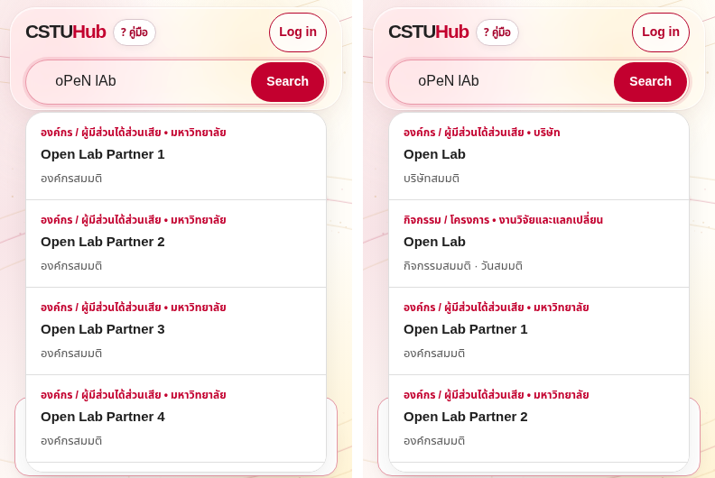
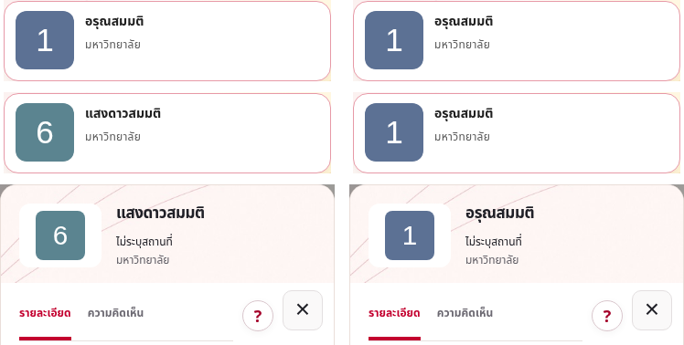
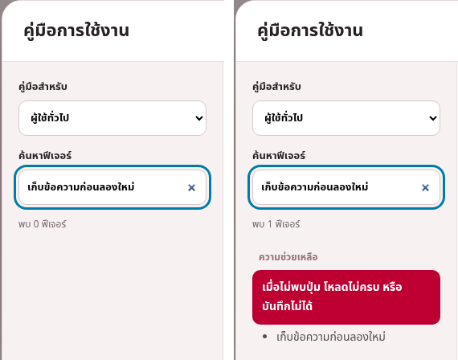
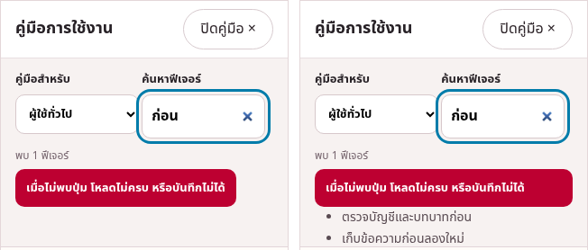

# บันทึกตรวจหน้าเว็บ CSTUHub

ตรวจเมื่อ 24 พฤศจิกายน 2569 จาก [หน้าแรกบน main ที่ใช้เทียบ](https://github.com/Micosz/Cs361-Group1-Project7/blob/abb7cb3205942f9ee110af226e69ee4f667113fd/public/index.html) ภาพประกอบถ่ายจาก Chromium บน Cloud โดยใช้ชื่อ องค์กร และรายการตัวอย่างทั้งหมด กิจกรรมที่ใช้ทดสอบระบุว่า **วันสมมติ**

## สิ่งที่ควรเพิ่ม ตัด และปรับ

| สิ่งที่พบ | ข้อเสนอ | จุดที่ต้องระวัง | สถานะ |
| --- | --- | --- | --- |
| หน้า Welcome มีปุ่มเริ่มต้น แต่ชื่อหมวดปรากฏเมื่อถึง Information Board | นำแถบหมวดเดิมขึ้นมาใต้ข้อความต้อนรับ แล้วให้ตามไปอยู่เหนือรายการ ใช้สีดำบน Welcome และสีขาวพร้อมหมวดสีแดงบนบอร์ด | การเลื่อนขึ้นลงต้องคงหมวดและโฟกัส มือถือ 320 พิกเซลต้องกดทุกปุ่มที่แสดงได้ | รอรีวิว [PR #268](https://github.com/Micosz/Cs361-Group1-Project7/pull/268) |
| ค้นชื่อขั้นที่มองเห็นในคู่มือแล้วไม่พบบท | เพิ่มชื่อขั้นในการค้นตามบทบาทและอธิบายใต้ปุ่มว่าตรงขั้นใด | คงหนึ่งปุ่มต่อบท โฟกัสขณะพิมพ์ และทางกลับบอร์ด | รอรีวิว [PR #279](https://github.com/Micosz/Cs361-Group1-Project7/pull/279) · [Issue #278](https://github.com/Micosz/Cs361-Group1-Project7/issues/278) |
| ชื่อและปลายทางของการ์ด Welcome เปลี่ยนระหว่างที่คนอ่าน | เลือกสามองค์กรตอนข้อมูลพร้อมแล้วคงไว้จนเปิดหน้าใหม่ | ตรวจการแตะหลังรอ เมาส์ คีย์บอร์ด การลองโหลดใหม่ และปุ่มพักภาพพื้นหลัง | รอรีวิว [PR #277](https://github.com/Micosz/Cs361-Group1-Project7/pull/277) · [Issue #276](https://github.com/Micosz/Cs361-Group1-Project7/issues/276) |
| พิมพ์ชื่อองค์กรหรือกิจกรรมตรงทั้งหมด แต่ชื่อคล้ายกันใช้พื้นที่หกคำแนะนำแรกจนเต็ม | จัดชื่อที่ตรงทั้งชื่อไว้ก่อนตัดรายการ | คงลำดับของคำค้นกว้าง ป้ายประเภท และตัวกรอง | รอรีวิว [PR #275](https://github.com/Micosz/Cs361-Group1-Project7/pull/275) · [Issue #274](https://github.com/Micosz/Cs361-Group1-Project7/issues/274) |
| เมื่อค้นแล้วไม่มีรายการ หน้าเดิมมีข้อความบอกผลอยู่แล้ว แต่ต้องย้อนกลับไปลบคำค้น | เพิ่มปุ่มล้างคำค้นในพื้นที่ผลลัพธ์ว่าง | คนที่เลือกประเภท วันที่ หรือช่วงกิจกรรมไว้ต้องได้รายการที่ตรงเงื่อนไขเดิมหลังล้าง | รอรีวิว [PR #269](https://github.com/Micosz/Cs361-Group1-Project7/pull/269) · [Issue #267](https://github.com/Micosz/Cs361-Group1-Project7/issues/267) |
| ปิดรายละเอียดหลังตามชื่อผู้จัดหรือยกเลิกร่างความคิดเห็นแล้วโฟกัสตกที่หน้าเว็บ | คืนโฟกัสให้ปุ่มหรือลิงก์ที่เปิดจากบอร์ด | ลิงก์ผู้จัดบนการ์ดและชื่อกิจกรรมเป็นคนละตัวเปิด | ผ่านบน Chromium สองขนาดและรอเพื่อนรีวิวใน [#271](https://github.com/Micosz/Cs361-Group1-Project7/pull/271) · [#270](https://github.com/Micosz/Cs361-Group1-Project7/issues/270) |
| ตัวกรอง MoU/MoA และข่าวลงนามแสดงยอด (0) เหนือข้อตกลงที่เปิดได้ | ใช้ชื่อช่วงเวลาบนแท็บและปุ่มข้ามช่วง | ยอดเดิมรู้เฉพาะจำนวนข่าว ข้อตกลงทยอยโหลดเป็นหน้า | รอรีวิว [PR #273](https://github.com/Micosz/Cs361-Group1-Project7/pull/273) · [Issue #272](https://github.com/Micosz/Cs361-Group1-Project7/issues/272) |
| บอร์ดข้อเสนอเดิมมีหน้ารายละเอียด ขั้นตอน และประวัติให้ลองใช้ | ต้นแบบจำลองการส่งเรื่อง การอนุมัติ และการส่งกลับพร้อมเหตุผล พร้อมแสดงสถานะและประวัติ | ระยะเวลาที่รอผู้รับเรื่องและสิทธิ์ของผู้รับยังรอยืนยันใน #235 ส่วนการติดตาม MoU หลังลงนามและเปิดงานที่เกี่ยวข้องอยู่ใน V7 #263 | ใช้การแบ่งงานตาม [ความเห็นใน #235](https://github.com/Micosz/Cs361-Group1-Project7/issues/235#issuecomment-7061999712) · [V7 #263](https://github.com/Micosz/Cs361-Group1-Project7/issues/263) · [ต้นแบบ #242](https://github.com/Micosz/Cs361-Group1-Project7/pull/242) |
| มีงานวัดหน้าแรกและงานเชื่อมข้อมูลที่ทีมรับไว้แล้ว | ติดตามผลผ่าน Issue เดิมของแต่ละงาน | การเปิดงานซ้อนทำให้เทียบผลงานและตามผู้รับผิดชอบยาก | ทีมติดตามที่ [V6 #257](https://github.com/Micosz/Cs361-Group1-Project7/issues/257) และ [V7 #258](https://github.com/Micosz/Cs361-Group1-Project7/issues/258) |

การตรวจปุ่มใช้ Tab, Enter และ Space ควบคู่กับการเลื่อนหน้าและการตั้งค่าลดการเคลื่อนไหว แนวทางอ้างอิงมาจาก [WAI-ARIA Button Pattern](https://www.w3.org/WAI/ARIA/apg/patterns/button/) และ [WCAG Animation from Interactions](https://www.w3.org/WAI/WCAG22/Understanding/animation-from-interactions.html)

## วันกิจกรรมที่ตรวจจากต้นทาง

ตรวจซ้ำวันที่ 25 พฤศจิกายน 2569 (เวลาไทย) ช่องวันจัดและวันสิ้นสุดที่ว่างหมายถึงยังไม่มีวันที่ยืนยันสำหรับรายการนั้น

| กิจกรรม | วันจัดที่ยืนยันได้ | วันสิ้นสุดที่ยืนยันได้ | วันเผยแพร่หลักฐาน | ข้อสรุปและต้นทาง |
| --- | --- | --- | --- | --- |
| CSTU Spark Camp in AI · Final Pitch Day | 30 ก.ค. 2569 | 30 ก.ค. 2569 | กำหนดการไม่แสดงวันเผยแพร่ · ข่าวสาขา 15 ส.ค. 2569 | กำหนดการระบุวัน Final Pitch และข่าวสาขายืนยันว่าได้จัดกิจกรรมในพิธีลงนาม ตัวเลขนี้ใช้กับ Final Pitch Day เท่านั้น [กำหนดการผู้จัด](https://v0-cstu-spark-camp-landing-page.vercel.app/session/final-pitch-day) · [ข่าวสาขา](https://www.linkedin.com/posts/cstu-thammasatuniversity-aiplatformengineering-ugcPost-7494355090963615744-UwSS/) |
| AIST · แลกเปลี่ยนวิจัยที่ Tsukuba | | | หน้ารวมทั้งสองแห่งไม่แสดงวันเผยแพร่รายกิจกรรม | **จบแล้ว · รอยืนยันรอบ** สำหรับผู้เข้าร่วมคู่เดียวกัน สาขาระบุ 10 มิ.ย.–17 ส.ค. 2563 ส่วนคณะระบุ 5 มิ.ย.–7 ส.ค. และ 25 ส.ค.–15 ก.ย. 2562 ต้องได้หลักฐานที่จับคู่รายการกับรอบใดรอบหนึ่งก่อนลงวันที่ [เว็บสาขา](https://cs.sci.tu.ac.th/partnership-th/) · [เว็บคณะ](https://sci.tu.ac.th/all-exchange-students-th/) |
| โครงการนำร่อง Kansai University | | | ข่าวคณะเจ้าภาพ 4 ส.ค. 2569 · โพสต์สาขา 15 ส.ค. 2569 | **มีรายงานว่ากำลังเข้าร่วมใน ส.ค. 2569 · รอยืนยันวันสิ้นสุด** ทั้งเจ้าภาพและสาขายืนยันการเข้าร่วมขณะเผยแพร่ ยังระบุขอบเขตของโครงการจากสองวันนี้ไม่ได้ [ข่าวคณะเจ้าภาพ](https://www.kansai-u.ac.jp/bds/news/2026/08/post-42.html) · [โพสต์สาขา](https://www.linkedin.com/posts/cstu-computersciencetu-thammasatuniversity-ugcPost-7494355815647064064-GhgF/) |

กำหนดการ PRAGMA 37 ลงชื่อผู้เข้าร่วมคู่เดียวกับบัญชีของคณะในทอล์กวันที่ **11 ก.ย. 2562** สารบัญของผู้จัดระบุว่าการประชุมจัดที่ **San Diego วันที่ 11–14 ก.ย. 2562** ซึ่งอยู่ภายในช่วง 25 ส.ค.–15 ก.ย. ที่คณะบันทึกไว้ ช่วงนั้นจึงอาจครอบคลุมกิจกรรมมากกว่าหนึ่งสถานที่ กำหนดการยืนยันได้เพียงว่ามีชื่อในรายการบรรยาย การเดินทางจริงและวันสิ้นสุดที่ AIST ในญี่ปุ่นยังต้องมีหลักฐานอื่นยืนยัน [กำหนดการ PRAGMA 37](https://www.pragma-grid.net/pragma37-program/) · [สารบัญการประชุมของผู้จัด](https://www.pragma-grid.net/meetings/) · [บัญชีการแลกเปลี่ยนของคณะ](https://sci.tu.ac.th/all-exchange-students-th/)

เก็บวันเผยแพร่ไว้กับแหล่งอ้างอิง ช่อง `period_date` และ `period_end_date` ใช้เฉพาะวันจัดกิจกรรม ควรกรอกวันจัดเพียงช่องเดียวเมื่อยืนยันว่าเป็นกิจกรรมวันเดียว เพราะบอร์ดใช้วันนั้นเป็นทั้งต้นและปลายช่วง สำหรับ Kansai ให้เก็บเดือนที่มีรายงานไว้ในคำอธิบาย การใส่เดือนนี้เป็นเดือนจัดจะทำให้รายการเข้า “ผ่านมาแล้ว” เมื่อสิ้นเดือน ส่วน “จบแล้ว” ของ AIST เป็นข้อสรุปจากเอกสาร การจัดแท็บยังรอวันที่ของรอบที่ตรงกับรายการ

### ทดสอบการแสดงผลด้วยวันสมมติ

เปิดหมวด ACTIVITIES & MOU บน Chromium โดยตั้งวันนี้เป็น **15 มิ.ย. 2569 เวลา 12.00 น. กรุงเทพฯ** เริ่มจากตัวกรองว่าง กิจกรรมทั้งสี่ใช้ชื่อและวันสมมติ

| หลักฐานสมมติ | ข้อความวันที่บนการ์ด | ผลที่เห็นในบอร์ด |
| --- | --- | --- |
| ยืนยันว่าจัดวันเดียว 14 มิ.ย. | 14 มิ.ย. 69 | อยู่ใน “ปัจจุบัน” ตลอดวันจัด และเข้า “ผ่านมาแล้ว” วันที่ 15 มิ.ย. กรองเฉพาะ 14 มิ.ย. พบรายการในแท็บที่ผ่านมาแล้ว |
| ยืนยันว่าจัด 10–20 มิ.ย. | 10 มิ.ย. 69 – 20 มิ.ย. 69 | กรองเฉพาะ 14 มิ.ย. พบรายการ อยู่ใน “ปัจจุบัน” ถึง 20 มิ.ย. และเข้า “ผ่านมาแล้ว” วันที่ 21 มิ.ย. |
| ต้นทางระบุเพียงเดือนจัด มิ.ย. 2569 | มิ.ย. 69 | กรองเฉพาะ 3, 14 หรือ 21 มิ.ย. ก็พบรายการ วันที่ 1 ก.ค. จึงเข้า “ผ่านมาแล้ว” วันแรกและวันสุดท้ายของเดือนใช้เพื่อเทียบช่วงเท่านั้น |
| มีเพียงวันเผยแพร่ 3 มิ.ย. เว้นวันจัดทั้งสองช่อง | ไม่ระบุวันที่ | อยู่ท้าย “ปัจจุบัน” เมื่อกรองเฉพาะ 3 มิ.ย. จะเห็นรายการนี้ก็ต่อเมื่อเลือก “รวมกิจกรรมที่ไม่ระบุวันที่” เปลี่ยนวันเผยแพร่ในคำอธิบายเป็น 25 มิ.ย. ได้ผลเหมือนเดิม |

เมื่อไม่กรอง วันที่ 15 มิ.ย. แท็บ “ปัจจุบัน” เรียงรายการเฉพาะเดือน → ช่วงวัน → ไม่ระบุวันที่ ส่วน “ผ่านมาแล้ว” มีรายการวันเดียว วันที่ 1 ก.ค. แท็บ “ผ่านมาแล้ว” เรียงเฉพาะเดือน → ช่วงวัน → วันเดียว ตามวันสิ้นสุดล่าสุดก่อน รายการที่มีแต่วันเผยแพร่ยังอยู่ใน “ปัจจุบัน”

ตรวจ 19 ครั้งต่อชุด ทั้งข้อความวันที่ ลำดับรายการและป้ายสิ้นสุด บนเดสก์ท็อป 1280×800 มือถือ 390×844 ที่เปิดลดการเคลื่อนไหว และเดสก์ท็อปที่เปลี่ยนเฉพาะวันเผยแพร่ รวม 57 ครั้งผ่านทั้งหมด ชุดทดสอบวันที่เดิมผ่าน 7 กรณี [ชุดทดสอบวันที่บน main](https://github.com/Micosz/Cs361-Group1-Project7/blob/abb7cb3205942f9ee110af226e69ee4f667113fd/tests/frontend/activity-time.test.cjs)

### การ์ดที่รู้เพียงเดือนเมื่อกรองวันเดียว

บนหน้าเดิม เมื่อตั้งทั้งสองช่องเป็น **3 มิ.ย. 2569** จะพบ “เวทีโครงงาน” ที่ขึ้นว่า **มิ.ย. 69** กับ “วงอ่านงานวิจัย” ที่ขึ้นว่า **3 มิ.ย. 69** เปลี่ยนทั้งสองช่องเป็น 4 มิ.ย. เหลือเพียง “เวทีโครงงาน” การ์ดเดือนจึงบอกได้ว่ากิจกรรมอยู่ในเดือนที่เลือก แต่หลักฐานยังระบุวันจัดไม่ได้ พฤติกรรมการจับคู่ช่วงวันที่นี้มีอยู่ใน V5 แล้ว [ข้อตกลงตัวกรองเดิม](https://github.com/Micosz/Cs361-Group1-Project7/blob/abb7cb3205942f9ee110af226e69ee4f667113fd/docs/design/v5-improvements.md) · [ตัวอย่างความละเอียดระดับเดือนและวันของ Library of Congress](https://www.loc.gov/standards/datetime/)

**การจำลองบนเบราว์เซอร์** ใช้กิจกรรมสมมติห้ารายการที่ชื่อไม่บอกว่าทราบวันละเอียดเพียงใด ตั้งวันนี้เป็น 2 มิ.ย. 2569 เวลาไทย แล้วเทียบหน้าเดิมกับต้นแบบข้อความสองตำแหน่ง ทั้งสองต้นแบบแสดงคำอธิบายเฉพาะเมื่อกรองวันเดียวและมีรายการที่รู้เพียงเดือนอยู่ในผลลัพธ์

| แบบที่ลอง | สิ่งที่เห็นเมื่อกรอง 3 มิ.ย. | ผลด้านพื้นที่ |
| --- | --- | --- |
| หน้าเดิม | วันที่บนสองการ์ดคือ “มิ.ย. 69” และ “3 มิ.ย. 69” | ใช้เป็นจุดเทียบ |
| อธิบายข้างตัวกรอง | เพิ่ม “กิจกรรมที่แสดงเฉพาะเดือนยังไม่ยืนยันว่าจัดในวันที่เลือก” ข้อความวันที่บนการ์ดเหมือนหน้าเดิม | รายการเลื่อนลง 30 พิกเซลที่ความกว้าง 1280, 31 พิกเซลที่ 390 และ 52 พิกเซลที่ 320 |
| อธิบายบนการ์ด | เฉพาะ “เวทีโครงงาน” แสดง “มิ.ย. 69 · ไม่ระบุวัน” ส่วน “วงอ่านงานวิจัย” แสดง “3 มิ.ย. 69” | วันที่อยู่ในกรอบการ์ดครบทั้งสามขนาด ความสูงส่วนท้ายการ์ดและตำแหน่งเริ่มรายการเท่าหน้าเดิม |

ทดสอบแปดสถานะ ได้แก่ วันเดียว เปิดรวมรายการไม่ระบุวัน วันอื่นในเดือนเดิม วันในเดือนถัดไป ช่วงสองวัน ทั้งเดือน ล้างวันที่ และแท็บ “ผ่านมาแล้ว” โดยตั้งวันนี้เป็น 1 ก.ค. สำหรับสถานะสุดท้าย ชื่อ จำนวน และลำดับผลลัพธ์ตรงกันทั้งสามแบบบนจอ 1280×800, 390×844 และ 320×707 รวม **72 ครั้ง** มือถือทั้งสองขนาดเปิดโหมดลดการเคลื่อนไหว

ภาพตัดจาก Chromium แสดงตัวกรองและส่วนข้อความของการ์ดคู่เดียวกัน ทั้งสามแบบใช้วันที่และข้อมูลสมมติชุดเดียวกัน [ภาพเปรียบเทียบเดสก์ท็อป](assets/information-board/month-filter-desktop.jpg) · [ภาพเปรียบเทียบมือถือ](assets/information-board/month-filter-mobile.jpg)

**สถานะการตัดสินใจ** เก็บข้อความบนการ์ดไว้ทดสอบกับผู้ใช้ก่อน เพราะวางข้อจำกัดของวันที่ไว้กับรายการที่เกี่ยวข้องและใช้พื้นที่เดิม รอบนี้วัดเฉพาะพฤติกรรมของหน้าเว็บ ยังไม่มีผลการทดสอบความเข้าใจจากผู้ใช้จริง ให้เริ่มจากภาพหน้าเดิมด้านล่างและจดคำตอบก่อนเปิดภาพที่มีคำเสริม

**คำถามสำหรับภาพหน้าเดิม** “รายการไหนที่ยืนยันได้ว่าจัดวันที่ 3 มิ.ย. และดูจากตรงไหน?” เปิดให้ดูเฉพาะภาพโจทย์ก่อน แล้วจึงใช้คำถามเดิมกับภาพที่เพิ่มข้อความ โดยเก็บคำตอบทั้งสองครั้งแยกกัน [ภาพโจทย์ก่อนคำเสริม](assets/information-board/month-filter-original.jpg) · [ภาพเปรียบเทียบหลังตอบ](assets/information-board/month-filter-mobile.jpg)

## ผลตรวจในเบราว์เซอร์

- แถบหมวดผ่านการทดสอบจอ 1280×800, 390×844 และ 320×707 รวมการเลื่อนสองทาง กด Tab เลือกด้วย Enter หรือ Space และการตั้งค่าลดการเคลื่อนไหว เมื่อกลับขึ้นยังเห็นปุ่มที่เลือกและกรอบโฟกัสเดิม
- เมื่อกดล้างคำค้น รายการกลับมาตามประเภทและวันที่ที่เลือกไว้ รวมถึงแท็บกิจกรรมที่ผ่านมาแล้ว ที่หัว PR รอบแรก (`530eac5` และ `78354f5`) ชุดทดสอบของแต่ละ branch ผ่าน frontend 42 กรณีและ browser 12 กรณี

### ตรวจแถบ Welcome ร่วมกับการล้างคำค้น

วันที่ 25 พฤศจิกายน 2569 ทดสอบจากฐาน [`abb7cb3`](https://github.com/Micosz/Cs361-Group1-Project7/commit/abb7cb3205942f9ee110af226e69ee4f667113fd) โดยรวมการเปลี่ยนแปลงเฉพาะใน checkout ชั่วคราวบน Cloud ทั้งสองครั้ง Git รวม `public/index.html` และ `tests/e2e/workflows.spec.cjs` ที่แก้ร่วมกันได้อัตโนมัติ

| ชุดที่ตรวจ | หัว PR แถบหมวด #268 | หัว PR ล้างคำค้น #269 | Git tree ของชุดรวมในเครื่อง |
| --- | --- | --- | --- |
| ก่อนแก้โฟกัส | `530eac5` | `78354f5` | `8cea6d551f1fd9b3845d9ea59dc1c116ec6adbe6` |
| หลังแก้โฟกัส | [`530eac5`](https://github.com/Micosz/Cs361-Group1-Project7/pull/268) | [`845cbcb`](https://github.com/Micosz/Cs361-Group1-Project7/pull/269) | `26dc1bfed063080904886b7a52c8bbd94e7c7382` |

**จุดที่พบและแก้** บนจอ 320×707 การล้างคำค้นคืนผลลัพธ์และย้ายโฟกัสกลับไปยัง “ประเภทกิจกรรม” ตามเดิม แต่ตรงกลางช่องถูกหัวเว็บบังทั้งเมื่อใช้คีย์บอร์ดและเมื่อแตะ ทดสอบซ้ำบน #269 เดี่ยวพบว่าช่องอาจเลื่อนพ้นขอบบนได้ด้วย จึงแก้ใน #269 ให้เลื่อนเท่าที่ต้องใช้เพื่อให้เห็นตัวกรองหลังการ์ดกลับมา ในชุดรวมหลังแก้ ขอบล่างหัวเว็บอยู่ที่ 122 พิกเซล และขอบบนของตัวกรองอยู่ที่ 130 พิกเซลทั้งสองวิธี [ภาพก่อนและหลังจาก #269 เดี่ยว](assets/information-board/search-focus-mobile.jpg) · [เกณฑ์ตรวจใน #267](https://github.com/Micosz/Cs361-Group1-Project7/issues/267)

**ขั้นตอนสำหรับผู้รีวิว** ชุดทดสอบใช้ผู้ชมจำลองที่ยังไม่เข้าสู่ระบบ ข้อมูลกิจกรรมสมมติหกรายการ และตั้งวันนี้เป็น 1 ก.ค. 2569 เวลา 12.00 น. กรุงเทพฯ

1. ที่หน้า Welcome เลือก **ACTIVITIES & MOU** ด้วย Enter หรือแตะปุ่ม เมื่อถึง Information Board ต้องยังเลือกหมวดกิจกรรมอยู่ ในเส้นทางคีย์บอร์ดโฟกัสยังอยู่ที่ปุ่มหมวดเดิม
2. เลือก **ผ่านมาแล้ว** และประเภท **งานวิจัยและแลกเปลี่ยน** ใส่วันที่เริ่มต้น **05/06/2569** และสิ้นสุด **20/06/2569** ตามลำดับ ต้องเห็น “วงวิจัยใต้” วันที่ 18 มิ.ย. ก่อน “วงวิจัยเหนือ” วันที่ 12 มิ.ย. ทั้งสองรายการติดป้ายวันสมมติ
3. ค้น **ไม่มีรายการสมมตินี้** เมื่อแท็บ “ผ่านมาแล้ว (0)” แสดงข้อความว่าง ให้เลือก **ล้างคำค้นหา** ใต้ข้อความนั้น ตรวจว่าช่องค้นหาว่าง ปุ่มล้างหายไป โฟกัสมองเห็นได้ที่ “ประเภทกิจกรรม” และสองรายการเดิมกลับมาในลำดับเดิม วันที่ทั้งสองช่อง ประเภท หมวด และแท็บ “ผ่านมาแล้ว (2)” ต้องตรงกับก่อนค้น
4. ทำซ้ำโดยเปิด “รวมกิจกรรมที่ไม่ระบุวันที่” ก่อนค้น ช่องนี้ต้องยังเลือกอยู่หลังล้าง แท็บ “ปัจจุบัน” นับสองรายการเมื่อเปิด เทียบกับหนึ่งรายการเมื่อปิด ส่วนแท็บ “ผ่านมาแล้ว” ยังมีสองรายการ

| วิธีกดใน Chromium | จอที่ทดสอบ | ผลหลังล้างคำค้น |
| --- | --- | --- |
| คีย์บอร์ด ใช้ Tab และ Shift+Tab เดินผ่านตัวควบคุม ใช้ Enter หรือ Space กดปุ่ม | 1280×800 โหมดปกติ และ 390×844 กับ 320×707 โหมดลดการเคลื่อนไหว | ทั้งสามขนาดคืนสองรายการ คงเงื่อนไขเดิม และแสดงตัวกรองที่มีโฟกัสใต้หัวเว็บ |
| เมาส์บนเดสก์ท็อป และสัมผัสบนมือถือจำลอง | 1280×800 โหมดลดการเคลื่อนไหว และ 390×844 กับ 320×707 โหมดปกติ | ทั้งสามขนาดคืนสองรายการ ตัวเลือก “รวมกิจกรรมที่ไม่ระบุวันที่” ยังเปิดอยู่ |

**สถานะสำหรับโปรแกรมอ่านหน้าจอ** Chromium เปิดเผยกลุ่มปุ่ม “เลือกหมวดข้อมูล” หนึ่งกลุ่ม ปุ่ม ACTIVITIES & MOU มีสถานะ `pressed` เมื่อถึงบอร์ด และเปิดเผยปุ่ม “ล้างคำค้นหา” เมื่อผลว่าง หลังล้าง ต้นไม้ accessibility ระบุว่า combobox “ประเภทกิจกรรม” มีโฟกัสและมีค่า “งานวิจัยและแลกเปลี่ยน” ส่วนแท็บ “ผ่านมาแล้ว (2)” มีสถานะ `selected` และพบชื่อการ์ดที่กลับมาทั้งสองใบ การตรวจนี้อ่านสถานะจาก Chromium บน Cloud การออกเสียงและลำดับประกาศของ VoiceOver หรือ NVDA ยังไม่ได้ทดสอบกับโปรแกรมจริง

**รันซ้ำใน checkout ชั่วคราว** จาก clone ของโครงการ คำสั่งนี้ใช้หัว PR และไฟล์ทดสอบฉบับเดียวกับที่ตรวจ ไฟล์ทดสอบจำกัดคำขอไว้ที่เซิร์ฟเวอร์ในเครื่องและตอบด้วยข้อมูลสมมติ [ชุดทดสอบเส้นทางร่วม](review-fixtures/information-board-review.spec.cjs)

```sh
git fetch origin
git worktree add --detach ../cstuhub-pr-review 530eac5414ebee0378c367864f77c6a250953c14
cd ../cstuhub-pr-review
git merge --no-commit --no-ff 845cbcba8b05d0ecdeda0502f83fd20161d33b27
git write-tree
git cat-file blob 12212ae2ef879eeb99e674766c57de17b117ef70 > tests/e2e/information-board-review.spec.cjs
npm ci
npx playwright install chromium
npm run test:frontend
npm run test:e2e
```

ผลบนชุดรวมหลังแก้ผ่าน **frontend 42 กรณี** และ **Playwright 20 กรณี** แบ่งเป็นชุดของสอง PR 14 กรณีกับเส้นทางตรวจร่วม 6 กรณี ชุดตรวจโฟกัสที่เพิ่มใน #269 ล้มที่การมองเห็นตัวกรองเมื่อรันกับโค้ดก่อนแก้ และผ่านเมื่อรันหลังแก้ [CI ของ #268](https://github.com/Micosz/Cs361-Group1-Project7/actions/runs/45451015478) · [CI ของ #269 หลังแก้](https://github.com/Micosz/Cs361-Group1-Project7/actions/runs/45479321108)

## เปิดรายละเอียดแล้วกลับมาที่รายการที่กรองไว้

รอบ 04:05 น. วันที่ 25 พฤศจิกายน 2569 เทียบ `main` ที่ `abb7cb3` กับ `fix/public-detail-focus` ที่ `01cf346` ใน Chromium บน Cloud ใช้ผู้เยี่ยมชมจำลองและข้อมูลสมมติทั้งชุด สองหมวดเปิดหน้ารายละเอียดคนละแบบ คู่ความร่วมมือใช้หน้าต่างที่เว็บจัดการโฟกัสเอง ส่วนกิจกรรมใช้ `<dialog>` ของเบราว์เซอร์ [หน้าต่างคู่ความร่วมมือบน main](https://github.com/Micosz/Cs361-Group1-Project7/blob/abb7cb3205942f9ee110af226e69ee4f667113fd/public/assets/detail-sheet.js#L59-L79) · [หน้าต่างกิจกรรมบน main](https://github.com/Micosz/Cs361-Group1-Project7/blob/abb7cb3205942f9ee110af226e69ee4f667113fd/public/assets/records.js#L234-L247)

ค้นคำว่า “คลอง” และเลือกวันที่ 5–20 มิ.ย. 2569 ในหมวดคู่ความร่วมมือเลือกประเภทมหาวิทยาลัย ในหมวดกิจกรรมเลือก “ผ่านมาแล้ว” และประเภทงานวิจัยและแลกเปลี่ยน แต่ละหมวดเหลือสองการ์ดหลังค้นจากสามการ์ดที่ผ่านประเภทและช่วงวัน เปิดการ์ดที่สองเพื่อวัดว่ากลับมาถูกรายการ ทดสอบที่ 320×707, 390×844 และ 1280×800 โดยระบุวันที่กิจกรรมเป็นวันสมมติ

| สิ่งที่ลอง | ผลบน main | ผลหลังแก้ |
| --- | --- | --- |
| ใช้ Tab ไปที่ชื่อการ์ดแล้วกด Enter หรือกดชื่อโดยตรง จากนั้นปิดด้วย Escape หรือปุ่มปิดตามกรณี | โฟกัสกลับมาที่ปุ่มชื่อเดิมครบ 12/12 เส้นทาง | ยังผ่านครบ 12/12 |
| แตะหรือคลิกคำอธิบายบนการ์ด แล้วปิดด้วยปุ่มปิดหรือ Escape | โฟกัสอยู่ที่ `body` ทั้ง 12/12 เส้นทาง บนการ์ดกิจกรรม Tab ถัดไปข้ามลิงก์ชื่อคู่ความร่วมมือ | โฟกัสกลับชื่อการ์ดเดิมครบ 12/12 และ Tab ถัดไปถึงลิงก์ชื่อคู่ความร่วมมือในการ์ดกิจกรรม [ภาพก่อนและหลัง](assets/information-board/public-detail-return.jpg) |
| เปิดคู่ความร่วมมือแล้วกด Tab → Shift+Tab → Escape | ที่ 320 และ 390 พิกเซล Tab เข้าแผงชื่อองค์กรที่เลื่อนได้ แต่ Shift+Tab ไปถึงการ์ดด้านหลัง ทำให้ Escape ปิดไม่ได้ ที่ 1280 พิกเซลปิดได้ | โฟกัสอยู่ในหน้าต่างและ Escape ปิดแล้วกลับชื่อเดิมทั้งสามขนาด [ภาพก่อนและหลัง](assets/information-board/public-detail-keyboard.jpg) |
| ตรวจสถานะหลังปิดจากสี่วิธีข้างต้นในแต่ละหมวด | คำค้น ประเภท วันเริ่มและวันสิ้นสุด แท็บปัจจุบัน/ผ่านมาแล้ว และลำดับการ์ดคงเดิม | ค่าเดิมครบทั้ง 24 เส้นทาง การ์ดที่เปิดยังมองเห็นได้ ตำแหน่งเลื่อนของหน้าเปลี่ยน 0 CSS พิกเซลจากก่อนเปิดใน fixture นี้ |

**สิ่งที่นำไปแก้** การกดส่วนคำอธิบายใช้ปุ่มชื่อการ์ดเดิมเป็นจุดคืนโฟกัส ส่วนแผงชื่อองค์กรเข้าลำดับ Tab เมื่อมีเนื้อหาให้เลื่อน จึงย้อนจากจุดแรกไปจุดท้ายของหน้าต่างได้ ข้อเสนอทั้งสองตรงกับแนวทางที่ให้ Tab วนภายในหน้าต่าง, Escape ปิดได้ และคืนโฟกัสให้ตัวเปิดเมื่อปิด [WAI-ARIA Dialog (Modal) Pattern](https://www.w3.org/WAI/ARIA/apg/patterns/dialog-modal/) · [Issue #270](https://github.com/Micosz/Cs361-Group1-Project7/issues/270) · [PR #271](https://github.com/Micosz/Cs361-Group1-Project7/pull/271)

**Back ขึ้นกับทางเข้า** การเปิดการ์ดทั้งสองหมวดคง URL และจำนวนรายการในประวัติไว้ เมื่อเข้าบอร์ดด้วยลิงก์ตรงจากหน้าจำลองอีกหน้า Back พากลับหน้านั้น เมื่อกดจาก Welcome เข้าสู่ `#board-section` ก่อนเปิดรายละเอียดคู่ความร่วมมือ Back เอา fragment ออกจาก URL และหน้าต่างยังเปิดอยู่จนกด Escape จึงเก็บปุ่มปิดเดิมไว้ พักแนวคิดเพิ่มปุ่มย้อนกลับหรือให้ Back ปิดหน้าต่างจนกว่าจะทราบว่าผู้ใช้คาดหวังอะไรจากสองทางเข้านี้ การเปิดย้อนข้ามข้อตกลงและกิจกรรมอยู่ในงาน V7 ของทีม [โค้ดลิงก์ Welcome](https://github.com/Micosz/Cs361-Group1-Project7/blob/abb7cb3205942f9ee110af226e69ee4f667113fd/public/assets/opening.js#L230-L242) · [Issue #263](https://github.com/Micosz/Cs361-Group1-Project7/issues/263)

**ขอบเขตสำหรับรีวิว** ตรวจ Issue และ PR ที่เปิดก่อนแยกงาน บั๊กนี้เกิดบน main โดยไม่ต้องมีแถบ Welcome หรือปุ่มล้างคำค้น เลือกส่งเฉพาะ JavaScript สองไฟล์กับ regression test การทดลองเปลี่ยนเลขรุ่น URL ของสคริปต์พร้อมกันชนกับ #269 ที่ `public/index.html` บรรทัด 33–34 จึงใช้ URL เดิมใน #271 และทดสอบชุดรวมจริง โดยไม่ต้องแก้ branch ของสอง PR ก่อนหน้า รอบนี้ตรวจไฟล์บน Cloud ด้วยเบราว์เซอร์ที่เปิดใหม่ พฤติกรรมแคชในเบราว์เซอร์ที่เคยเข้าเว็บจริงและเสียงอ่านจาก VoiceOver/NVDA ยังไม่ได้ทดสอบ [PR #268](https://github.com/Micosz/Cs361-Group1-Project7/pull/268) · [PR #269](https://github.com/Micosz/Cs361-Group1-Project7/pull/269)

**ข้อสังเกตสำหรับแถบหมวด** ในชุดรวมที่กรองเหลือคู่ความร่วมมือหนึ่งรายการ ที่ความกว้าง 320 พิกเซล โหมดเมาส์บางตำแหน่งเลื่อนทำให้ปุ่ม Activities & MOU อยู่หลังหัวเว็บ หลังปิดรายละเอียดวัดขอบปุ่มได้ที่ 17–65 พิกเซล หัวเว็บสิ้นสุดที่ 122 พิกเซล เมื่อลองเลื่อนขึ้น 300 พิกเซล ปุ่มอยู่ที่ 139–187 และคลิกเปลี่ยนหมวดได้ ในโหมดสัมผัสที่ขนาดเดียวกัน ปุ่มกดได้ตั้งแต่หลังปิด นี่เป็นจุดให้ทวนกับรายการสั้นในรีวิว #268 ส่วนผลการคืนโฟกัสของ #271 ตรวจจากปุ่มชื่อการ์ดโดยตรง ยังไม่มีข้อสรุปจากผู้ใช้จริง

### ทำซ้ำบน Cloud

ใช้โคลนของ repo นี้บน Cloud และ checkout ชั่วคราว ชุดทดสอบแทนคำตอบของแค็ตตาล็อกและ session ด้วย fixture และปิดกั้นคำขอนอก `127.0.0.1:4173` รวมถึงคำขอเขียนข้อมูล นาฬิกาจำลองอยู่ที่ 1 ก.ค. 2569 เวลา 12:00 น. กรุงเทพฯ ไฟล์ทดสอบแนบค่าก่อนและหลังปิดและสถานะโฟกัสของเบราว์เซอร์ [ชุดทดสอบและข้อมูลสมมติ](review-fixtures/public-detail-return.spec.cjs)

```sh
git fetch origin main fix/public-detail-focus docs/final-web-review
git worktree add --detach ../cstuhub-public-details 01cf346272c7280ebad1090159e554d9e06b40a4
cd ../cstuhub-public-details
git cat-file blob deccdbc57e9b5b53b7802ce79672b6e811914c5d > tests/e2e/public-detail-return.spec.cjs
npm ci
npx playwright install chromium
npm run test:frontend
npm run test:e2e
```

หากต้องการเห็นอาการก่อนแก้ ใช้ `abb7cb3205942f9ee110af226e69ee4f667113fd` ในขั้นตอนสร้าง worktree และ fixture blob เดิม ชุดตรวจ 11 กรณีบน main ผ่าน 3 และพบอาการ 8 กรณี บนหัว #271 ผ่านทั้ง 11 กรณี อีกทั้งผ่าน frontend 42 และ Playwright ของโครงการ 12 กรณี ชุดรวมชั่วคราวของ #268 `530eac5`, #269 `845cbcb` และ #271 `01cf346` ได้ Git tree `207ebe45b57d4c2af6e50b2810045bd2b0cec47e` โดยไม่มี conflict และผ่าน Playwright ของโครงการ 15 กรณีกับชุดตรวจรายละเอียด 11 กรณี CI ของหัว #271 ผ่านและข้ามขั้นตอน deploy [CI ของ #271](https://github.com/Micosz/Cs361-Group1-Project7/actions/runs/45492486770)

## ปุ่มเลือกหมวดหลังปิดรายละเอียดบนจอแคบ

ที่ 320×707 พิกเซล ผู้เยี่ยมชมกรองคู่ความร่วมมือเหลือมหาวิทยาลัยสมมติหนึ่งแห่ง เปิดรายละเอียดจากคำอธิบายการ์ด แล้วกดปิดด้วยเมาส์ เมื่อเปิดการลดการเคลื่อนไหว บนหัวเดิมของ #268 พบว่าแถบหมวดอยู่หลังหัวเว็บ 3 จาก 5 ครั้ง กดตรงกลาง Activities & MOU แล้วหมวดยังคงเป็น Collaborator หลังแก้ กดกึ่งกลางปุ่มแล้วเข้าสู่รายการกิจกรรมได้ทั้ง 5 ครั้ง ทั้งบน #268 เดี่ยวและเมื่อทดสอบร่วมกับ #269/#271 [ภาพสองฝั่งจาก fixture](assets/information-board/category-header-short-list.jpg) · [การแก้ใน PR #268](https://github.com/Micosz/Cs361-Group1-Project7/pull/268/commits/c7545f43da58c373b06756e40093805574ba6f6f)

| สิ่งที่วัดหลังปิดโดยยังไม่เลื่อนหน้า | ก่อนแก้เมื่อหัวเว็บบัง | หลังแก้ |
| --- | --- | --- |
| ตำแหน่งในภาพที่เลื่อนหน้า 713 CSS พิกเซลเท่ากัน | หัวเว็บสิ้นสุดที่ 122 ปุ่มอยู่ที่ 17–65 | หัวเว็บสิ้นสุดที่ 122 ปุ่มอยู่ที่ 234–282 |
| จุดกึ่งกลางพิกเซลที่รับคลิก วัดทุกพิกเซลในกรอบของแต่ละปุ่ม | Collaborator 0/5,184 และ Activities & MOU 0/5,568 | Collaborator 4,748/5,184 และ Activities & MOU 5,143/5,568 พื้นที่มุมโค้งอยู่นอกตัวปุ่ม |
| แนวกึ่งกลางปุ่ม Activities & MOU | 0 จาก 48 แถว | 48 จาก 48 แถว และจุดตัวอย่างด้านใน 25/25 ของทั้งสองปุ่มรับคลิก |
| ใช้แป้นพิมพ์ต่อทันทีหลังใช้เมาส์ปิด | ในรอบที่เมาส์กดไม่ได้ ปุ่มยังรับโฟกัสผ่าน Tab และ Space เลือกกิจกรรมได้ | บน #268 เดี่ยวเริ่มจากตัวเอกสาร ใช้ Tab 27 ครั้งใน fixture นี้ เมื่อทดสอบร่วมกับ #271 โฟกัสเริ่มจากปุ่มที่คืนให้หลังปิด ใช้ Shift+Tab 7 ครั้งถึง Activities & MOU แล้ว Space เลือกกิจกรรมและโฟกัสอยู่ที่ปุ่ม |

ระหว่างเปิดรายละเอียด หน้าเว็บล็อกการเลื่อนชั่วคราว การวัดหัวเว็บจากตำแหน่ง ณ ขณะนั้นทำให้แถบลอยค้างใต้หัวเว็บหลังปิดได้ อีกกรณีหนึ่งคือเมื่อเลื่อนถึงท้ายรายการสั้น ปุ่มบนมือถือมีช่วงบน 8 จาก 48 พิกเซลอยู่ใต้หัวเว็บ การแก้ใน #268 วัดระยะจากความสูงและตำแหน่งยึดของหัวเว็บ และคิดความสูงขั้นต่ำของบอร์ดมือถือจากพื้นที่ใต้หัวเว็บ รายการยาว 12 แห่งยังเลื่อนไปถึงการ์ดสุดท้ายโดยแถบหมวดเลื่อนพ้นจอตามรายการ [สคริปต์แถบหมวด](https://github.com/Micosz/Cs361-Group1-Project7/blob/c7545f43da58c373b06756e40093805574ba6f6f/public/assets/opening.js#L49-L72) · [ความสูงของบอร์ด](https://github.com/Micosz/Cs361-Group1-Project7/blob/c7545f43da58c373b06756e40093805574ba6f6f/public/assets/opening.css#L246-L256)

### ทวน Welcome ช่วงลอย และบอร์ด

ทดสอบ Chromium บน Cloud ด้วยข้อมูลสมมติและผู้เยี่ยมชม ในแต่ละรูปแบบด้านล่าง ทดสอบทั้งการเคลื่อนไหวปกติและลดการเคลื่อนไหว เลือก Activities & MOU จาก Welcome จากแถบลอย และจากแถบที่ถึงบอร์ดแล้ว ทั้งด้วยเมาส์หรือสัมผัส และด้วย Tab ตามด้วย Enter หรือ Space รวม 60 เส้นทางต่อ checkout ทุกตำแหน่งพบแถบเดียว มีสองปุ่มสาธารณะ จุดด้านใน 25/25 ต่อปุ่มรับการกด เมื่อเลื่อนกลับ Welcome หมวดเดิมยังถูกเลือก การใช้แป้นพิมพ์คงโฟกัสหลังเลือก

| ขนาด CSS พิกเซล | อุปกรณ์ป้อนข้อมูลที่จำลอง | ปุ่มที่ท้ายรายการสั้นหลังแก้ |
| --- | --- | --- |
| 320×707 | เมาส์และสัมผัส | รับคลิกครบ 48/48 แถว ตำแหน่งขอบบน 138 |
| 390×844 | เมาส์และสัมผัส | รับคลิกครบ 48/48 แถว ตำแหน่งขอบบน 236 |
| 1280×800 | เมาส์ | รับคลิกครบ 49/49 แถว ตำแหน่งขอบบน 158 |

ใช้ชุดแถบหมวด 21 กรณี และกรณีสลับจากเมาส์ไปคีย์บอร์ดหลังปิดอีก 1 กรณี หัวเดิมผ่าน 12/22 และเทสต์ถดถอยใหม่ในโครงการพบอาการเดิม หัวใหม่ผ่าน 22/22, frontend 42/42 และ Playwright ของโครงการ 13/13 ชุดรวมชั่วคราวผ่าน 22/22, frontend 42/42, Playwright ของโครงการ 16/16 และ fixture เดิมของการค้นหาและรายละเอียดรวม 17/17 ครั้งแรกที่รันชุดแถบหมวดหลาย checkout พร้อมกัน Chromium ของชุดรวมหยุดในกรณีเดสก์ท็อป จึงทวนชุดรวมทั้งชุดทีละ worker [ชุดทดสอบพร้อมข้อมูลสมมติ](review-fixtures/browse-category-hit-targets.spec.cjs) · [CI ของหัวใหม่](https://github.com/Micosz/Cs361-Group1-Project7/actions/runs/45501215053)

**ทำซ้ำ** ใน checkout ชั่วคราว ใช้ Chromium กับ fixture ที่ตอบเฉพาะคำขอ GET ใน localhost กรณี 320 พิกเซลบันทึกค่าทั้งห้าครั้งและภาพจากครั้งที่มีจุดรับคลิกน้อยที่สุดในรายงาน JSON อาการก่อนแก้ขึ้นกับจังหวะวาดหน้า จำนวนครั้งที่พบจึงอาจต่างกัน ใช้ SHA `530eac5414ebee0378c367864f77c6a250953c14` เพื่อเทียบก่อนแก้

```sh
git fetch origin feature/browse-shortcuts feature/clear-result-search fix/public-detail-focus docs/final-web-review
git worktree add --detach ../cstuhub-short-board c7545f43da58c373b06756e40093805574ba6f6f
cd ../cstuhub-short-board
git cat-file blob 1003a7e2875f2d74faa849149af9718acedbb59e > tests/e2e/browse-category-hit-targets.spec.cjs
npm ci
npx playwright install chromium
npm run test:frontend
npx playwright test --workers=1
```

ชุดรวมประกอบด้วย #268 `c7545f4`, [#269](https://github.com/Micosz/Cs361-Group1-Project7/pull/269) `845cbcba8b05d0ecdeda0502f83fd20161d33b27` และ [#271](https://github.com/Micosz/Cs361-Group1-Project7/pull/271) `01cf346272c7280ebad1090159e554d9e06b40a4` ได้ Git tree `416e50d72bb51c6f904129a46249dd259d1bc01f` โดยไม่มี conflict หากต้องการทวนใน detached checkout ข้างต้น ให้รวมสองหัวตามลำดับในเครื่องชั่วคราว แล้วใช้คำสั่งทดสอบเดิม

```sh
git merge --no-ff --no-edit 845cbcba8b05d0ecdeda0502f83fd20161d33b27
git merge --no-commit --no-ff 01cf346272c7280ebad1090159e554d9e06b40a4
git write-tree
```

ผลนี้มาจาก hit testing การกดจริงในเบราว์เซอร์ และโฟกัส DOM ของ fixture จอสัมผัสเป็นการจำลองใน Chromium สภาพแวดล้อม Cloud รอบนี้ไม่มี WebKit ที่ติดตั้งไว้ เส้นทางจากประวัติคู่ความร่วมมือไปยังกิจกรรมด้วย pointer ใน WebKit รวมถึง Safari บนอุปกรณ์จริงและเสียงจาก VoiceOver ยังรอการตรวจ

## คืนโฟกัสเมื่อคลิกชื่อการ์ดจากตัวกรอง

เมื่อโฟกัสอยู่ที่ตัวกรองประเภท แล้วเรียก `button.click()` ที่ชื่อการ์ด รายละเอียดเปิดได้ แต่บนหัวเดิมของ #271 เมื่อปิดแล้วโฟกัสกลับไปตัวกรองทั้ง 12 ครั้ง หากจะใช้แป้นพิมพ์ต่อที่การ์ด ต้องเคลื่อนโฟกัสจากตัวกรองไปใหม่ หลังแก้ ปุ่มชื่อที่เปิดรายการรับโฟกัสทั้ง 12 ครั้ง ภาพบนและล่างถ่ายหลัง Escape ที่ตำแหน่งเดียวกัน กรอบโฟกัสสีแดงเป็นของหน้าเว็บ [ภาพก่อนและหลังจาก fixture](assets/information-board/card-title-focus-return.jpg) · [Issue #270](https://github.com/Micosz/Cs361-Group1-Project7/issues/270)

HTML Standard แยกการเปิดใช้งานปุ่มออกจากการให้โฟกัส เบราว์เซอร์เป็นผู้กำหนดว่าองค์ประกอบใดรับโฟกัสเมื่อคลิก และการเรียก `click()` ผ่าน DOM ไม่ทำให้ปุ่มนั้นรับโฟกัสเอง ใน fixture จึงตรวจระหว่างอีเวนต์คลิกว่าโฟกัสยังอยู่ที่ตัวกรอง แล้วตรวจหลังปิดว่า `document.activeElement` เป็นปุ่ม DOM ตัวเดิมบนการ์ด [HTML Standard เรื่องโฟกัส](https://html.spec.whatwg.org/multipage/interaction.html#focus)

| ทางเปิดรายละเอียด | ก่อนแก้ `01cf346` | หลังแก้ `f5489ba` |
| --- | --- | --- |
| โฟกัสที่ตัวกรอง แล้วเรียก DOM click ที่ชื่อคู่ความร่วมมือหรือกิจกรรม | กลับตัวกรองคู่ความร่วมมือ 6 ครั้ง ตัวกรองกิจกรรม 6 ครั้ง | กลับปุ่มชื่อเดิม 12/12 |
| เปิดด้วย Enter คลิกหรือแตะคำอธิบาย และคลิกหรือแตะชื่อโดยตรงใน Chromium | กลับปุ่มชื่อเดิม 36/36 | กลับปุ่มชื่อเดิม 36/36 |
| เปิดคู่ความร่วมมือจากชื่อ แล้วกดกิจกรรมในประวัติของคู่ความร่วมมือ | หลังปิดกิจกรรม โฟกัสตกที่ตัวหน้าเว็บ 12/12 | หลังปิดกิจกรรม กลับปุ่มชื่อคู่ความร่วมมือบนบอร์ด 12/12 |

การ์ดสาธารณะส่งปุ่มชื่อที่เปิดรายการให้หน้ารายละเอียดเก็บไว้ เมื่อเปิดกิจกรรมจากประวัติ หน้ารายละเอียดกิจกรรมแทนที่แผงคู่ความร่วมมือเดิม จึงใช้ปุ่มชื่อคู่ความร่วมมือที่ยังอยู่บนบอร์ดเป็นจุดกลับ ทุกเส้นทางคงประเภทที่กรอง URL และจำนวนรายการในประวัติเบราว์เซอร์ไว้ [การเปิดจากการ์ด](https://github.com/Micosz/Cs361-Group1-Project7/blob/f5489ba4c3f1f1838e5f879b1d6c31a05ff09e63/public/assets/script.js#L474-L477) · [การเปิดกิจกรรมจากประวัติ](https://github.com/Micosz/Cs361-Group1-Project7/blob/f5489ba4c3f1f1838e5f879b1d6c31a05ff09e63/public/assets/script.js#L430-L438)

### ทำซ้ำด้วย fixture ผู้เยี่ยมชม

ทดสอบทั้ง Escape และปุ่มปิด บน Chromium ที่ 320×707 และ 390×844 แบบจำลองสัมผัส และ 1280×800 แบบเมาส์ เปิดโหมดลดการเคลื่อนไหว กรองจากสามการ์ดเหลือสองการ์ดก่อนเริ่มแต่ละหมวด สำหรับหน้าต่างกิจกรรม ชุดตรวจรออีเวนต์ `close` ของเบราว์เซอร์ก่อนอ่านโฟกัส fixture ชุดนี้ใช้รายการสมมติและอนุญาตเฉพาะ GET บน localhost [fixture พร้อมข้อมูลและวิธีวัด](review-fixtures/card-opener-focus.spec.cjs)

```sh
git fetch origin fix/public-detail-focus feature/browse-shortcuts feature/clear-result-search docs/final-web-review
git worktree add --detach ../cstuhub-card-return f5489ba4c3f1f1838e5f879b1d6c31a05ff09e63
cd ../cstuhub-card-return
git cat-file blob 3fef234993d1b8ee45fce0d3af9ab336740d4e04 > tests/e2e/card-opener-focus.spec.cjs
npm ci
npx playwright install chromium
PLAYWRIGHT_JSON_OUTPUT_NAME=card-opener-results.json npx playwright test tests/e2e/card-opener-focus.spec.cjs --workers=1 --reporter=json
```

ใช้ SHA `01cf346272c7280ebad1090159e554d9e06b40a4` ในขั้นตอนสร้าง worktree เพื่อทวนก่อนแก้ เทสต์ถดถอยใหม่ของโครงการตรวจพบอาการเดิมทั้ง 3 กรณี หลังแก้ บน #271 เดี่ยวผ่าน frontend 42/42 และ Playwright ของโครงการ 15/15 ทวนกิจกรรมเดสก์ท็อปชุดละแปดทางเปิด–ปิดอีกห้าครั้งผ่านครบ GitHub Actions ของหัวนี้ผ่านทั้งชุดเบราว์เซอร์ ชุดทดสอบโครงการ และการตรวจแพ็กเกจ ส่วนขั้น deploy ถูกข้าม [เทสต์ถดถอยใน #271](https://github.com/Micosz/Cs361-Group1-Project7/blob/f5489ba4c3f1f1838e5f879b1d6c31a05ff09e63/tests/e2e/workflows.spec.cjs#L87-L125) · [CI ของ #271](https://github.com/Micosz/Cs361-Group1-Project7/actions/runs/45508875540)

checkout รวมชั่วคราวใช้ #271 `f5489ba4c3f1f1838e5f879b1d6c31a05ff09e63`, #268 `c7545f43da58c373b06756e40093805574ba6f6f` และ #269 `845cbcba8b05d0ecdeda0502f83fd20161d33b27` ได้ Git tree `a0af1f502f9f21fe140b70d4707f23704e40a92e` โดยไม่มี conflict ผ่าน frontend 42/42, Playwright ของโครงการ 19/19 และ fixture สำหรับรีวิว 48/48 กรณี แบ่งเป็นแถบหมวด 22, ค้นหาแล้วล้างคำค้น 6, หน้ารายละเอียดเดิม 11 และการคืนโฟกัสรอบนี้ 9 กรณี ชุดสุดท้ายครอบคลุม 60 เส้นทางในตาราง

### ลำดับแนะนำสำหรับรีวิวแยก PR

1. **#271 คืนโฟกัสให้การ์ด** เริ่มที่ตัวกรอง เปิดชื่อแล้วปิด จากนั้นลองประวัติคู่ความร่วมมือไปยังกิจกรรม ตรวจว่ากด Tab ต่อจากชื่อบนบอร์ดได้ [PR #271](https://github.com/Micosz/Cs361-Group1-Project7/pull/271)
2. **#269 ล้างคำค้น** เลือกกิจกรรมที่ผ่านมาและช่วงวัน ค้นจนว่างแล้วล้างคำค้น ตรวจว่ารายการเดิมกลับมาพร้อมค่ากรองและแท็บเดิม [PR #269](https://github.com/Micosz/Cs361-Group1-Project7/pull/269)
3. **#268 แถบหมวด Welcome** ตามแถบจาก Welcome ไปบอร์ดแล้วย้อนขึ้น ตรวจปุ่มหมวดหลังปิดรายละเอียดในรายการสั้นที่ 320 พิกเซลทั้งด้วยเมาส์และแป้นพิมพ์ [PR #268](https://github.com/Micosz/Cs361-Group1-Project7/pull/268)

**รอการทดสอบกับคน** บน Safari และ VoiceOver ของอุปกรณ์จริง ให้เริ่มจากตัวกรอง คลิกชื่อ ปิด แล้วลอง Tab หรืออ่านต่อ เพื่อระบุว่ากลับมาที่ชื่อใดและได้ยินอะไร ผลรอบนี้วัดจาก Chromium จำลองบน Cloud ซึ่งไม่มี WebKit ติดตั้งไว้ สำหรับการ์ดที่ระบุได้เพียงเดือน ให้ดูภาพเดิมแล้วตอบ “รายการไหนที่ยืนยันได้ว่าจัดวันที่ 3 มิ.ย. และดูจากตรงไหน?” ก่อนใช้คำถามเดิมกับภาพที่เพิ่มคำอธิบาย ผลความเข้าใจของผู้ใช้ยังรอการเก็บ [ภาพและวิธีเปรียบเทียบการ์ดระบุเดือน](#การ์ดที่รู้เพียงเดือนเมื่อกรองวันเดียว)

## จากองค์กรไปข่าวลงนามและข้อตกลงบนบอร์ดสาธารณะ

ใน fixture ผู้เยี่ยมชมตามประวัติของมหาวิทยาลัยไปถึงข่าวลงนาม และกดชื่อมหาวิทยาลัยในข่าวเพื่อย้อนกลับได้ แต่เมื่อมหาวิทยาลัยเดียวกันมีข้อตกลงสองฉบับ ข้อมูลที่เปิดให้ผู้เยี่ยมชมดูยังไม่มีตัวระบุที่บอกว่าข่าวอ้างถึงฉบับใด ส่วนที่พบข้อผิดพลาดและรีวิวแยกได้คือจำนวนบนแท็บช่วงเวลา ตัวกรอง “MoU / MoA และข่าวการลงนาม” เคยแสดง “ผ่านมาแล้ว (0)” ทั้งที่มีข้อตกลงหมดอายุให้เปิด [ภาพก่อนและหลัง](assets/information-board/mou-period-labels.jpg) · [Issue #272](https://github.com/Micosz/Cs361-Group1-Project7/issues/272) · [PR #273](https://github.com/Micosz/Cs361-Group1-Project7/pull/273)

### เส้นทางที่ทดสอบ

ตรวจวันที่ 25 พฤศจิกายน 2569 ใน Chromium บน Cloud ด้วยผู้เยี่ยมชมจำลอง จอสัมผัส 390×844 และเดสก์ท็อป 1280×800 เปิด reduced motion กำหนดวันที่อ้างอิงสมมติ 1 ก.ค. 2569 เวลาไทย รายการและวันทั้งหมดเป็นข้อมูลสมมติ เซิร์ฟเวอร์ตอบเฉพาะคำขอ GET ใน localhost [fixture และเงื่อนไขตรวจ](review-fixtures/partner-agreement-route.spec.cjs)

1. จาก Welcome เลือก Collaborator กรองมหาวิทยาลัยและค้น “คลองกลาง” จากสามองค์กรเหลือหนึ่งแห่ง เปิดชื่อองค์กรแล้วเลือกข่าวพิธีลงนามจากประวัติ ในหน้าข่าวมีลิงก์กลับไปหามหาวิทยาลัยผู้จัด กดชื่อมหาวิทยาลัยแล้วเห็นประวัติเดิมอีกครั้ง
2. ปิดรายละเอียดด้วยปุ่มปิดบนมือถือหรือ Escape บนเดสก์ท็อป หมวด Collaborator คำค้น ตัวกรองมหาวิทยาลัย และการ์ดที่เหลือตรงกับตอนเปิด URL และจำนวนรายการในประวัติเบราว์เซอร์เท่าเดิม ชื่อการ์ดยังอยู่ในจอ ผลนี้ครอบคลุมลิงก์ชื่อผู้จัดจากข่าวในแค็ตตาล็อกที่เปิดรายละเอียดซ้อนในหน้าเดิม
3. เลือก Activities & MOU แล้วเลือกตัวกรองข้อตกลงและข่าวลงนาม คำค้นเดิมยังอยู่ ในช่วงปัจจุบันเปิดพบ MoU หนึ่งฉบับ ในช่วงที่ผ่านมาแล้วเปิดพบ MoA หมดอายุและข่าวลงนามคนละรายการ ปิดรายละเอียด MoA แล้วกลับมาที่ปุ่มชื่อฉบับเดิมพร้อมช่วงเวลา คำค้น ประเภท และลำดับการ์ดเดิม
4. ข้อตกลงสมมติทั้งสองฉบับและข่าวใช้คำว่า “คลองกลาง” เหมือนกัน ชุดข้อมูลสาธารณะของข้อตกลงมีชื่อ ประเภท วันเริ่ม วันจบ และสถานะ ส่วนความสัมพันธ์ที่กิจกรรมเผยแพร่ระบุองค์กรหลักและผู้ร่วมจัด การเจอชื่อเดียวกันจึงยังใช้เลือกข้อตกลงรายฉบับไม่ได้ ข่าวมีวันที่ของกิจกรรมเอง [ฟิลด์ข้อตกลงสาธารณะ](https://github.com/Micosz/Cs361-Group1-Project7/blob/abb7cb3205942f9ee110af226e69ee4f667113fd/backend/lambda/CSTUHubAuth/backend/permissions/projections.py#L80-L88) · [ความสัมพันธ์สาธารณะของกิจกรรม](https://github.com/Micosz/Cs361-Group1-Project7/blob/abb7cb3205942f9ee110af226e69ee4f667113fd/backend/lambda/CSTUHubAuth/backend/relationships/activity_links.py#L148-L179) · [คู่มือข้อมูล](https://github.com/Micosz/Cs361-Group1-Project7/blob/abb7cb3205942f9ee110af226e69ee4f667113fd/docs/data/data-guide.md#L24-L32)

### เพิ่ม ตัด หรือปรับ

| ทางเลือก | หลักฐานและความเสี่ยง | สถานะ |
| --- | --- | --- |
| ตัดตัวเลขบางส่วนบนแท็บและปุ่มข้ามช่วงของตัวกรอง MoU | ตัวเลขเดิมนับเฉพาะข่าว ข้อตกลงมาจากอีกรายการที่แบ่งหน้า การบวกเฉพาะหน้าที่โหลดจะทำให้ยอดเปลี่ยนตามการเลื่อน | ทำใน #273 ใช้ชื่อช่วงเวลา และแสดงจำนวนเดิมเมื่อกลับไปกรองกิจกรรมทั่วไป |
| เพิ่มทางไปหาข้อตกลงรายฉบับจากองค์กรหรือข่าว | กรณีสองฉบับขององค์กรเดียวต้องมีความสัมพันธ์ที่ยืนยันได้ การจับคู่จากชื่อหรือวันที่เผยแพร่อาจพาไปผิดฉบับ | อยู่ในงาน V7 #263 ซึ่งครอบคลุมทิศกลับและการแยกสองฉบับด้วย [ขอบเขตงาน](https://github.com/Micosz/Cs361-Group1-Project7/issues/263) |
| ปรับป้ายให้แยกข่าวลงนามออกจากข้อตกลงชัดขึ้น | การ์ดข้อตกลงมีชนิด MoU/MoA และสถานะอยู่แล้ว ยังไม่มีผลจากคนที่แสดงว่าป้ายเดิมก่อความเข้าใจผิด | เก็บเป็นคำถามรอบต่อไป ใช้ภาพสองการ์ดที่มีชื่อองค์กรเดียวกันแล้วถาม “รายการไหนยืนยันว่าข้อตกลงยังมีผล และดูจากตรงไหน?” |

แนวทางของ GOV.UK ให้ใช้ชื่อแท็บที่ช่วยตัดสินใจว่าจะเปิดเนื้อหาใด ส่วน W3C อธิบายว่าข้อความลิงก์และบริบทควรทำให้เข้าใจปลายทางได้ การตัดยอดบางส่วนและการรอรหัสความสัมพันธ์ก่อนเพิ่มลิงก์รายฉบับเป็นการตัดสินใจจากหลักฐานของบอร์ดนี้ [GOV.UK Design System — Tabs](https://design-system.service.gov.uk/components/tabs/#use-clear-labels) · [W3C — Link Purpose (In Context)](https://www.w3.org/WAI/WCAG22/Understanding/link-purpose-in-context.html)

### เปรียบเทียบก่อนและหลัง

| ข้อมูลสมมติในตัวกรอง MoU | ก่อนแก้ | หลังแก้บนมือถือและเดสก์ท็อป |
| --- | --- | --- |
| มีเฉพาะข้อตกลง ปัจจุบันหนึ่งฉบับและหมดอายุหนึ่งฉบับ | สองแท็บขึ้น (0) แม้เปิดพบช่วงละหนึ่งฉบับ | ชื่อที่เห็นและชื่อที่เบราว์เซอร์ส่งให้เทคโนโลยีช่วยเหลือคือ “ปัจจุบัน” และ “ผ่านมาแล้ว” เปิดพบฉบับเดิม |
| ช่วงปัจจุบันว่าง ช่วงที่ผ่านมามีข้อตกลงหนึ่งฉบับและข่าวหนึ่งชิ้น | ปุ่ม “ดูกิจกรรมที่ผ่านมาแล้ว (1)” พาไปพบสองรายการ | ปุ่ม “ดูรายการที่ผ่านมาแล้ว” พาไปทั้งสองรายการ |
| มีข้อตกลง 21 ฉบับ | หน้าที่สองจึงพบฉบับหมดอายุ แท็บที่ผ่านมายังขึ้น (1) แม้มีข่าวอีกหนึ่งชิ้นและเห็นสองการ์ด | เปิดหน้าแรก 20 ฉบับ เลื่อนแล้วโหลดหน้าที่สองด้วย cursor เดิมหนึ่งครั้ง แท็บใช้ชื่อช่วง |
| กลับไปเลือกประเภทงานวิจัย | ปัจจุบัน (1) และผ่านมาแล้ว (0) ตรงกับการ์ด | ชื่อและยอดทั้งสองกลับมาตามเดิม |

**ทำซ้ำ** ใช้ checkout ชั่วคราว ชุดทดสอบสร้างข้อมูลเองทั้งหมด คำสั่งนี้ใช้เซิร์ฟเวอร์และ Chromium ตาม Playwright config ของโครงการ

```sh
git fetch origin fix/mou-period-labels docs/final-web-review
git worktree add --detach ../cstuhub-mou-review 0e7afce854d24dd65a9d497c43923f5b124b2165
cd ../cstuhub-mou-review
git cat-file blob 93110e606b0df73c23e6567cb47dff19f5a17fe4 > tests/e2e/partner-agreement-route.spec.cjs
npm ci
npx playwright install chromium
npx playwright test tests/e2e/partner-agreement-route.spec.cjs --workers=1
```

บน main `abb7cb3` ชุดเส้นทาง 10 กรณีผ่าน 4 และพบยอดไม่ตรง 6 กรณี บน #273 `0e7afce854d24dd65a9d497c43923f5b124b2165` ผ่าน 10/10, frontend 42/42 และ Playwright ของโครงการ 12/12 เทสต์ถดถอยใหม่ของโครงการล้มบน main ที่ชื่อ “ปัจจุบัน (0)” และผ่านบนหัวฟีเจอร์ [ผล CI ของ PR](https://github.com/Micosz/Cs361-Group1-Project7/actions/runs/45515793572)

ชุดรวมสร้างจาก #268 `c7545f4`, #269 `845cbcb`, #271 `f5489ba` และ #273 `0e7afce` ใน checkout ชั่วคราว Git tree `bd97cebafe9857057260a3b4d38a749857312200` รวมได้โดยไม่มี conflict ผลคือ frontend 42/42, Playwright ของโครงการ 20/20, fixture เดิมของสาม PR 48/48 และ fixture เส้นทางรอบนี้ 10/10 ชุดเส้นทางตรวจการกลับรายการ ส่วนผลโฟกัสด้านล่างเป็นค่าที่บันทึกแยก งาน CI ของ #273 ผ่านทั้งสามงานทดสอบ และงาน deploy มีสถานะ skipped

**จุดที่รอตรวจต่อ** บนชุดรวม เมื่อเปิดองค์กร → ข่าวแล้วปิดข่าวทันที โฟกัส DOM กลับชื่อการ์ดองค์กรตาม #271 หากกดชื่อผู้จัดในข่าวกลับเข้ารายละเอียดองค์กรอีกครั้งแล้วค่อยปิด การ์ดยังอยู่ที่เดิมบนมือถือ (scrollY 716 → 716) และเดสก์ท็อป (698 → 698) แต่หลังปิดและหลัง Tab ครั้งแรก เบราว์เซอร์รายงาน `document.activeElement` เป็น `BODY` ทั้งสองขนาด กรณีนี้อยู่ในเส้นทางคืนโฟกัสเดิม ขั้นต่อไปคือเทียบจุดที่ควรกลับเมื่อเริ่มจากการ์ดกิจกรรมกับเมื่อเริ่มจากการ์ดองค์กร แล้วติดตามใน #270/#271 หลักฐานรอบนี้วัดใน Chromium บน Cloud การอ่านออกเสียงและการใช้งานจริงใน Safari/VoiceOver ยังรอการตรวจ [Issue #270](https://github.com/Micosz/Cs361-Group1-Project7/issues/270) · [PR #271](https://github.com/Micosz/Cs361-Group1-Project7/pull/271) · [WAI-ARIA Dialog Pattern](https://www.w3.org/WAI/ARIA/apg/patterns/dialog-modal/)

## คำแนะนำค้นหาเมื่อทราบชื่อเต็ม

บน `main` เมนูหน้า Welcome รับองค์กรที่ผ่านตัวกรอง ตามด้วยกิจกรรมที่ผ่านตัวกรอง แล้วแสดงหกรายการแรก เมื่อมีเจ็ดองค์กรชื่อคล้ายกัน บริษัทและกิจกรรมที่ชื่อ `Open Lab` ทั้งคู่จึงหลุดจากเมนู แม้พิมพ์ชื่อเต็มแล้ว ผู้เยี่ยมชมยังพบรายการนั้นได้ในบอร์ด [โค้ดเดิม](https://github.com/Micosz/Cs361-Group1-Project7/blob/abb7cb3205942f9ee110af226e69ee4f667113fd/public/assets/script.js#L232-L270)

[PR #275](https://github.com/Micosz/Cs361-Group1-Project7/pull/275) ยกเฉพาะรายการที่ชื่อองค์กรหรือชื่อกิจกรรมตรงกับคำค้นทั้งชื่อ ใช้กติกาตัวพิมพ์เล็กและตัดช่องว่างหัวท้ายเดิม หลังกรองประเภทและวันที่แล้ว จึงแบ่งรายการตามความตรงและแสดงหกรายการแรก แต่ละกลุ่มใช้ลำดับเดิม รวมถึงป้ายบอกประเภทและการเปิดด้วยรหัสรายการ [การจัดอันดับที่ทดสอบ](https://github.com/Micosz/Cs361-Group1-Project7/blob/a6862cc5ad5a80cf3bc1873711fac2bde0655d25/public/assets/script.js#L236-L283) · [Issue #274](https://github.com/Micosz/Cs361-Group1-Project7/issues/274)



ภาพซ้ายแสดงองค์กรชื่อคล้ายกัน ส่วนภาพขวาแสดงบริษัทและกิจกรรมชื่อ Open Lab ที่สองอันดับแรก ข้อความใต้ชื่อระบุว่าเป็นข้อมูลสมมติ

### ผลทดสอบด้วยข้อมูลสมมติ

ทดสอบ Chromium บน Cloud ที่ 390×844 แบบสัมผัส และ 1280×800 แบบเมาส์ ใช้ผู้เยี่ยมชมและจำลองคำตอบจากเซิร์ฟเวอร์ในเครื่อง ข้อมูลประกอบด้วยเจ็ดองค์กรชื่อ `Open Lab Partner 1–7` บริษัทและกิจกรรมวิจัยชื่อ `Open Lab` และองค์กรกับกิจกรรมในกลุ่ม `River` วันจัดทุกวันในชุดนี้เป็นวันสมมติ

| สิ่งที่ตรวจ | ผลทั้งสองหน้าจอ |
| --- | --- |
| ผลลัพธ์หกอันดับเมื่อค้น `open` | ก่อนและหลังให้ `Open Lab Partner 1–6` ตามลำดับเดิม คำสั้น `river` ให้ `River Society` ตามด้วย `River Seminar` |
| ช่องว่างหัวท้ายและตัวพิมพ์ | คำว่า `  oPeN lAb  ` เดิมให้เฉพาะ Partner 1–6 หลังปรับได้บริษัท Open Lab → กิจกรรม Open Lab → Partner 1–4 การเว้นสองช่องกลางคำใน `Open  Lab` ยังให้ผลว่าง |
| เลือกหนึ่งในสองรายการชื่อเดียวกัน | ป้ายบริษัทนำไปยังองค์กรที่มีประวัติความร่วมมือ ป้ายงานวิจัยและแลกเปลี่ยนนำไปยังกิจกรรมที่แสดงวันสมมติ 15 ก.ค. 69 ตรวจด้วยการแตะหรือคลิกที่รายการจริง |
| ตัวกรองตัดชื่อที่ตรง | เลือกบริษัทและกิจกรรมวิชาการ เหลือเฉพาะบริษัท Open Lab เมื่อเปลี่ยนเป็นงานวิจัยและกำหนดวันเริ่มต้น 16 ก.ค. กิจกรรมวันที่ 15 ก.ค. ยังถูกตัดออก ค่าตัวกรองทั้งสองยังเป็นค่าที่เลือก |
| ผลตอบกลับมาผิดลำดับ | หน่วงคำตอบของ `Open Lab` ให้ `River Seminar` แสดงก่อน แล้วปล่อยคำตอบเก่าและรอเบราว์เซอร์วาดหน้าอีกสองเฟรม ทั้งช่องค้นหาและเมนูยังเป็น River Seminar |

นำชุดทดสอบเดียวกันไปรันกับ `main` ที่ `abb7cb3205942f9ee110af226e69ee4f667113fd` ผ่าน 6/8 และพบว่าชื่อเต็มทั้งสองหลุดจากเมนูที่สองขนาดจอ บนหัวฟีเจอร์ `a6862cc5ad5a80cf3bc1873711fac2bde0655d25` ชุดใหม่ผ่าน 8/8, Playwright ของโครงการรวมชุดใหม่ผ่าน 19/19 และ frontend ผ่าน 42/42 งาน CI สามงานผ่าน และงาน deploy มีสถานะ skipped [ชุดทดสอบหน้า Welcome](https://github.com/Micosz/Cs361-Group1-Project7/blob/a6862cc5ad5a80cf3bc1873711fac2bde0655d25/tests/e2e/search-suggestions.spec.cjs) · [ผล GitHub Actions](https://github.com/Micosz/Cs361-Group1-Project7/actions/runs/45524052576)

ทวนกับ #268 `c7545f4`, #269 `845cbcb`, #271 `f5489ba` และ #273 `0e7afce` ใน checkout ชั่วคราว รวมได้โดยไม่มี conflict ที่ Git tree `62f4f91027c77cb2ffe69990e1a98ccc4ab456a1` ผล Playwright ของโครงการ 28/28, frontend 42/42, ชุดแถบหมวด–ล้างคำค้น–คืนโฟกัส 48/48 และเส้นทางจากองค์กรไปข่าวกับข้อตกลง 10/10 ผลการลองหน้าเว็บมาจาก fixture บน Chromium การอ่านป้ายด้วย VoiceOver และพฤติกรรมบนอุปกรณ์จริงยังรอการตรวจ

หน้า PR แสดง #274 ในช่อง Development และเปิดภาพประกอบแบบไม่ลงชื่อเข้าใช้ได้ หน้า Issue ที่อ่านแบบสาธารณะยังไม่แสดง PR ในช่องเดียวกัน

### วิธีทวนก่อนรีวิว

```sh
git fetch origin feature/exact-name-suggestions
git worktree add --detach ../cstuhub-search-review a6862cc5ad5a80cf3bc1873711fac2bde0655d25
cd ../cstuhub-search-review
npm ci
npx playwright install chromium
npx playwright test tests/e2e/search-suggestions.spec.cjs --workers=1
```

หากต้องการเห็นอาการเดิม ให้สร้าง checkout ชั่วคราวที่ `abb7cb3` แล้วใช้ไฟล์ทดสอบเดียวกันจากหัวฟีเจอร์ รันคำสั่ง Playwright ข้างต้น กรณีชื่อเต็มควรล้มเหลวเมื่อเจอ Partner 1–6 บนทั้งสองขนาดจอ

### ข้อเสนอที่คัดไว้ก่อนรอบลงมือ

| อันดับ | สิ่งที่พบและข้อเสนอเดิม | เวลาโดยประมาณและเกณฑ์ทดสอบ | สถานะ |
| --- | --- | --- | --- |
| 1 | ให้ชื่อที่ตรงทั้งหมดมาก่อนเมื่อต้องตัดคำแนะนำเหลือหกรายการ การค้นชื่อรายการที่ทราบอยู่แล้วเป็นกรณีที่ระบบค้นของ Primo ให้น้ำหนักชื่อเต็มด้วย [เอกสารการจัดอันดับของ Ex Libris](https://knowledge.exlibrisgroup.com/Primo/Content_Corner/Central_Discovery_Index/Documentation_and_Training/Documentation_and_Training_%28English%29/CDI_-_The_Central_Discovery_Index/080Search_and_Ranking_in_CDI) | 45–75 นาที ตรวจลำดับ คำค้นกว้าง ชื่อซ้ำต่างประเภท ตัวกรอง และผลตอบกลับมาช้า | รอรีวิว #275 |
| 2 | การจำลองก่อนรอบนี้พบว่าการ์ด Welcome ที่รับโฟกัสเปลี่ยนทั้งชื่อและปลายทางหลังตัวจับเวลา 10 วินาที แม้กดหยุดภาพพื้นหลัง [แนวทางการเคลื่อนไหวของ Arizona State University](https://brandguide.asu.edu/elements-guidelines/web/ux-design/animation) | 45–90 นาที ทดลองให้รายการอยู่ที่เดิมระหว่างโฟกัสหรือชี้เมาส์ แล้วตรวจว่าการเปิดได้รายการที่เริ่มอ่าน การอ่านบนจอสัมผัสก่อนแตะอาจยังไม่เกิดโฟกัส | เลือกคงการ์ดต่อการเปิดหน้า รอรีวิว [PR #277](https://github.com/Micosz/Cs361-Group1-Project7/pull/277) |
| 3 | ผู้ใช้คีย์บอร์ดพิมพ์คำค้นได้ แต่ตัวเลือกในเมนูเป็นข้อความที่รับคลิก การเลื่อนตัวเลือกด้วยลูกศรและกด Enter ต้องพิจารณาทั้งการบอกตัวเลือกปัจจุบันและการคืนโฟกัส [รูปแบบ Combobox ของ W3C](https://www.w3.org/WAI/ARIA/apg/patterns/combobox/) | 1.5–2.5 ชั่วโมง ทวนลูกศร Enter Escape และ Tab รวมถึงการกด Search ตามเดิม | รอออกแบบและทดสอบแยก |
| 4 | ช่องวันที่ฝั่งองค์กรใช้ชื่อ “วันที่เริ่มต้นความร่วมมือ” ขณะที่ตัวกรองพิจารณาช่วงกิจกรรมที่เชื่อมกับองค์กร [ตัวกรองบน main](https://github.com/Micosz/Cs361-Group1-Project7/blob/abb7cb3205942f9ee110af226e69ee4f667113fd/public/assets/script.js#L1040-L1071) · [แนวทางป้ายกำกับของ W3C](https://www.w3.org/WAI/WCAG22/Understanding/labels-or-instructions.html) | 30–60 นาที เทียบป้ายที่อ่านได้บนหน้าและชื่อสำหรับโปรแกรมอ่านจอ จากนั้นทวนว่าชุดองค์กรที่ผ่านช่วงวันยังเหมือนเดิม | รอยืนยันถ้อยคำ |
| 5 | เสนอเพิ่มรายการลงปฏิทินสำหรับกิจกรรมที่ยืนยันวันจัดแล้ว โดยมีตัวอย่างจากปฏิทินของมหาวิทยาลัย [กิจกรรมของ Cornell](https://events.cornell.edu/event/2026-festival-of-medieval-readings) · [ความหมายของวันสิ้นสุดใน iCalendar](https://www.rfc-editor.org/rfc/rfc5545.html#section-3.6.1) | 2–4 ชั่วโมงสำหรับต้นแบบ ทวนวันเดียวและช่วงวันที่ยืนยัน รวมถึงรายการที่รู้เฉพาะเดือนหรือวันเผยแพร่ซึ่งยังสร้างนัดแบบระบุวันไม่ได้ | รอหลักฐานว่าผู้เยี่ยมชมต้องการใช้ |

การจัดอันดับคำแนะนำเป็นงานแยกจากการล้างคำค้นตาม [#267](https://github.com/Micosz/Cs361-Group1-Project7/issues/267) และ [#269](https://github.com/Micosz/Cs361-Group1-Project7/pull/269) ส่วนงานลดการอ่านข้อมูลหน้าแรกและงานเชื่อมข้อมูลความร่วมมืออยู่กับทีมเดิม [V6 #257](https://github.com/Micosz/Cs361-Group1-Project7/issues/257) · [V7 #263](https://github.com/Micosz/Cs361-Group1-Project7/issues/263)

## การ์ด Welcome ระหว่างอ่านและเปิดรายละเอียด

ในชุดจำลองหกองค์กร การ์ดใบแรกบน `main` แสดง “อรุณสมมติ” พออ่านค้าง 20 วินาทีแล้วแตะหรือคลิกตำแหน่งเดิม กลับเปิด “แสงดาวสมมติ” ตัวจับเวลาเดิมสุ่มใหม่ทุกสิบวินาทีและเขียนทับทั้งชื่อ ประเภทใต้ชื่อ และองค์กรที่จะเปิด [โค้ดก่อนปรับ](https://github.com/Micosz/Cs361-Group1-Project7/blob/abb7cb3205942f9ee110af226e69ee4f667113fd/public/assets/script.js#L691-L746)

[PR #277](https://github.com/Micosz/Cs361-Group1-Project7/pull/277) เลือกองค์กรครั้งแรกที่โหลดข้อมูลสำเร็จแล้วผูกการ์ดทั้งสามกับองค์กรชุดนั้นตลอดการเปิดหน้านี้ การโหลดหน้าใหม่สุ่มได้อีกครั้ง ผู้เยี่ยมชมที่ต้องการดูองค์กรอื่นเปิด Collaborator ได้ตามเดิม ขั้นตอนนี้รักษารายการที่คนอ่านบนจอสัมผัสก่อนแตะ ซึ่งยังไม่มีโฟกัสหรือเมาส์ให้ตรวจจับ แนวทาง W3C สำหรับ carousel ที่เลื่อนอัตโนมัติก็ระบุให้หยุดเมื่อโฟกัสเข้าหรือเมาส์อยู่เหนือองค์ประกอบ [W3C Carousel Pattern](https://www.w3.org/WAI/ARIA/apg/patterns/carousel/) · [Issue #276](https://github.com/Micosz/Cs361-Group1-Project7/issues/276)



คอลัมน์ซ้ายคือหน้าเดิม คอลัมน์ขวาคือหัวฟีเจอร์ ภาพจากบนลงล่างแสดงจุดเริ่มอ่าน หลังรอจริง 20 วินาที และผลของการแตะที่ตำแหน่งเดิม ภาพถ่ายบนจอจำลอง 390×844 ใช้ชื่อองค์กรและโลโก้ตัวเลขสมมติ

### หลักฐานบน Chromium

ชุดจับเวลาจริงใช้เวลารอ 20.200–20.217 วินาทีต่อกรณี ทั้งสองรุ่นได้ชื่อเริ่มต้นเหมือนกัน กำหนดค่าการสุ่มใน fixture ให้การสุ่มครั้งถัดไปเลือกจากอีกด้านของรายการเพื่อทำซ้ำอาการ ก่อนปรับเปิดตรงกับชื่อเริ่มต้น 0/6 หลังปรับเปิดตรง 6/6 ตัวเลขนี้เป็นจำนวนกรณีทดสอบ อัตราที่ผู้ใช้จริงจะพบปัญหายังไม่ได้วัด

| จอและวิธีเลือก | โหมดปกติ | โหมดลดการเคลื่อนไหว |
| --- | --- | --- |
| 320×707 อ่านแล้วแตะ โดยยังไม่ได้โฟกัสการ์ด | เดิมเปิดแสงดาวสมมติ หลังปรับเปิดอรุณสมมติ | ได้ผลเดียวกัน |
| 390×844 อ่านแล้วแตะ | เดิมเปิดแสงดาวสมมติ หลังปรับเปิดอรุณสมมติ | ได้ผลเดียวกัน |
| 1280×800 | วางเมาส์แล้วคลิกพิกัดเดิม เดิมเปิดแสงดาวสมมติ หลังปรับเปิดอรุณสมมติ | ใช้ Tab ไปที่การ์ดแล้วกด Space เดิมเปิดแสงดาวสมมติ หลังปรับเปิดอรุณสมมติ |

ชุดทดสอบใน PR ใช้นาฬิกาเบราว์เซอร์เดินสองช่วง ช่วงละสิบวินาที ตรวจชื่อและประเภททั้งสามใบ แล้วตรวจชื่อในหน้ารายละเอียดพร้อมข้อความเฉพาะขององค์กรที่เปิด บนเดสก์ท็อปทวนเมาส์, Tab → Enter และ Tab → Space ในทั้งสองโหมด บนมือถือทวนการแตะทั้งสองขนาดและทั้งสองโหมด [ชุดทดสอบที่รันซ้ำได้](https://github.com/Micosz/Cs361-Group1-Project7/blob/60be92e1658762ec9562a82cca724cb2baccf3ad/tests/e2e/welcome-cards.spec.cjs)

| ทางที่ทวนเพิ่ม | ผลบนหัวฟีเจอร์ |
| --- | --- |
| ครั้งแรกโหลดพลาด → Search → กรองบริษัท | แสดงข้อผิดพลาดก่อนลองใหม่ เลือกสามองค์กรเมื่อโหลดสำเร็จ กรองเหลือสองบริษัทแล้วการ์ด Welcome ยังเป็นชุดเดิม หน้าใหม่เลือกชุดใหม่ได้ |
| ปุ่มพักและเล่นพื้นหลัง | โหมดปกติพักและเล่นต่อได้ สถานะปุ่มและฉากสอดคล้องกัน โหมดลดการเคลื่อนไหวแสดงฉากพักและซ่อนปุ่มตามเดิม |
| ภาพตัวอย่างโลโก้รอบการ์ด | ภาพที่รับโฟกัสอยู่ต่อ ส่วนภาพตัวอย่างอื่นยังเปลี่ยนตามรอบเดิม การหมุนภาพตัวอย่างใช้ตัวจับเวลาของส่วนแสดงภาพเอง [โค้ดภาพตัวอย่าง](https://github.com/Micosz/Cs361-Group1-Project7/blob/60be92e1658762ec9562a82cca724cb2baccf3ad/public/assets/opening.js#L425-L442) |
| ไป Collaborator | พบหกองค์กรตามลำดับเดิม และเปิดองค์กรที่อยู่นอกสามการ์ดได้ |

ชุดใหม่บน `main` ที่ `abb7cb3205942f9ee110af226e69ee4f667113fd` ผ่าน 3/14 สิบกรณีเปิดคนละองค์กรกับที่เริ่มอ่าน อีกหนึ่งกรณีพบว่าการ์ดเปลี่ยนหลังลองโหลดใหม่ บนหัวฟีเจอร์ `60be92e1658762ec9562a82cca724cb2baccf3ad` ชุดใหม่ผ่าน 14/14, Playwright ทั้งโครงการ 25/25 และ frontend 42/42 [การเลือกองค์กรครั้งเดียวต่อหน้า](https://github.com/Micosz/Cs361-Group1-Project7/blob/60be92e1658762ec9562a82cca724cb2baccf3ad/public/assets/script.js#L691-L724)

ทวนร่วมกับ #268 `c7545f4`, #269 `845cbcb`, #271 `f5489ba`, #273 `0e7afce` และ #275 `a6862cc` ใน checkout ชั่วคราว รวมได้โดยไม่มี conflict ที่ Git tree `4ff02730cf71cb593022457bcc19f13c49d0b12f` ผ่าน Playwright 42/42 และ frontend 42/42 การทดสอบนี้ใช้ Chromium บน Cloud กับคำตอบจำลองของผู้เยี่ยมชม ผลบนอุปกรณ์จริงและเสียงอ่านของโปรแกรมอ่านจอยังไม่ได้ตรวจ

### วิธีทวนบนหัวฟีเจอร์

```sh
git fetch origin fix/stable-welcome-cards
git worktree add --detach ../cstuhub-welcome-review 60be92e1658762ec9562a82cca724cb2baccf3ad
cd ../cstuhub-welcome-review
npm ci
npx playwright install chromium
npx playwright test tests/e2e/welcome-cards.spec.cjs --workers=1
```

สำหรับเทียบก่อนแก้ ให้ใช้ checkout ชั่วคราวของ `abb7cb3` กับไฟล์ทดสอบเดียวกันจากหัวฟีเจอร์ หากต้องการทวนด้วยเวลาจริง ในสำเนาไฟล์ทดสอบให้ลบบรรทัด `await page.clock.install()`และแทนสองคำสั่ง `fastForward` ด้วย `await new Promise(resolve => setTimeout(resolve, 20200))` จากนั้นรันชุดเดียวกันพร้อม `--grep "opens the organization" --timeout=60000`

[Issue #276](https://github.com/Micosz/Cs361-Group1-Project7/issues/276) มอบหมายให้ Micosz และติดป้าย `Type: Fix Bug` ช่อง Development ฝั่ง PR แสดง Issue นี้ ภาพใน PR เปิดได้โดยไม่ต้องลงชื่อเข้าใช้ ส่วนหน้า Issue แบบสาธารณะยังไม่แสดง PR ในช่อง Development

[GitHub Actions](https://github.com/Micosz/Cs361-Group1-Project7/actions/runs/45531832574) ผ่านงานทดสอบ frontend และ Lambda งานทดสอบเบราว์เซอร์ และงานตรวจไวยากรณ์กับจัดแพ็กเกจ งาน deploy มีสถานะ skipped

## ค้นบทคู่มือจากชื่อขั้นตอน

เมื่อผู้เยี่ยมชมจำคำว่า “เก็บข้อความก่อนลองใหม่” จากหัวขั้นตอนแล้วพิมพ์หาในคู่มือ หน้าเดิมแสดงศูนย์ผล บน Chromium ที่ความกว้าง 320, 390 และ 1280 พิกเซล การค้นด้วยชื่อขั้นเต็มของ 7 บทสาธารณะพบตรงบทของขั้นนั้น **1/13 ชื่อก่อนปรับ และ 13/13 ชื่อหลังปรับ** ทุกขนาดจอ ชื่อเดียวที่เดิมค้นพบคือ “กดพักพื้นหลัง” ซึ่งปรากฏซ้ำในข้อความอธิบาย ตัวเลขนี้นับชื่อขั้นในคู่มือฉบับที่ตรวจ ชื่อองค์กร เซสชัน และภาพในขั้นตอนเป็นข้อมูลจำลอง [เนื้อหาคู่มือที่ใช้เทียบ](https://github.com/Micosz/Cs361-Group1-Project7/blob/abb7cb3205942f9ee110af226e69ee4f667113fd/public/assets/manual-data.json) · [PR #279](https://github.com/Micosz/Cs361-Group1-Project7/pull/279)



ภาพขวาแสดงบท “เมื่อไม่พบปุ่ม โหลดไม่ครบ หรือบันทึกไม่ได้” พร้อมชื่อขั้นที่ทำให้พบ ผู้ใช้เลือกเปิดได้จากชื่อบท

| คำค้น | ผลที่ตรวจจากหน้าเว็บ |
| --- | --- |
| “ผู้ตอบ” ในบทบาทสาธารณะ | มีสองปุ่ม ได้แก่ “อ่านและส่งความคิดเห็นสาธารณะ” กับ “กรองและแสดงความเห็นต่อ Comment” แต่ละปุ่มมีชื่อขั้นที่ตรงของบทตนเองอยู่ใต้ปุ่ม |
| “ก่อน” ในบทบาทสาธารณะ | มีปุ่มบทแก้ปัญหาเพียงปุ่มเดียว ใต้ปุ่มแสดง “ตรวจบัญชีและบทบาทก่อน” และ “เก็บข้อความก่อนลองใหม่” ตามลำดับในบท |
| “เลือกผู้รับผิดชอบ” ในบทบาท Coordinator จำลอง | มีสองปุ่ม บท “เพิ่มคู่ความร่วมมือ” พบจากชื่อขั้น “เลือกผู้รับผิดชอบ” ส่วนบท “เพิ่มกิจกรรมและเชื่อมหน่วยงาน” เดิมพบจากเนื้อหาอยู่แล้ว จึงแสดงชื่อขั้นของข้อความนั้นคือ “เชื่อมคู่ความร่วมมือและข้อตกลง” |
| คำเดียวกันในบทบาทสาธารณะ | ได้ศูนย์ผลทั้งผู้เยี่ยมชมและ Coordinator ที่เลือกดูคู่มือสำหรับผู้ใช้ทั่วไปในช่องบทบาท |
| คำค้นเดิมและข้อมูลประกอบภาพ | ชื่อบท หมวด ข้อความในขั้นตอน และคำว่า Feedback ที่เปลี่ยนตัวพิมพ์ยังให้ผลเดิม ชื่อไฟล์ `board-tabs.jpg` ข้อความ alt “หน้าจอ CSTUHub” และข้อความคำบรรยายท้ายบทให้ศูนย์ผล |



ภาพจากจอ 320 พิกเซลแสดงหนึ่งบททั้งสองฝั่ง ภาพขวาบอกว่าคำค้นตรงสองขั้น ตรวจขอบข้อความของปุ่มและแต่ละชื่อขั้นทั้งที่ 320 และ 390 พิกเซลแล้วอ่านข้อความได้ครบ

### การอ่านผลและการกลับไปยังบอร์ด

ชื่อที่ Chromium ส่งให้โปรแกรมอ่านจอสำหรับแต่ละปุ่มคือชื่อบท ส่วนคำอธิบายมาจากรายการชื่อขั้นผ่าน `aria-describedby` ตรวจจาก accessibility tree ทั้งบทบาทสาธารณะและ Coordinator จำลอง ขณะพิมพ์หรือแทรกอักษรกลางคำ โฟกัสและตำแหน่งเคอร์เซอร์อยู่ในช่องค้นหา ชุดทดสอบนับการเปลี่ยนข้อความใน `role=status` เมื่อจำนวนเปลี่ยนจาก 2 → 1 → 2 → 0 → 1 การเปลี่ยนคำที่ยังได้ยอดเท่าเดิมไม่เขียนสถานะซ้ำ [W3C อธิบายการผูกคำอธิบายกับปุ่ม](https://www.w3.org/WAI/WCAG22/Techniques/aria/ARIA1) · [W3C อธิบาย role=status](https://www.w3.org/WAI/WCAG22/Techniques/aria/ARIA22)

เมื่อแตะปุ่มบทบนมือถือหรือใช้ Tab แล้วกด Enter หรือ Space บนเดสก์ท็อป โฟกัสไปที่ h2 ของบทนั้น โดย h3 เรียงตามต้นฉบับ เมื่อค้นตรงเฉพาะขั้นที่สอง “เก็บข้อความก่อนลองใหม่” การแตะที่ 320/390 และ Enter/Space ที่ 1280 ส่งโฟกัสไป h2 และเริ่มเนื้อหาที่ตำแหน่งเลื่อน 0 ครบทั้งสี่ทาง เมื่อกด Escape โฟกัสกลับปุ่มเปิดคู่มือเดิม ทั้งปุ่มส่วนหัวและปุ่มภายในรายละเอียดองค์กร ทวนคำค้น ตัวกรอง รายการ ตำแหน่งเลื่อน และ URL ของบอร์ดที่กรองไว้ [โค้ดการค้นและการเปิดบท](https://github.com/Micosz/Cs361-Group1-Project7/blob/efcc415211bbf2913ff55bb3674c41a87d6b0b56/public/assets/manual.js#L72-L136)

ในการทดสอบร่วมกับหก PR ครั้งแรก พบตำแหน่งเลื่อนต่าง 75 พิกเซลหนึ่งครั้งหลัง Escape ขณะที่ชุดทดสอบยังไม่ได้กดส่งคำค้นของบอร์ด โค้ดบอร์ดอาจวาดรายการใหม่ระหว่างเปิดคู่มือ จึงปรับ **เฉพาะชุดทดสอบ** ให้กด Search ก่อน และวัดจากจังหวะที่ปุ่มเปิดคู่มือได้รับคลิกจนถึงสองเฟรมหลังปิด ทวนเส้นทางคืนบอร์ดทั้งสี่ทาง ทางละห้าครั้ง ผ่าน **20/20** แยกลองคำค้นที่ยังรอประมวลผลอีกแปดครั้งและคำค้นที่ส่งแล้วสี่ครั้งต่อรุ่น บนชุดหก PR เดิมและชุดที่เพิ่มฟีเจอร์ ได้ตำแหน่งเดิมทั้ง 12/12 ต่อรุ่น รวมถึงหลังรอเพิ่ม 220 มิลลิวินาที ในการสังเกตชุดหก PR ก่อนเพิ่มฟีเจอร์อีกครั้งหนึ่ง บอร์ดเลื่อนภายหลังปิดเมื่อยังไม่ส่งคำค้น สาเหตุของผลต่าง 75 พิกเซลครั้งแรกยังไม่ยืนยัน

### วิธีทวนและสถานะรีวิว

```sh
git fetch origin feature/manual-step-search
git worktree add --detach ../cstuhub-manual-review efcc415211bbf2913ff55bb3674c41a87d6b0b56
cd ../cstuhub-manual-review
npm ci
npx playwright install chromium
npx playwright test tests/e2e/manual-step-search.spec.cjs --workers=1
```

ใช้ checkout ชั่วคราวของ `abb7cb3205942f9ee110af226e69ee4f667113fd` กับไฟล์ทดสอบเดียวกันเมื่อต้องการเทียบก่อนแก้ ชุดใหม่บน main ผ่าน 4/20 บนหัวฟีเจอร์ `efcc415211bbf2913ff55bb3674c41a87d6b0b56` ผ่าน 20/20 รวม Playwright ของโครงการ 31/31 และ frontend 42/42 [ไฟล์ทดสอบ](https://github.com/Micosz/Cs361-Group1-Project7/blob/efcc415211bbf2913ff55bb3674c41a87d6b0b56/tests/e2e/manual-step-search.spec.cjs) · [ผล GitHub Actions](https://github.com/Micosz/Cs361-Group1-Project7/actions/runs/45539522389)

เมื่อลองร่วมกับ #268 `c7545f4`, #269 `845cbcb`, #271 `f5489ba`, #273 `0e7afce`, #275 `a6862cc` และ #277 `60be92e` ชุดรวมชั่วคราวที่ Git tree `d5e9e361390bad64fc81fd102bfb3dbcf8ab839b` ผ่าน Playwright 62/62 และ frontend 42/42 ผลด้านการเข้าถึงเป็นค่าจาก Chromium บน Cloud ส่วนการฟังด้วย VoiceOver หรือ NVDA และการใช้อุปกรณ์จริงยังรอตรวจ

[Issue #278](https://github.com/Micosz/Cs361-Group1-Project7/issues/278) มีป้าย `Type: Enhancement` และมอบหมายให้ Micosz ช่อง Development ฝั่ง PR แสดง Issue นี้ หน้า Issue แบบสาธารณะยังไม่แสดง PR ย้อนกลับ ภาพในหน้า PR เปิดได้แบบไม่ลงชื่อเข้าใช้ทั้งสองภาพ งาน CI ทั้งสามงานผ่าน และงาน deploy มีสถานะ skipped

## คืนโฟกัสจากข่าวลงนามและความคิดเห็นกลับสู่รายการเดิม

ทวนบน Chromium ด้วยข้อมูลสมมติที่ 390×844 และ 1280×800 พิกเซล เปรียบเทียบหัวเดิม `f5489ba4c3f1f1838e5f879b1d6c31a05ff09e63` กับหัว #271 `23f4d076277e50c500d7f51a4c019736c0191d34` ผู้เยี่ยมชมค้น “คลองกลาง” เลือกช่วง 1–30 มิ.ย. 2569 (วันสมมติ) และกรองเหลือสองรายการ ในหมวดองค์กรเลือกมหาวิทยาลัย ส่วนหมวดกิจกรรมเลือก MoU และแท็บที่ผ่านมาแล้ว

| เส้นทางที่ลอง | ก่อนแก้ | หลังแก้และจุดที่ Tab ไปต่อ |
| --- | --- | --- |
| ชื่อองค์กร → ข่าวลงนามในประวัติ → ลิงก์ชื่อผู้จัด → ปิด | โฟกัสตกที่ `body` | กลับปุ่มชื่อองค์กรแรก แล้ว Tab ไปชื่อองค์กรที่สอง ทวนด้วย Enter และ Escape บนเดสก์ท็อป และแตะลิงก์กับปุ่มปิดบนมือถือ |
| ชื่อกิจกรรม → ผู้จัด → ปุ่มปิด | กลับชื่อกิจกรรม | กลับชื่อกิจกรรม แล้ว Tab ไปลิงก์ผู้จัดบนการ์ดเดียวกัน |
| ลิงก์ผู้จัดบนการ์ดกิจกรรม → Escape | การคลิกหรือแตะกลับลิงก์ได้ แต่เมื่อโฟกัสอยู่ที่ตัวกรองประเภทแล้วเรียก `link.click()` กลับไปที่ตัวกรอง | ทั้งสองวิธีกลับลิงก์ผู้จัด แล้ว Tab ไปชื่อกิจกรรมถัดไป |
| องค์กร → ความคิดเห็น → พิมพ์ร่าง → ยกเลิก → Escape หรือกด Escape จากตัวกรองกลุ่มผู้ตอบ | ทั้งสองทางตกที่ `body` | ทั้งสองทางกลับชื่อองค์กร แล้ว Tab ไปชื่อองค์กรถัดไป |
| ทำสองทางจากความคิดเห็นในหน้ากิจกรรม | กลับชื่อกิจกรรมทั้งสองทาง | กลับชื่อกิจกรรม แล้ว Tab ไปลิงก์ผู้จัดบนการ์ดนั้น |

เมื่อเปิดผู้จัดจากในข่าว หน้าผู้จัดใช้ตัวเปิดเดิมที่บอร์ดเก็บไว้ ส่วนลิงก์ผู้จัดที่อยู่บนการ์ดระบุตัวเองเป็นต้นทาง เมื่อปิดความคิดเห็นขององค์กร หน้ารายละเอียดตรวจว่าโฟกัสยังอยู่ข้างในก่อนนำช่องความเห็นและตัวกรองออก หลักการนี้ช่วยให้คนที่ใช้แป้นพิมพ์อ่านรายการถัดไปต่อได้ตามลำดับ [WAI-ARIA Dialog Pattern](https://www.w3.org/WAI/ARIA/apg/patterns/dialog-modal/)

[ภาพเปรียบเทียบหลังเปิดชื่อผู้จัดจากข่าวลงนาม](assets/information-board/organizer-detail-return.jpg) · [ภาพเปรียบเทียบหลังยกเลิกร่างบนจอ 390 พิกเซล](assets/information-board/comment-detail-return.jpg)

### วิธีทวนและผลของ #271

จาก clone ของโครงการ ใช้ checkout แยกแล้วรันชุดตรวจที่อยู่บนหัว PR

```sh
git fetch origin fix/public-detail-focus
git worktree add --detach ../cstuhub-focus-check 23f4d076277e50c500d7f51a4c019736c0191d34
cd ../cstuhub-focus-check
npm ci
npx playwright install chromium
npx playwright test tests/e2e/nested-detail-focus.spec.cjs
```

ใช้ไฟล์ทดสอบเดียวกันบน checkout ของหัวเดิมเพื่อเทียบผล ก่อนแก้ผ่าน 6/14 กรณี หลังแก้ผ่าน 14/14 กรณี รวมการปิดที่วัด 16 ครั้ง โฟกัสและ Tab ถูก 8/16 ครั้งก่อนแก้และ 16/16 ครั้งหลังแก้ คำค้น ประเภท ช่วงวันที่ แท็บ ลำดับการ์ด URL และตำแหน่งเลื่อนคงเดิมครบทั้ง 16 ครั้งในแต่ละรุ่น การจำลองสองความกว้างนี้บล็อกคำขอเขียนทุกครั้งและไม่พบคำขอส่งความคิดเห็น [ไฟล์ทดสอบบนหัว PR](https://github.com/Micosz/Cs361-Group1-Project7/blob/23f4d076277e50c500d7f51a4c019736c0191d34/tests/e2e/nested-detail-focus.spec.cjs)

บน #271 เดี่ยว ผ่าน Playwright ของโครงการ 29/29 และ frontend 42/42 เมื่อนำไปทวนกับ #268 `c7545f4` และ #269 `845cbcb` ใน checkout ชั่วคราว Git tree `2314f572e385722244eeb064687ad3deb2cace6e` รวมได้โดยไม่มี conflict ผ่าน Playwright 33/33, frontend 42/42 และชุดทวนเดิมของแถบหมวด การค้นหา และโฟกัส 48/48 งาน CI บนหัว PR ผ่านทั้งสามงานที่รัน ขั้น deploy ถูกข้าม [CI ของหัว #271](https://github.com/Micosz/Cs361-Group1-Project7/actions/runs/45545139254)

ผลนี้ครอบคลุมลิงก์ผู้จัดในรายละเอียดที่เปิดแทนกันบนบอร์ดสาธารณะ และการกด Escape ขณะตัวกรองผู้ตอบพับอยู่ การแตะจำลองและ `link.click()` วัดโฟกัสจาก DOM ของ Chromium การฟังด้วย VoiceOver/NVDA และการใช้งาน Safari หรือโทรศัพท์จริงยังรอตรวจ

## หลักฐานหน้าจอ

| สิ่งที่ตรวจ | ก่อน | หลัง |
| --- | --- | --- |
| จุดที่เริ่มเลือกหมวด | [Welcome เดิม](assets/information-board/welcome-before.jpg) | [แถบหมวดใต้ข้อความต้อนรับ](assets/information-board/welcome-after.jpg) |
| ตำแหน่งเมื่อถึงรายการ | [บอร์ดเดิม](assets/information-board/board-before.jpg) | [หมวดกิจกรรมที่เลือกยังอยู่](assets/information-board/board-after.jpg) |
| ย้อนขึ้นบนมือถือ | — | [แถบยังอยู่ที่ Exchange](assets/information-board/exchange-mobile.jpg) |
| ผลลัพธ์ว่าง | [ข้อความเดิม](assets/information-board/search-before.jpg) | [ปุ่มล้างคำค้น](assets/information-board/search-empty.jpg) · [ผลหลังล้างโดยคงประเภทมหาวิทยาลัย](assets/information-board/search-restored.jpg) |
