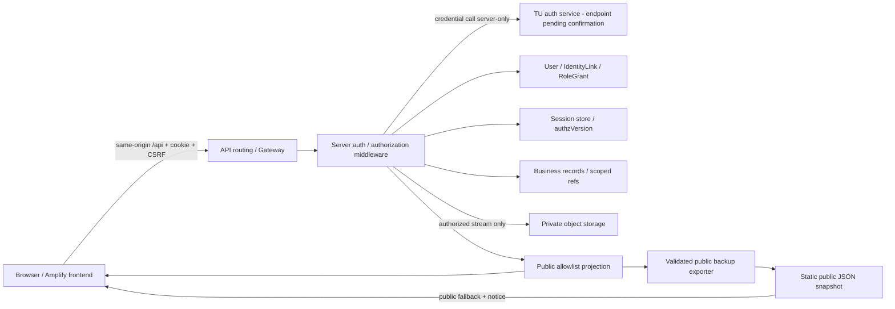

Warning: truncated output (original token count: 21047)
Total output lines: 638

# V3 Design

รวมข้อกำหนด V3-B1 วันที่ 8 ต.ค. 69 ไว้ไฟล์เดียว เนื้อหาเป็น baseline ณ วันออกแบบ ไม่ใช่สถานะ implementation/deployment ล่าสุด ผลตรวจอยู่ใน [V3 Evidence](../evidence/v3-evidence.md) และขั้นตอนตั้งระบบอยู่ใน [สารบัญเอกสาร](../README.md)

## สารบัญ

- [V3 design baseline — #72](#design-baseline)
- [Scope and Permission Matrix — #66](#scope-permissions)
- [TU identity and Session — #90](#authentication-session)
- [Data dictionary, ownership and states — #91](#data-model)
- [API contracts and page flows — #92](#api-flows)
- [Architecture decisions and V2 migration — #93](#architecture-migration)

## V3 design baseline — #72

**Version: V3-B1 · 8 October 2026 · สถานะ: baseline สำหรับอ่านและพัฒนาต่อ**

จัดทำตามคำขอให้ทำ [#72](https://github.com/Micosz/Cs361-Group1-Project7/issues/72) และ 5 sub-issues ทั้งชุด ผู้ใช้จะอ่านภายหลัง จึงไม่อ้างว่าเป็นรายละเอียดที่ทีม review/อนุมัติครบแล้ว การปิดงานเอกสาร baseline ไม่ใช่การรับรอง production readiness

### อ่านตามลำดับ

เริ่มจาก [สารบัญเอกสาร](../README.md) เพื่อเลือกคู่มือที่ต้องใช้ เอกสารในโฟลเดอร์นี้เป็น design baseline; ผล implementation และข้อจำกัดหลังรวมโค้ดอยู่ใน `docs/evidence/`

| Issue | เอกสาร | สิ่งที่ได้ |
| --- | --- | --- |
| #66 | [Scope และ Permission Matrix](#scope-permissions) | ฟีเจอร์ส่งจริง, บทบาท, action/scope, bootstrap และ allow/deny |
| #90 | [TU identity และ Session](#authentication-session) | contract ที่ตรวจได้, วิธีผูกบัญชี, cookie Session, failure/revocation |
| #91 | [Data dictionary และ states](#data-model) | entities/fields/relationships/classification, legacy และ state transitions |
| #92 | [API contracts และ page flows](#api-flows) | routes, write fields, errors, public projection, workspace และ contract cases |
| #93 | [Architecture, ADR และ migration](#architecture-migration) | ทางเลือก/เหตุผล, data flow, migration validation/rollback และ deployment gates |
| #72 | เอกสารหน้านี้ | แผนที่เอกสาร สถานะ decision และ traceability รวม |

### ฐานที่ใช้

- [#88: ตรวจ V2](../evidence/v2-evidence.md#v2-review-issue-88) และ [#89: follow-up](../evidence/v2-evidence.md#v2-follow-up-issue-89) พร้อมหลักฐาน source/Production ณ 8 ต.ค. 2026; ไม่ใช้ผลเก่าแทน live verification ใหม่
- [User Role Diagram ใน PR #67](https://github.com/Micosz/Cs361-Group1-Project7/pull/67) อ่านภาพจริง: Public ดูข้อมูลสาธารณะ, student ดู exchange ของตน, coordinator บันทึก/แก้ไขงานรับผิดชอบ, staff จัดการข้อมูล/เอกสาร/สถานะ, executive ดูข้อมูลภายใน/ภาพรวม รายงานส่งออกและ Feedback ในภาพกว้างกว่าขอบเขต V3 จึงเลื่อนตาม #72
- [V2 ADR](../architecture/ADR-001-v2-hosting.md), [ข้อมูล V1](../data/data-guide.md#v1-data), `public/assets/script.js`, `migrate.js` และ [inventory จริง](../evidence/assets/v3/design/legacy-inventory.json) จาก backup 26 records โครงสร้างฐานข้อมูล AWS จริงยังต้องเทียบเพิ่ม
- เอกสาร TU/OWASP/AWS ที่เปิดอ่านรอบนี้มีลิงก์ในเอกสารที่ใช้ ไม่ทดลอง Login จริง ไม่สร้าง key ไม่เปลี่ยน AWS และไม่รัน migration

### Decision register

| ID | ข้อเลือกสำหรับ baseline | สถานะ / จุดยืนยัน |
| --- | --- | --- |
| B1 | บทบาท 5 กลุ่ม, public ไม่ต้อง Login; student read-only; executive read-only | ใช้เป็น baseline ตาม diagram/#66; อ่าน Matrix ก่อน implementation |
| B2 | staff มีขอบเขตหลักสูตร; role-manager เป็น capability ที่มอบหมายแยก ไม่ได้ติดมากับทุก staff | ตัวเลือก least privilege; ต้องระบุคน bootstrap จริงก่อนใช้งาน |
| B3 | opaque server-side Session และ same-origin `/api` | เลือกสำหรับ baseline; ต้องพิสูจน์ proxy/cookie บน hosting จริง |
| B4 | local UUID + explicit TU identity link; ไม่ใช้ email/name เป็น owner key | เลือก; provider identifier/alias rules ยังต้องยืนยันกับ TU |
| B5 | public field allowlist แยก API/backup; ข้อมูล protected ไม่อยู่ static bundle | เลือก; migration ต้องเทียบ public regression ก่อน cutover |
| B6 | private object storage; backend authorize/stream ทุก download | เลือกพฤติกรรม; S3 เป็น candidate ตาม stack เดิม ยังไม่สร้าง bucket |
| B7 | เพิ่ม schema แบบมี version และ migration บนสำเนาก่อน | เลือก; backend table/key/index layout และ costs รอ deployment review |

### สิ่งที่ยังไม่ถือว่าพิสูจน์แล้ว

1. TU endpoint ที่ทีมมีสิทธิ์ใช้, key/quota จริง, response จริง และความคงที่/aliases ของ username หรือ provider ID
2. ชื่อ role-manager คนแรก, staff curriculum scope และรายชื่อบัญชี/record mapping ที่ยืนยันได้
3. API 500 ใน #88 มีสาเหตุใด; AWS config/logs, backend schema, IAM และ deployment source SHA ปัจจุบัน
4. same-origin API routing/cookie behavior, private storage/IAM/file delivery และค่าใช้จ่ายจริง
5. schema/public fields/สถานะ/ช่วงวันในชุดนี้เป็น baseline choices; ประเด็นที่ทีมเปลี่ยนให้ bump version แล้วปรับทั้ง 5 เอกสารก่อนพัฒนาส่วนที่กระทบ

จุดค้างเหล่านี้เป็น implementation/release gates ไม่ใช่ข้ออ้างว่าทดลองแล้วสำเร็จ ห้าม deploy protected data โดยข้าม gate

### ขั้นตอนต่อไป

เริ่ม #75/#74/#76/#78 ตาม B3/B4 เมื่อ TU prerequisites พร้อม; #77/#79 ใช้ Matrix; feature #94–#111 ใช้ dictionary/API เดียวกัน เอกสารออกแบบ/local fixtures ทำควบคู่ได้ ส่วน #112–#115 ต้องมี allow/deny, migration, private-file และ Production evidence จริง

ก่อนปิด release ตรวจด้วยผู้ใช้ anonymous/no-role/student/coordinator/staff/executive/role-manager, direct API ID tampering, role withdrawal, expiry และ V2 regression ไม่ใช้ UI hidden buttons แทน backend permissions

## Scope and Permission Matrix — #66

**V3-B1 · baseline choices · 8 October 2026** · [สารบัญ/ข้อจำกัด](#design-baseline)

### Scope

ส่งจริง: Public V2 เดิม, TU Login + account linking + Session/logout, role assignments, เพิ่ม/แก้ partner/contact/activity, สร้าง/แก้ agreement + status/renewal, เอกสาร private, สร้าง/แก้ exchange/participants/status, My Exchange และ coordinator/staff/executive workspaces พร้อม keyword/type/date filters ที่ระบุใน API contract

เลื่อน/ไม่รวม ณ baseline เดิม: Feedback หลายแหล่ง, เชื่อมข้อมูลระบบอื่น, analytics เชิงลึก/ส่งออกรายงาน, สมัครโครงการ/approval workflow, ลบ, follow/notifications, บัญชีคู่ความร่วมมือ/ศิษย์เก่า และ auto-sync/scheduled backup ไม่ตีความว่าแนวคิดทั้งหมดใน Role Diagram ต้องส่ง V3

### เพิ่มขอบเขต Feedback — เจ้าของงานสั่ง 18 ตุลาคม 2026

รายการนี้เพิ่มเติมจาก baseline ด้านบนตามคำสั่งเจ้าของงานในแชต ไม่ใช่การยืนยันว่าทีมอนุมัติ baseline ทั้งชุดหรือกำหนด release ถัดไปแล้ว

- เพิ่มรายการ Feedback ในรายละเอียด Activity และ Exchange บนหน้าหลัก โดย Coordinator อ่าน/เพิ่ม/แก้ไขได้เฉพาะงานรับผิดชอบ และ Staff ทำได้ภายใน scope ที่มีสิทธิ์
- Executive อ่านความคิดเห็นและสิ่งที่ควรปรับปรุงในรายละเอียดได้ตาม scope แต่เพิ่ม/แก้ไขไม่ได้ และ API ไม่ส่ง `respondentName` ให้ Executive; Public/Student อ่านหรือเขียน Feedback ไม่ได้
- เก็บวันที่รับผลตอบรับ แหล่งที่มา (ผู้เข้าร่วม/คู่ความร่วมมือ/อื่น ๆ) ความคิดเห็น สิ่งที่ควรปรับปรุง และชื่อผู้ให้ผลตอบรับภายในซึ่งไม่บังคับ ต้องไม่ใส่ข้อมูลระบุตัวบุคคลในข้อความความคิดเห็น เพราะไม่มีการทำ anonymization อัตโนมัติ
- ยังไม่รวมลบรายการ แบบสำรวจ/คะแนน การให้นักศึกษากรอกเอง และรายงานสรุป Feedback
- ใช้ API nested parent พร้อมการตรวจ session/scope/assignment, CSRF, idempotency และ optimistic version ของระบบเดิม ไม่เพิ่มช่องทาง public หรือ browser storage สำหรับข้อมูลนี้
- การรวมเข้า main และ deploy เว็บหลักรอคำสั่งเจ้าของงานภายหลัง ผลตรวจ local/mock ไม่ใช่หลักฐานการทำงานบน AWS จริง

### เพิ่มขอบเขตภาพรวมและรายงาน — เจ้าของงานสั่ง 19 ตุลาคม 2026

รายการนี้ขยายจาก baseline V3 ที่เดิมเลื่อนการสรุป Feedback/การส่งออกรายงาน โดยยังไม่เปลี่ยนบันทึก baseline ย้อนหลัง

- ใช้มุมมองภาพรวมร่วมหนึ่งหน้า: Staff เห็นเฉพาะข้อมูลตาม grant/scope; Executive เห็นสรุปความร่วมมือและ Stakeholder; รายละเอียดแบ่งแท็บแทน modal ใหญ่
- รองรับตัวกรอง scope, stakeholder type, activity type, status และช่วงวันที่; รวม counts/status, Feedback summary และ outcomes ที่ผู้ใช้บันทึก
- Activity/Exchange มีช่อง optional `outcomeSummary`; ไม่มีการอนุมานผลลัพธ์จากคำอธิบายทั่วไปหรือสถานะเพียงอย่างเดียว
- CSV เป็นรายงาน aggregate เท่านั้น; endpoint อนุญาตข้อมูลตาม role/scope ก่อนสรุป และไม่ส่ง respondentName/participant IDs/responsible-user IDs
- ไม่ถือว่าการเปลี่ยนนี้กำหนด release version; main/deploy ยังต้องได้รับคำสั่งแยก

### นิยามขอบเขต

- `public`: รายการที่ถูกเผยแพร่พร้อม field allowlist; anonymous และทุกบทบาทอ่านได้
- `curriculum`: record อยู่ใน `scopeIds` ที่มอบหมายให้ user ในบทบาทนั้น
- `assigned`: user อยู่ใน `responsibleUserIds` ของ record **และ** มี coordinator grant ใน curriculum เดียวกัน
- `participant`: user อยู่ใน `participantUserIds` ของ exchange **และ** มี student grant ใน curriculum เดียวกัน; เป็น own exchange view ไม่ได้สิทธิ์แก้ไข
- role ที่อยู่คนละ curriculum ใช้ข้าม scope ไม่ได้; `createdBy` ไม่ให้สิทธิ์อ่าน/แก้อัตโนมัติ
- default deny; หลายบทบาทรวมเฉพาะ grant/action/scope ที่ตรงกัน ไม่รวม scope ของ role หนึ่งเข้ากับ action ของอีก role หนึ่ง

### Matrix

`R` อ่าน, `C` สร้าง, `U` แก้ไข, `S` เปลี่ยนสถานะ, `F` อัปโหลด, `D` ดู/ดาวน์โหลดเอกสาร; `—` ปฏิเสธ ทั้งหมดบังคับที่ backend

| Resource / Action | Anonymous / no-role | Student | Coordinator | Staff | Executive |
| --- | --- | --- | --- | --- | --- |
| Public partner/activity/detail/search | R public | R public | R public | R public | R public |
| Internal partner/contact/history | — | — | R/U assigned; ประวัติเพิ่ม/แก้ได้ | R/C/U curriculum; ประวัติเพิ่ม/แก้ได้ | R partner/history curriculum non-personal; contact — |
| Activities + partner/agreement links | — | — | R/U assigned; C ใน grant scope โดย assign ตนเอง | R/C/U curriculum | R curriculum non-personal |
| Agreements + responsibility/dates/renewal/status | — | — | R/C/U/S assigned (create assign ตนเอง) | R/C/U/S curriculum | R curriculum non-personal |
| Exchanges + partners/dates/participants/status | — | R participant projection | R/C/U/S assigned (create assign ตนเอง) | R/C/U/S curriculum | R curriculum non-personal ไม่เห็น participant identity |
| Agreement documents | — | — | F/D assigned parent | F/D curriculum parent | D curriculum เมื่อ audience=`internal` |
| Exchange documents audience=`participants` | — | D participant; ไม่ upload | F/D assigned parent | F/D curriculum parent | — |
| Exchange documents audience=`internal` | — | — | F/D assigned parent | F/D curriculum parent | D curriculum ถ้าไม่เป็น personal |
| Participant/user account details | — | เฉพาะตนผ่าน `/auth/session` | เฉพาะ minimal identity ของ participants ใน assigned exchange | minimal identity สำหรับงาน curriculum | — |
| Internal overview/count/search | — | own exchange count | assigned count | curriculum count | curriculum non-personal count |
| มอบหมาย responsible users / scopes | — | — | คง assignment เดิม; ห้ามเพิ่ม/ย้าย scope | U curriculum; target ต้องมี grant ที่เหมาะสม | — |
| Role grants / revoke | — | — | — | เฉพาะผู้ถือ capability `manageRoles` | — |
| Delete / approve / global admin | — | — | — | — | — |

Student ไม่ได้สิทธิ์ protected จาก TU `type=student` อัตโนมัติ; ต้องมี application grant และ participant link Executive ไม่เป็น editor/admin การอ่าน internal ไม่รวม personal fields โดยอัตโนมัติ

### Role-manager และ bootstrap

`manageRoles` เป็น capability ทางเทคนิคแยกจาก business roles ใช้จัดการ student/coordinator/staff/executive grants ภายใน `managedScopeIds` เท่านั้น ไม่ให้สิทธิ์อ่านข้อมูลธุรกิจเพิ่ม

1. ผู้ดูแล deployment ที่ได้รับมอบหมายยืนยันตัวตน/หลักสูตรของผู้รับผิดชอบคนแรกนอกเว็บ แล้วใช้ขั้นตอน provisioning ฝั่ง server สร้าง `manageRoles` grant; ไม่มี public bootstrap endpoint และไม่ใช้ email/employee เดาเป็น admin
2. บันทึก actor/target/scope/action/time โดยไม่บันทึก credentials; ทดสอบคนไม่มี capability ส่ง role request แล้วได้ 403
3. role-manager เพิ่ม/ถอน **business** grants ในขอบเขตตนได้ แต่ห้ามแก้ grant/capability ของตน และห้ามมอบ `manageRoles` ผ่าน business-role API การหมุนเวียน role-manager ใช้ provisioni…11047 tokens truncated…``

แต่ละ workspace เก็บ query/type/status/date/cursor ใน URL ของ workspace; back จาก detail คืน filters เดิม ไม่เก็บ protected data/credentials ใน URL หรือ localStorage Form อ่าน permission จาก server response เพื่อแสดง controls แต่ backend ตรวจซ้ำทุก action; no-role แยกจาก expired (401), forbidden (403) และ record ไม่พบ/นอก scope (404)

List/detail/form มี loading, empty, failed+retry, saving+disable double submit และ conflict+reload controls; 401 clear cached protected state แล้ว Login พร้อม safe return path; 403 ไม่ auto retry; error ไม่ render provider stack และไม่แทนด้วยข้อมูล public backup

### Contract test cases ที่ frontend/backend ใช้ร่วมกัน

| ID | Input / Expected |
| --- | --- |
| A01 | anonymous GET public →200 allowlist; GET protected →401 |
| A02 | no-role Session →200 session/grants=[]; protected list →403 |
| A03 | student participant GET E1 →200 minimal projection; E2 ID tamper →404; PATCH/upload E1 →403 |
| A04 | coordinator assigned PATCH valid →200/version+1/read-back; other record →404; responsibility/publication injection →403 |
| A05 | staff scope C1 POST/PATCH valid →201/200; scope C2/ref C2 or unverified participant →404/422 without reference details |
| A06 | executive GET scoped overview →200 no personal fields; POST/PATCH →403; personal doc →404 |
| A07 | revoke grant/authzVersion during Session →next request401; fresh Login still no removed grant |
| A08 | missing Origin/CSRF on write →403 before side effect; stale If-Match→409; repeated Idempotency-Key same body →same result |
| A09 | keyword+type+date →intersection and scoped count; unknown enum/reversed range→422; public related count ไม่รวม internal records |
| A10 | pending/rejected/other-owner document/expired Session →deny; allowed ready file →stream no public URL |
| A11 | invalid TU body/status/key/timeout/quota →#90 errors without authenticated Session |
| A12 | legacy missing owner →public allowlist ยังอ่านได้; protected coordinator/student access denied; staff remediation within scope only |

นี่คือ acceptance specifications ยังไม่มี V3 server/route implementation หรือผล runtime tests ในงานออกแบบนี้

## Architecture decisions and V2 migration — #93

**V3-B1 · proposed design, ไม่มี AWS changes** · [สารบัญ](#design-baseline)

### Current → target

V2 source ที่ตรวจ: static frontend ใน `public/`, Amplify config, public API URL, backup workflow และ old migration script; ไม่มี Lambda source/IaC ใน repo นี้ การตอบ 500 ณ #88 ไม่พิสูจน์สาเหตุ Lab/IAM/table; ต้องตรวจ AWS แยกก่อน runtime work

Logical boundaries ไม่ได้หมายความว่าต้องมี Lambda/table ใหม่ทุกกล่อง; เลือก physical layout หลังอ่าน backend จริง Backend credentials/key อยู่ secret configuration ไม่ผ่าน frontend/git/backup/logs

### ADR-B1: identity และ Session

Decision: ใช้ local UUID + verified TU link และ opaque cookie Session ตาม [#90](#authentication-session) ยืนยัน grants/version ทุก request และ rotate token เมื่อ Login; trade-off เป็น store lookup เพิ่มเพื่อ revoke ได้ชัดเจน JWT ลด lookup บางส่วนแต่ต้องออกแบบ revocation/claims freshness; SSO redirect ยังไม่มี provider evidence จึงไม่เลือก

Session store จะใช้ DynamoDB เป็น candidate ตาม stack เดิม แต่ implementation ต้องกำหนด key, consistent read/transaction สำหรับ user/version/grant updates และ benchmark ค่าใช้จ่าย/latencyก่อนรับ หากอ่านข้อมูล authz แบบ eventually consistent แล้วทำให้ revoke ยังใช้ได้ ถือว่าไม่ผ่าน contract TTL ใช้ cleanup เท่านั้น ต้องตรวจ deadline ในโค้ดด้วย ดู [AWS consistency](https://docs.aws.amazon.com/amazondynamodb/latest/developerguide/HowItWorks.ReadConsistency.html) และ [AWS TTL](https://docs.aws.amazon.com/amazondynamodb/latest/developerguide/TTL.html); GSI ไม่รองรับ strongly consistent read จึงห้ามพึ่ง GSI เพียงอย่างเดียวตัดสิน role withdrawal; list candidates จาก index ต้อง revalidate current record permission ก่อน response/count

### ADR-B2: data และ API boundary

Decision: คง Partner/Activity IDs และ public DTO/backup shape เดิมผ่าน adapter; เพิ่ม User/Identity/Role/Agreement/Exchange/Document entities ฝั่ง server schemaVersion=3 ใช้ scope filters ก่อน count/pagination; ห้าม frontend อ่าน database ด้วย AWS credentials

ตัวเลือก: ขยาย DynamoDB เดิมแบบ entity discriminator + indexes, หรือแยกตาราง auth/business, หรือ relational database ทางเลือกแรก/สองลดการย้าย stack แต่ต้องกำหนด access patterns/transaction/index และ Lambda permissions; relational ช่วย constraints/joins แต่เพิ่ม migration และ connection operations **ยังไม่เลือก table topology หรือ library ใหม่แทนทีม** Candidate minimum คือใช้บริการเดิมพร้อมแยก auth/export permissions และ access paths ตาม entity/scope/user; ห้าม full-scan แล้วส่ง protected data ให้ browser กรองเอง

ค่าใช้จ่ายเพิ่มจาก auth reads/writes, sessions, object storage, streaming egress และ logs; ยังไม่มี workload/account cost evidence จึงไม่ใส่ตัวเลขราคา ไม่มีการจัดซื้อ/เปิดบริการในงานนี้

### ADR-B3: private documents

Decision: private object storage + backend authorize metadata/content ทุกครั้งและ stream; S3 เป็น candidate ที่สอดคล้อง AWS เดิม เปิด block-public-access, encryption, least-privilege service role และ random object keys ตาม implementation review ไม่มี public bucket/URL ใน response

เปรียบเทียบ: เก็บไฟล์ใน repo/public/backup ทำให้ authorization ใช้ไม่ได้จึงไม่เลือก; short-lived presigned URLs ลด backend bandwidth แต่ URL ที่ออกแล้วอาจใช้ต่อจนหมดอายุ/เงื่อนไข credentials เปลี่ยน จึงไม่เลือกเป็น baseline ที่ต้องตรวจสิทธิ์ทุก download อ่านข้อจำกัดจาก [AWS presigned URL documentation](https://docs.aws.amazon.com/AmazonS3/latest/userguide/using-presigned-url.html) ไม่อ้างว่าถอนลิงก์ได้ทันที

Streaming ต้องพิสูจน์ Lambda/Gateway/hosting size/time limits รองรับ PDF/JPEG/PNG **10 MiB** และไม่มี untrusted inline active content หาก stack รองรับไม่ได้ ให้ปรับ ADR/limit ก่อน implement ไม่รับปากว่า route ปัจจุบัน stream ได้แล้ว request ที่เริ่มส่ง bytes ไปก่อน revoke เรียกกลับไม่ได้; request ใหม่ต้อง check เสมอ

### ADR-B4: deployment และ Lab availability

Decision: คง Amplify frontend และ AWS API-first เป็น baseline, ต้องมี same-origin `/api` routing สำหรับ cookie design ค่อยพิสูจน์วิธี routing/custom domain กับ deployment จริง ไม่มีการสมมติว่า Amplify reverse proxy รองรับ protected cookies ตามต้องการโดยอัตโนมัติ หากทำไม่ได้ให้ทบทวน #90/#92 พร้อม CORS/CSRF tests

Public fallback ช่วย read-only availability เมื่อ Lab/API ไม่พร้อม แต่ไม่ทำให้ Login/write/private document ใช้ offline ได้ Protected API unavailable →error ไม่มีข้อมูล protected ใน static backup ข้อมูล public ใช้ manual backup + reload จนทีมเลือกระบบ freshness อื่น

### Migration mapping

Source ที่ตรวจได้คือ repository backup ไม่ใช่ export ฐานข้อมูลล่าสุด ต้องมี authorized DB export จริงก่อนย้าย และต้องแก้ API readiness ถ้าจะใช้ API เป็น source

| Source | Target mapping | Safe default / ห้ามเดา |
| --- | --- | --- |
| partner id/name/type/summary/location/url/logo/full_description | Partner stable id, camelCase internal fields; public adapter แปลงกลับ | คง full description ที่อนุญาตเผยแพร่; type internship ที่มีจริงห้ามทิ้ง |
| partner coordinators เป็นชื่อ | Contact legacy name ใน scope ที่ยืนยัน | ไม่สร้าง User/grant/identity link จากชื่อ/email; responsibility=[] |
| activity id/title/type/summary/full_description/period/period_date | Activity id เดิม, periodText/periodDate | date missing→null; ไม่ parse ข้อความปีไปเป็นวันโดยเดา |
| partnerId และ partnerName | partnerId เป็น authority; display name อ่านจาก Partner | missing ref→quarantine; ไม่สร้าง partner จากข้อความชื่อเอง |
| co_hosts names | coHostPartnerIds หลังตรวจ mapping; preserve legacyCoHostNames internal | substring match ใช้เสนอ candidate เท่านั้น; ambiguity→manual review; public relation regression ต้องผ่านก่อน cutover |
| access_level/visibility | publication ตาม rule ด้านล่าง | absent/unknown/conflicting→internal/quarantine; ห้าม OR flags ที่ขัดกัน |
| ไม่มี scope/user/time/version | scopeId จาก deployment owner, createdBy/updatedBy=null, migration timestamps, version=1, schemaVersion=3 | scope ไม่ทราบ→หยุด; imported responsible=[] ได้แต่ไม่มี assigned access |
| ไม่มี Agreement/Exchange/Document | ไม่มี target record จนมี source ที่ยืนยัน | ไม่สร้าง agreement จาก activity.type หรือชื่อ; import เพิ่มภายหลังใช้ draft/dates=null และ validate refs |

Publication normalization: partner/activity ที่เดิมมี explicit public flag อย่างน้อยหนึ่งตัวและ **ไม่มีอีก flag ที่ explicit non-public** →eligible public; ต้องผ่าน field projection ก่อน publish ไม่มี flags→internal; flags ขัดกัน→quarantine ทั้งจำนวนและ ID ของ quarantine ต้องรายงาน ห้าม drop เงียบ

Public field allowlist ใน [API](#api-flows) ใช้กับ exporter/API/bundle เดียวกัน Contact names/phone/email และ owner/user/participants/document objectKey ไม่อยู่ใน allowlist ถึง legacy file เคยมี coordinators ก็ไม่คัดลอกเข้า public export ใหม่ การเปลี่ยนนี้ต้องประกาศใน migration report แต่ UI ปัจจุบันไม่ได้อ่าน coordinators ตาม source ที่ตรวจ

### Runbook: backup → dry run → cutover → validate

1. **Freeze/source:** ระบุ target environment, ผู้รับผิดชอบ, source export timestamp/hash และ frontend/backend versions; หยุด writes ช่วง cutover หรือมี delta plan ที่ตรวจได้ ขาดข้อมูล/สิทธิ์/rollback owner ให้หยุด ไม่ใช้ production เป็นที่ทดลอง
2. **Backup:** export DB/metadata พร้อม version + snapshot และสำรอง private objects/config references ตามสิทธิ์ที่อนุญาต เก็บ encrypted ใน restricted location ไม่ commit dump/credentials/personal data ลง git ทดลองอ่านสำเนาและ restore ใน environment ทดสอบก่อน
3. **Dry run:** transform ไป destination สำเนา/namespace ใหม่ ไม่ overwrite V2; สร้าง ID mapping, duplicate/orphan/conflict/unresolved/field-removal report เปรียบเทียบกับ [inventory](../evidence/assets/v3/design/legacy-inventory.json) เฉพาะเพื่อ baseline ไม่สรุปจำนวน production ว่าต้องเท่ากันถ้าข้อมูลเปลี่ยน
4. **Validate data:** source IDs เท่ากับ migrated+quarantined IDs, ไม่ซ้ำ/ไม่หาย, count ต่อ entity, primary/co-host/agreement/participant refs และ scope ถูกต้อง, unknowns ไม่กลายเป็น permission, state/date rules ผ่าน; conditional writes รองรับ rerun idempotent ข้อมูลต่างจาก mapping ให้หยุด
5. **Validate access/public:** compare public allowlist fields/IDs และ Search/type/date/modal relations ก่อน/หลัง; account fixture anonymous/no-role/student/coordinator/staff/executive ผ่าน direct deny; scan public API/backup/bundle/logs ไม่มี internal/personal/secret; file audience และ revoke/expiry ผ่าน
6. **Cutover:** หลังผลผ่านและผู้รับผิดชอบอนุญาต สลับ backend/config ไป namespace ใหม่ แล้ว publish compatibility snapshot/adapter ที่ตรงกัน เก็บ frontend SHA/backend config version ไม่ทำ migration บนทุก frontend build
7. **Smoke:** Public → Login/no-role → workspace → write/read-back → own exchange/docs → denial → logout; ตรวจ API 200 แยกจาก fallback และตรวจ build/deploy job แยกจาก HTTP200

### Stop / rollback

หยุดทันทีเมื่อ count/IDs/refs ต่างโดยอธิบายไม่ได้, projection หลุด field, owner/link ไม่ยืนยัน, role/file deny ล้มเหลว, source เปลี่ยนหลัง freeze หรือ restore ยังไม่ผ่าน

ก่อน cutover: ทิ้ง destination สำเนาที่ล้มเหลวตามนโยบายข้อมูลและใช้ V2 เดิมต่อ ไม่แตะ source หลัง cutover: ปิด writes/ระบุช่วง delta, switch traffic/config กลับ version เดิม, ใช้ public snapshot ที่ตรวจแล้วหาก API ไม่พร้อม, reconcile writes หลัง cutover ก่อน retry ห้าม restore ทับข้อมูลใหม่โดยเงียบ Revoke V3 Sessions ที่อาจใช้ schema/permissions ใหม่และระงับ private file routes จนแน่ใจว่า policy ตรงกัน

เก็บ source/destination mapping, validation, deployment และ rollback decision เป็น restricted evidence แล้วเผยแพร่เฉพาะสรุปที่ไม่มีข้อมูลลับ สคริปต์ `migrate.js` เดิมไม่ทำขั้นตอนเหล่านี้จึงไม่ถือว่ารองรับ V3

### Traceability และสถานะ

| Issue | Deliverable ในชุดนี้ | Acceptance / ข้อจำกัด |
| --- | --- | --- |
| #66 | Scope, Matrix, role manager/bootstrap และ examples | ครอบคลุม action/scope/deny; คน bootstrap จริงยังต้องระบุ |
| #90 | TU docs evidence, identity approach, Session lifecycle/failures | endpoint/identity stability/key/quota ยังไม่ทดสอบจริง; gate ชัดเจน |
| #91 | Dictionary, relationships, examples, states/legacy | สำรวจ repo snapshot แล้ว; schema DB จริงยังต้อง export เทียบ |
| #92 | Contracts, projections, flows, A01–A12 | เป็น specification ไม่ใช่ implemented/verified routes |
| #93 | ADR alternatives/decisions, mapping, backup/validate/rollback | ไม่มี AWS/migration/deployment execution |
| #72 | [index และ decision register](#design-baseline) เชื่อม 5 deliverables | baseline พร้อมให้ผู้ใช้อ่านและปรับ; ไม่อ้าง team review ที่ยังไม่มี |

ผลตรวจชุดเอกสารจะบันทึกใน [baseline verification](../evidence/v3-evidence.md#verification) และคอมเมนต์ Issues พร้อม immutable commit links
