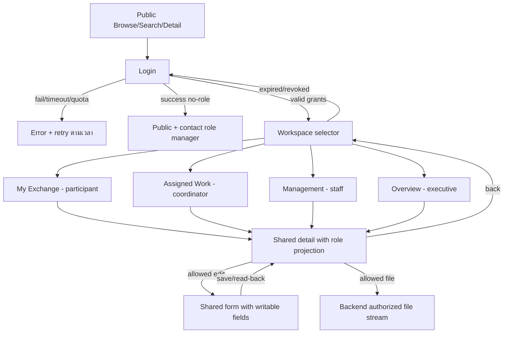
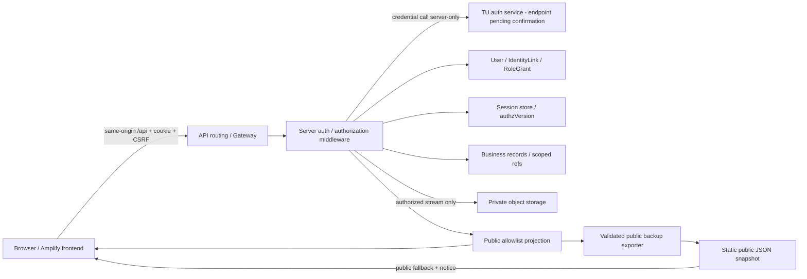

# V3 Design

รวมข้อกำหนด V3-B1 วันที่ 8 ต.ค. 69 ไว้ไฟล์เดียว เนื้อหาเป็น baseline ณ วันออกแบบ ไม่ใช่สถานะ implementation/deployment ล่าสุด ผลตรวจอยู่ใน [V3 Evidence](../evidence/v3-evidence.md) และขั้นตอนตั้งระบบอยู่ใน [สารบัญเอกสาร](../README.md)

## สารบัญ

- [V3 design baseline — #72](#design-baseline)
- [Scope and Permission Matrix — #66](#scope-permissions)
- [TU identity and Session — #90](#authentication-session)
- [Data dictionary, ownership and states — #91](#data-model)
- [API contracts and page flows — #92](#api-flows)
- [Architecture decisions and V2 migration — #93](#architecture-migration)


<a id="design-baseline"></a>

<a id="design-baseline-v3-design-baseline--72"></a>

## V3 design baseline — #72

**Version: V3-B1 · 8 October 2026 · สถานะ: baseline สำหรับอ่านและพัฒนาต่อ**

จัดทำตามคำขอให้ทำ [#72](https://github.com/Micosz/Cs361-Group1-Project7/issues/72) และ 5 sub-issues ทั้งชุด ผู้ใช้จะอ่านภายหลัง จึงไม่อ้างว่าเป็นรายละเอียดที่ทีม review/อนุมัติครบแล้ว การปิดงานเอกสาร baseline ไม่ใช่การรับรอง production readiness

<a id="design-baseline-อ่านตามลำดับ"></a>

### อ่านตามลำดับ

เริ่มจาก [สารบัญเอกสาร](../README.md) เพื่อเลือกคู่มือที่ต้องใช้ เอกสารในโฟลเดอร์นี้เป็น design baseline; ผล implementation และข้อจำกัดหลังรวมโค้ดอยู่ใน `docs/evidence/`

| Issue | เอกสาร | สิ่งที่ได้ |
| --- | --- | --- |
| #66 | [Scope และ Permission Matrix](#scope-permissions) | ฟีเจอร์ส่งจริง, บทบาท, action/scope, bootstrap และ allow/deny |
| #90 | [TU identity และ Session](#authentication-session) | contract ที่ตรวจได้, วิธีผูกบัญชี, cookie Session, failure/revocation |
| #91 | [Data dictionary และ states](#data-model) | entities/fields/relationships/classification, legacy และ state transitions |
| #92 | [API contracts และ page flows](#api-flows) | routes, write fields, errors, public projection, workspace และ contract cases |
| #93 | [Architecture, ADR และ migration](#architecture-migration) | ทางเลือก/เหตุผล, data flow, migration validation/rollback และ deployment gates |
| #72 | เอกสารหน้านี้ | แผนที่เอกสาร สถานะ decision และ traceability รวม |

<a id="design-baseline-ฐานที่ใช้"></a>

### ฐานที่ใช้

- [#88: ตรวจ V2](../evidence/v2-evidence.md#v2-review-issue-88) และ [#89: follow-up](../evidence/v2-evidence.md#v2-follow-up-issue-89) พร้อมหลักฐาน source/Production ณ 8 ต.ค. 2026; ไม่ใช้ผลเก่าแทน live verification ใหม่
- [User Role Diagram ใน PR #67](https://github.com/Micosz/Cs361-Group1-Project7/pull/67) อ่านภาพจริง: Public ดูข้อมูลสาธารณะ, student ดู exchange ของตน, coordinator บันทึก/แก้ไขงานรับผิดชอบ, staff จัดการข้อมูล/เอกสาร/สถานะ, executive ดูข้อมูลภายใน/ภาพรวม รายงานส่งออกและ Feedback ในภาพกว้างกว่าขอบเขต V3 จึงเลื่อนตาม #72
- [V2 ADR](../architecture/ADR-001-v2-hosting.md), [ข้อมูล V1](../data/data-guide.md#v1-data), `public/assets/script.js`, `migrate.js` และ [inventory จริง](../evidence/assets/v3/design/legacy-inventory.json) จาก backup 26 records โครงสร้างฐานข้อมูล AWS จริงยังต้องเทียบเพิ่ม
- เอกสาร TU/OWASP/AWS ที่เปิดอ่านรอบนี้มีลิงก์ในเอกสารที่ใช้ ไม่ทดลอง Login จริง ไม่สร้าง key ไม่เปลี่ยน AWS และไม่รัน migration

<a id="design-baseline-decision-register"></a>

### Decision register

| ID | ข้อเลือกสำหรับ baseline | สถานะ / จุดยืนยัน |
| --- | --- | --- |
| B1 | บทบาท 5 กลุ่ม, public ไม่ต้อง Login; student read-only; executive read-only | ใช้เป็น baseline ตาม diagram/#66; อ่าน Matrix ก่อน implementation |
| B2 | staff มีขอบเขตหลักสูตร; role-manager เป็น capability ที่มอบหมายแยก ไม่ได้ติดมากับทุก staff | ตัวเลือก least privilege; ต้องระบุคน bootstrap จริงก่อนใช้งาน |
| B3 | opaque server-side Session และ same-origin `/api` | เลือกสำหรับ baseline; ต้องพิสูจน์ proxy/cookie บน hosting จริง |
| B4 | local UUID + explicit TU identity link; ไม่ใช้ email/name เป็น owner key | เลือก; provider identifier/alias rules ยังต้องยืนยันกับ TU |
| B5 | public field allowlist แยก API/backup; ข้อมูล protected ไม่อยู่ static bundle | เลือก; migration ต้องเทียบ public regression ก่อน cutover |
| B6 | private object storage; backend authorize/stream ทุก download | เลือกพฤติกรรม; S3 เป็น candidate ตาม stack เดิม ยังไม่สร้าง bucket |
| B7 | เพิ่ม schema แบบมี version และ migration บนสำเนาก่อน | เลือก; backend table/key/index layout และ costs รอ deployment review |

<a id="design-baseline-สิ่งที่ยังไม่ถือว่าพิสูจน์แล้ว"></a>

### สิ่งที่ยังไม่ถือว่าพิสูจน์แล้ว

1. TU endpoint ที่ทีมมีสิทธิ์ใช้, key/quota จริง, response จริง และความคงที่/aliases ของ username หรือ provider ID
2. ชื่อ role-manager คนแรก, staff curriculum scope และรายชื่อบัญชี/record mapping ที่ยืนยันได้
3. API 500 ใน #88 มีสาเหตุใด; AWS config/logs, backend schema, IAM และ deployment source SHA ปัจจุบัน
4. same-origin API routing/cookie behavior, private storage/IAM/file delivery และค่าใช้จ่ายจริง
5. schema/public fields/สถานะ/ช่วงวันในชุดนี้เป็น baseline choices; ประเด็นที่ทีมเปลี่ยนให้ bump version แล้วปรับทั้ง 5 เอกสารก่อนพัฒนาส่วนที่กระทบ

จุดค้างเหล่านี้เป็น implementation/release gates ไม่ใช่ข้ออ้างว่าทดลองแล้วสำเร็จ ห้าม deploy protected data โดยข้าม gate

<a id="design-baseline-ขั้นตอนต่อไป"></a>

### ขั้นตอนต่อไป

เริ่ม #75/#74/#76/#78 ตาม B3/B4 เมื่อ TU prerequisites พร้อม; #77/#79 ใช้ Matrix; feature #94–#111 ใช้ dictionary/API เดียวกัน เอกสารออกแบบ/local fixtures ทำควบคู่ได้ ส่วน #112–#115 ต้องมี allow/deny, migration, private-file และ Production evidence จริง

ก่อนปิด release ตรวจด้วยผู้ใช้ anonymous/no-role/student/coordinator/staff/executive/role-manager, direct API ID tampering, role withdrawal, expiry และ V2 regression ไม่ใช้ UI hidden buttons แทน backend permissions

<a id="scope-permissions"></a>

<a id="scope-permissions-scope-and-permission-matrix--66"></a>

## Scope and Permission Matrix — #66

**V3-B1 · baseline choices · 8 October 2026** · [สารบัญ/ข้อจำกัด](#design-baseline)

<a id="scope-permissions-scope"></a>

### Scope

ส่งจริง: Public V2 เดิม, TU Login + account linking + Session/logout, role assignments, เพิ่ม/แก้ partner/contact/activity, สร้าง/แก้ agreement + status/renewal, เอกสาร private, สร้าง/แก้ exchange/participants/status, My Exchange และ coordinator/staff/executive workspaces พร้อม keyword/type/date filters ที่ระบุใน API contract

เลื่อน/ไม่รวม: Feedback หลายแหล่ง, เชื่อมข้อมูลระบบอื่น, analytics เชิงลึก/ส่งออกรายงาน, สมัครโครงการ/approval workflow, ลบ, follow/notifications, บัญชีคู่ความร่วมมือ/ศิษย์เก่า และ auto-sync/scheduled backup ไม่ตีความว่าแนวคิดทั้งหมดใน Role Diagram ต้องส่ง V3

<a id="scope-permissions-นิยามขอบเขต"></a>

### นิยามขอบเขต

- `public`: รายการที่ถูกเผยแพร่พร้อม field allowlist; anonymous และทุกบทบาทอ่านได้
- `curriculum`: record อยู่ใน `scopeIds` ที่มอบหมายให้ user ในบทบาทนั้น
- `assigned`: user อยู่ใน `responsibleUserIds` ของ record **และ** มี coordinator grant ใน curriculum เดียวกัน
- `participant`: user อยู่ใน `participantUserIds` ของ exchange **และ** มี student grant ใน curriculum เดียวกัน; เป็น own exchange view ไม่ได้สิทธิ์แก้ไข
- role ที่อยู่คนละ curriculum ใช้ข้าม scope ไม่ได้; `createdBy` ไม่ให้สิทธิ์อ่าน/แก้อัตโนมัติ
- default deny; หลายบทบาทรวมเฉพาะ grant/action/scope ที่ตรงกัน ไม่รวม scope ของ role หนึ่งเข้ากับ action ของอีก role หนึ่ง

<a id="scope-permissions-matrix"></a>

### Matrix

`R` อ่าน, `C` สร้าง, `U` แก้ไข, `S` เปลี่ยนสถานะ, `F` อัปโหลด, `D` ดู/ดาวน์โหลดเอกสาร; `—` ปฏิเสธ ทั้งหมดบังคับที่ backend

| Resource / Action | Anonymous / no-role | Student | Coordinator | Staff | Executive |
| --- | --- | --- | --- | --- | --- |
| Public partner/activity/detail/search | R public | R public | R public | R public | R public |
| Internal partner/contact/history | — | — | R/U assigned; ประวัติเพิ่ม/แก้ได้ | R/C/U curriculum; ประวัติเพิ่ม/แก้ได้ | R partner/history curriculum non-personal; contact — |
| Activities + partner/agreement links | — | — | R/U assigned; C ใน grant scope โดย assign ตนเอง | R/C/U curriculum | R curriculum non-personal |
| Agreements + responsibility/dates/renewal/status | — | — | R/C/U/S assigned (create assign ตนเอง) | R/C/U/S curriculum | R curriculum non-personal |
| Exchanges + partners/dates/participants/status | — | R participant projection | R/C/U/S assigned (create assign ตนเอง) | R/C/U/S curriculum | R curriculum non-personal ไม่เห็น participant identity |
| Agreement documents | — | — | F/D assigned parent | F/D curriculum parent | D curriculum เมื่อ audience=`internal` |
| Exchange documents audience=`participants` | — | D participant; ไม่ upload | F/D assigned parent | F/D curriculum parent | — |
| Exchange documents audience=`internal` | — | — | F/D assigned parent | F/D curriculum parent | D curriculum ถ้าไม่เป็น personal |
| Participant/user account details | — | เฉพาะตนผ่าน `/auth/session` | เฉพาะ minimal identity ของ participants ใน assigned exchange | minimal identity สำหรับงาน curriculum | — |
| Internal overview/count/search | — | own exchange count | assigned count | curriculum count | curriculum non-personal count |
| มอบหมาย responsible users / scopes | — | — | คง assignment เดิม; ห้ามเพิ่ม/ย้าย scope | U curriculum; target ต้องมี grant ที่เหมาะสม | — |
| Role grants / revoke | — | — | — | เฉพาะผู้ถือ capability `manageRoles` | — |
| Delete / approve / global admin | — | — | — | — | — |

Student ไม่ได้สิทธิ์ protected จาก TU `type=student` อัตโนมัติ; ต้องมี application grant และ participant link Executive ไม่เป็น editor/admin การอ่าน internal ไม่รวม personal fields โดยอัตโนมัติ

<a id="scope-permissions-role-manager-และ-bootstrap"></a>

### Role-manager และ bootstrap

`manageRoles` เป็น capability ทางเทคนิคแยกจาก business roles ใช้จัดการ student/coordinator/staff/executive grants ภายใน `managedScopeIds` เท่านั้น ไม่ให้สิทธิ์อ่านข้อมูลธุรกิจเพิ่ม

1. ผู้ดูแล deployment ที่ได้รับมอบหมายยืนยันตัวตน/หลักสูตรของผู้รับผิดชอบคนแรกนอกเว็บ แล้วใช้ขั้นตอน provisioning ฝั่ง server สร้าง `manageRoles` grant; ไม่มี public bootstrap endpoint และไม่ใช้ email/employee เดาเป็น admin
2. บันทึก actor/target/scope/action/time โดยไม่บันทึก credentials; ทดสอบคนไม่มี capability ส่ง role request แล้วได้ 403
3. role-manager เพิ่ม/ถอน **business** grants ในขอบเขตตนได้ แต่ห้ามแก้ grant/capability ของตน และห้ามมอบ `manageRoles` ผ่าน business-role API การหมุนเวียน role-manager ใช้ provisioning ที่ตรวจทานเช่นเดียวกับ bootstrap
4. ถอน role หรือเปลี่ยน scope ให้เพิ่ม `authzVersion`; request ถัดไปใช้ grants ล่าสุดและปฏิเสธ Session version เก่า ตาม [Session](#authentication-session) ไม่รอ cookie หมดอายุ

No-role Login สำเร็จได้ แต่เห็น Public และคำอธิบายว่าให้ติดต่อผู้รับผิดชอบเพื่อมอบหมายสิทธิ์ ไม่มี auto-role จากหน้าฟอร์ม Role หลายตัวมี workspace selector แต่ไม่บังคับเลือก role เพื่อหลบ backend check

<a id="scope-permissions-ข้อมูลและตัวอย่าง-allowdeny"></a>

### ข้อมูลและตัวอย่าง allow/deny

Public: ชื่อ/type/summary/location/เว็บไซต์/logo และกิจกรรมที่เลือกเผยแพร่; internal: responsibility/history/status/renewal/notes; personal: identity, contacts ที่ไม่อนุญาตเผยแพร่, participants และเอกสารที่มีข้อมูลบุคคล เอกสาร personal ต้อง audience=`participants` และ executive อ่านไม่ได้

| Case | Allow | Deny |
| --- | --- | --- |
| student U1 มี grant C1, exchange E1 ใน C1 มี U1 participant | อ่าน E1 + participant-audience docs | อ่าน E2 ของ U2, PATCH E1, upload หรือดูรายชื่อคนอื่น |
| coordinator U3 ใน C1 ถูก assign E1 | แก้ business fields/สถานะและ upload E1 | เปลี่ยน `responsibleUserIds`, `scopeId`, `createdBy` หรือแก้ E2 ที่ไม่ assigned |
| staff U4 ใน C1 | สร้าง/แก้ข้อมูล C1 และ assign coordinator ที่มี grant C1 | เปิด C2, assign ผู้ไม่มี grant หรือให้ role ตนเอง |
| executive U5 ใน C1 | อ่านภาพรวม C1 และ internal non-personal details/docs | POST/PATCH ทุก business record, participant identity/personal docs |
| anonymous หรือ user ยัง no-role | public projection | protected list/detail/count/file แม้ทราบ ID/URL |
| role-manager | มอบ student grant ใน managed C1 | promote ตนเอง, มอบ capability, หรือ scope C2 |

เกณฑ์ implementation: ทุกแถวมี positive/negative direct API tests, field allowlists และ cross-scope cases ตาม [API](#api-flows) รายการนี้คือ baseline ที่ผู้ใช้ขอให้จัดทำ ไม่อ้างว่ามีผู้ใช้จริงหรือ role-manager คนแรกแล้ว

<a id="authentication-session"></a>

<a id="authentication-session-tu-identity-and-session--90"></a>

## TU identity and Session — #90

**V3-B1 · design baseline · 8 October 2026** · [สารบัญ](#design-baseline)

<a id="authentication-session-provider-evidence-และข้อจำกัด"></a>

### Provider evidence และข้อจำกัด

เปิดอ่าน [TU Authentication](https://restapi.tu.ac.th/home/documents/Authen.html), [Getting started](https://restapi.tu.ac.th/home/documents/getting-started.html) และ [Developer Portal](https://restapi.tu.ac.th/tuapi/) วันที่ 8 ต.ค. 2026 เอกสารอธิบาย JSON POST พร้อม application key, username/password, boolean result และ profile สำหรับ student/employee; quota ที่หน้าเอกสารระบุคือ 1,000 requests/hour/user/key เป็นค่าจากเอกสาร ยังไม่ได้ยืนยันโควตาของทีม

หน้าเอกสารที่อ่านไม่ให้หลักฐาน endpoint ที่ทีมได้รับอนุญาตและ stable person ID เพียงพอ; Portal ต้อง Login จึงไม่มีผลจริงจากบัญชีทีม ไม่ส่ง credentials, ไม่สร้าง channel/key และไม่ทดลอง URL ที่ประกอบเอง `TU_AUTH_URL` ต้องได้จากผู้ให้บริการ/portal ของบัญชีที่มีสิทธิ์ก่อนเปิด integration ส่วน key เก็บใน server secret configuration เท่านั้น

Contract สำหรับ adapter: ส่ง `Content-Type: application/json`, `Application-Key` และ body `UserName`/`PassWord`; รับเฉพาะ HTTP success + object schema + `status === true` และ profile shape/type ที่ตรวจตาม provider contract จริง ไม่ถือ HTTP 200 หรือ truthy string ว่าสำเร็จ Profile ใช้แสดงชื่อ/หน่วยงานเท่าที่จำเป็น ไม่ตีความ employee เป็น staff/executive

<a id="authentication-session-ข้อเลือก-identity"></a>

### ข้อเลือก identity

- ใช้ UUID `userId` ภายในเป็น owner/participant/responsible key; แยก `IdentityLink` (provider=`tu`) จาก profile/email/contact
- ตัวเลือกแรกคือ immutable provider subject ที่ยืนยันได้จริง; **ยังไม่มีหลักฐานว่า TU response มี field นี้** จึงไม่ออกแบบให้ frontend ส่ง subject เอง
- provisional fallback: หลัง TU ยืนยัน credentials สำเร็จเท่านั้น สร้าง identity key เป็น HMAC(server secret, provider + exact submitted username) และ UUID no-role ที่แยกจาก privileged accounts ไม่เก็บ password; username แก้ case/trim/alias เฉพาะที่ provider ยืนยันว่าเทียบเท่า ห้าม merge บัญชีจาก email หรือชื่อเหมือนกัน
- กำหนด uniqueness ของ identity key; concurrent first logins ต้องสร้างเพียงบัญชีเดียว alias/username เปลี่ยนให้หยุด automatic linking และให้ผู้รับผิดชอบตรวจหลักฐานแล้วผูกเข้าบัญชีเดิม แบบมี audit ไม่ transfer role อัตโนมัติ
- privileged grant ต้องมี `identityVerified=true` จากกระบวนการตรวจ link แล้ว; provisional no-role ใช้ได้เฉพาะ Public จน mapping ถูกยืนยัน ไม่มีการรับ userId/role จาก TU success ที่ frontend ส่งมา
- ทดลองด้วยบัญชีที่อนุญาตอย่างน้อย student/employee, ตรวจ repeat login และ aliases ก่อนเปิด #76; ถ้า username ไม่มีความคงที่และพิสูจน์ mapping ไม่ได้ ให้หยุด privileged account linking ไม่แก้ด้วย email fallback

<a id="authentication-session-เปรียบเทียบและเลือก-session"></a>

### เปรียบเทียบและเลือก Session

| ทางเลือก | ผลต่อโครงการ | ข้อเลือก |
| --- | --- | --- |
| Opaque cookie + server Session store | ตรวจ expiry/revoke/grants ล่าสุดได้ทุก request แต่เพิ่ม store lookup | **เลือก baseline** เหมาะกับบทบาทเปลี่ยนได้และเว็บ browser เดียว |
| Self-contained JWT ใน browser | ต้องออกแบบ refresh/revocation เพิ่ม; role claims เก่าอาจอยู่จน expiry | ไม่เลือกใน V3 baseline |
| Redirect SSO/OIDC | ลดการรับรหัสผ่านใน app ถ้าผู้ให้บริการรองรับ | ยังไม่มีหลักฐาน TU รองรับในบริการนี้ จึงไม่สมมติว่ามี |

อ้างอิงแนวทาง cookie/expiry จาก [OWASP Session Management](https://cheatsheetseries.owasp.org/cheatsheets/Session_Management_Cheat_Sheet.html) และ CSRF จาก [OWASP CSRF Prevention](https://cheatsheetseries.owasp.org/cheatsheets/Cross-Site_Request_Forgery_Prevention_Cheat_Sheet.html) ค่าต่อไปนี้เป็น **ค่าที่เลือกเองสำหรับ baseline** ไม่ใช่ข้อกำหนด TU

<a id="authentication-session-session-lifecycle-และ-browser-boundary"></a>

### Session lifecycle และ browser boundary

1. ให้ frontend เรียก same-origin `/api`; routing ไป backend ต้องพิสูจน์บน Amplify/custom domain ก่อน deploy ไม่สมมติว่าตั้งค่าแล้ว ถ้าต้อง cross-origin ต้องออกแบบ cookie/CORS ใหม่ ไม่ใช้ wildcard credentials
2. `GET /api/auth/session` สร้าง pre-login anonymous Session เฉพาะเมื่อจำเป็น พร้อม CSRF token ผูก Session; `Cache-Control: no-store` cookie `__Host-cstuhub`, `Secure; HttpOnly; SameSite=Lax; Path=/` และไม่มี Domain
3. `POST /api/auth/login` ตรวจ exact allowed Origin + CSRF header, input lengths และ rate limit ก่อน TU call; password ไม่ trim หรือ log ส่ง credentials ไป TU จาก server เท่านั้น ปิด request-body logging ของ auth routes/APM
4. เมื่อ TU ผ่านและ account link ถูกต้อง ให้สร้าง random Session token 32 bytes, เก็บ SHA-256 ของ token ฝั่ง store, rotate pre-login token/CSRF และผูก userId/authzVersion ไม่คืน Session token ใน JSON/localStorage
5. Session idle **30 นาที**, absolute **8 ชั่วโมง**; server ตรวจทุก request และเลื่อน idle expiry ได้ไม่เกิน absolute ไม่มี refresh token หรือ silent TU password replay; absolute expiry ต้อง Login ใหม่ store cleanup/TTL ไม่ใช่ตัวตัดสินว่ายัง valid
6. backend อ่าน user active flag และ `authzVersion` แบบ authoritative ทุก protected request; role write เพิ่ม version แบบ atomic ถ้า mismatch ให้ 401 `SESSION_REVOKED` ต้อง Login ใหม่; ตรวจ business grants/scope ทุกครั้ง รวม file download ไม่มี cache decision ข้าม version
7. `POST /api/auth/logout` ตรวจ Origin/CSRF, revoke Session server-side และ expire cookie/clear UI state เป็น idempotent; browser Back/หลาย tabs ต้อง refetch Session ก่อน protected action; API protected ใช้ `no-store` ไม่ใช้ public fallback

CSRF token derive ด้วย HMAC(server CSRF secret, current session token) และเก็บ hash สำหรับตรวจเทียบ ทำให้ GET Session หลาย tabs ไม่เปลี่ยน token ของ Session เดิม; rotate เมื่อ Session token เปลี่ยน ไม่ส่ง secret ให้ browser

CSRF token ต้องอยู่ใน memory และส่ง `X-CSRF-Token` สำหรับ login/logout/ทุก mutation; token หายหรือ Origin ไม่ตรง → 403 ก่อนทำ side effect GET/HEAD ไม่ทำ business mutations Cookie alone ไม่พอป้องกัน CSRF Return path รับเฉพาะ relative route ใน allowlist ภายใน app ไม่มี external redirect

<a id="authentication-session-timeouterrorrate-limit-policy"></a>

### Timeout/error/rate-limit policy

TU call timeout **8s**, ไม่มี automatic retry ของ credential POST; initial local limit **5 attempts/5 minutes ต่อ identity fingerprint และ 30/5 minutes ต่อ IP**, ไม่บันทึกรหัสผ่านหรือ raw username ใน rate-limit logs ค่านี้ต้องปรับตาม provider quota จริง หลีกเลี่ยง hard account lock ที่คนอื่นใช้ทำ DoS

| Condition | App result / Session |
| --- | --- |
| success + verified application link | 200 `{user, grants, capabilities, csrfToken}`; new authenticated Session |
| success แต่ provisional/no-role | 200 user ไม่มี business grants; หน้าขอสิทธิ์ ไม่เข้าข้อมูลภายใน |
| wrong credentials / `status=false` | 401 `INVALID_CREDENTIALS`; ไม่สร้าง authenticated Session |
| response schema ไม่ตรง | 502 `AUTH_PROVIDER_INVALID_RESPONSE`; ไม่เชื่อ profile/สร้าง Session |
| missing config/invalid application key | 503 `AUTH_CONFIGURATION_UNAVAILABLE`; แจ้งผู้ดูแลผ่าน error code ที่ไม่มี key |
| timeout/provider unavailable | 503 `AUTH_PROVIDER_UNAVAILABLE`; ฟอร์มไม่กล่าวว่า Login สำเร็จ |
| local/provider quota exceeded | 429 `RATE_LIMITED`; bounded `Retry-After` ไม่ retry รหัสผ่านเอง |
| identity mapping ambiguous | 409 `IDENTITY_REVIEW_REQUIRED`; ไม่รวมบัญชีหรือให้ grants |
| missing/expired/revoked Session | 401 `AUTH_REQUIRED` / `SESSION_EXPIRED` / `SESSION_REVOKED`; clear protected state |
| valid Session แต่ไม่มี action/scope | 403 หรือ 404 สำหรับ record นอกขอบเขตตาม [API](#api-flows) |

External error message สั้นและไม่เผย provider response/key/account existence; server logs เก็บ requestId, category, latency และผล deny แบบไม่เก็บ credentials/Session/CSRF/body TU

<a id="authentication-session-validation-ที่ต้องทำใน-implementation"></a>

### Validation ที่ต้องทำใน implementation

Fixtures: HTTP200+false/string-true/missing fields, wrong creds, missing key, timeout, quota, double submit, ambiguous aliases, concurrent first login และ no-role; ไม่สร้าง privileged Session จาก fake frontend result

Runtime: ตรวจ cookie flags/Origin/CSRF, token rotation, idle/absolute expiry, logout, grant withdrawal ระหว่าง Session และ cross-user file request ด้วยข้อมูลทดสอบที่อนุญาต ตรวจ repository/bundle/log/storage ว่าไม่มี key/password/token ผลเหล่านี้เป็น acceptance cases **ยังไม่ได้รันทดสอบ TU หรือ Session จริง**

<a id="data-model"></a>

<a id="data-model-data-dictionary-ownership-and-states--91"></a>

## Data dictionary, ownership and states — #91

**V3-B1 · baseline schema · 8 October 2026** · [สารบัญ](#design-baseline)

<a id="data-model-สิ่งที่พบจริง"></a>

### สิ่งที่พบจริง

ตรวจ `public/data/partner-data-backup.json`, `data/partners.json`, `migrate.js` และ reconstruction ใน `public/assets/script.js` พบ snapshot flat 26 records (13 partners, 13 activities), partner `access_level=public`, activity `visibility=public`, `partnerId` และ `period_date`; มี co-host เป็นชื่อและ coordinator เป็นชื่อบุคคล ไม่มี user/owner/participant ID หรือ agreement/exchange/document entity ที่ยืนยันใน snapshot ดู [field inventory](../evidence/assets/v3/design/legacy-inventory.json) ข้อนี้ไม่ยืนยัน schema AWS ทั้งหมด

`migrate.js` เป็นสคริปต์เก่า PutCommand ลงตาราง Partner ไม่มีแผน V3/rollback จึงไม่ใช้รัน migration ใหม่นี้โดยตรง ข้อมูลชื่อ coordinator เดิมจะเก็บเป็น external contact จนมี identity mapping ยืนยัน ไม่เปลี่ยนชื่อเป็นผู้มีสิทธิ์อัตโนมัติ

<a id="data-model-common-fields-และกติกา"></a>

### Common fields และกติกา

ทุก business entity ใช้ `id:string` stable ไม่ซ้ำ, `entityType`, `schemaVersion:3`, `scopeId:string` required, `createdAt/updatedAt:UTC timestamp`, `createdBy/updatedBy:userId|null` (null ได้เฉพาะ imported legacy), `version:positive integer` สำหรับ optimistic concurrency; field server-owned ห้าม client เปลี่ยน

Public-capable Partner/Activity มี `publication:public|internal` default internal; ข้อมูลอื่น internal/personal โดยโครงสร้าง ไม่ publish ทั้งก้อน ค่า publication ขัดกับ legacy flags ให้ quarantine ตรวจเพิ่ม ไม่ใช้ OR แล้วเปิดอัตโนมัติ Unknown fields/mass assignment → 422

`R` required, `O` optional; `P` public ได้เฉพาะเมื่อรายการถูกเผยแพร่และอยู่ใน allowlist, `I` internal, `S` personal/server-only ทุก reference ต้องตรวจ existence, entity type, curriculum scope และสิทธิ์ผู้เรียกก่อนบันทึก ความสัมพันธ์ protected ไม่ถูกแปลงเป็นชื่อ/count ใน public responses

<a id="data-model-entities--field-dictionary"></a>

### Entities / field dictionary

| Entity | Fields / ชนิด / required | Classification และเงื่อนไข |
| --- | --- | --- |
| User | `id UUID R`, `displayName string R`, `active bool R`, `identityVerified bool R`, `authzVersion int R`, `email string O` | S; email optional display/contact ไม่เป็น unique account/authorization key; server owns active/identityVerified/version |
| IdentityLink | `provider='tu' R`, `subjectKey string R unique`, `userId R`, `verification=provisional\|verified R`, `verifiedAt timestamp O`, `aliasKeys string[] O` | S/server-only; subjectKey ตาม [identity design](#authentication-session); alias manual verified; ไม่เก็บ TU password |
| RoleGrant | `id R`, `userId R`, `role=student\|coordinator\|staff\|executive R`, `scopeId R`, `active bool R`, `grantedBy R`, `grantedAt R` | S; unique active user/role/scope, write เฉพาะ manageRoles capability; capability grants เก็บแยก provisioning path |
| Session | `tokenHash R`, `userId O` (anonymous ได้), `authzVersion O`, `csrfHash R`, `createdAt/lastSeenAt/absoluteExpiresAt R`, `revokedAt O` | Server-only; token อายุ/cleanup ตาม Session design ไม่ใช้ business table export |
| Partner | `name/type/summary/location string R`, `websiteUrl/logoPath/fullDescription string O`, `responsibleUserIds userId[] R`, `publication R` | P สำหรับ display fields เท่านั้น; responsible IDs I; type company/university/government/internship ตามข้อมูลจริง; imported legacy ใช้ responsible=[] ได้ |
| Contact | `id R`, `partnerId R`, `name R`, `position/email/phone string O` | S; external contact แยกจาก User ไม่มี Login/grants; ห้ามส่ง public อัตโนมัติ |
| RelationshipHistory | `id R`, `partnerId R`, `occurredOn date R`, `kind=meeting\|agreement\|activity\|other R`, `note string R`, `referenceType=agreement\|activity/referenceId O`, `recordedBy userId R` | I; บันทึก/แก้เหตุการณ์ตาม #95 ด้วย parent permission และ version check; sort occurredOn แล้ว createdAt/id ไม่ใช่ full audit dashboard; reference ต้องเข้าถึงได้และอยู่ scope เดียวกัน |
| Activity | `title/type/summary string R`, `fullDescription string O`, `partnerId R`, `coHostPartnerIds string[] O`, `agreementIds string[] O`, `periodText string O`, `periodDate date O`, `imagePath O`, `responsibleUserIds R`, `publication R` | P สำหรับ display fields/allowed public partner relations; links agreement/responsibility I; legacy co-host names เก็บ `legacyCoHostNames` I จน resolve |
| Agreement | `title string R`, `agreementType=MoU\|MoA R`, `partnerIds string[] R nonempty`, `responsibleUserIds userId[] R nonempty`, `startDate/endDate date O`, `status R`, `renewalDueOn date O`, `renewalNote/internalNote string O` | I; status/dates ตาม transition table; ไม่เผยเอกสาร/contact details สู่ Public |
| Exchange | `title string R`, `partnerIds string[] R nonempty`, `agreementId string O`, `responsibleUserIds userId[] R nonempty`, `participantUserIds userId[] R`, `startDate/endDate date O`, `status R`, `supportingInfo/supportingInfoForParticipant string O` | I; participant identities S; draft participant=[] ได้, ongoing ต้องมี verified participants; student projection ห้ามคืน participants คนอื่น/internal notes |
| Document | `id R`, `parentType=agreement\|exchange R`, `parentId R`, `scopeId R`, `objectKey R`, `displayName R`, `mime/size/hash R`, `audience=internal\|participants R`, `containsPersonal bool R`, `uploadState=pending\|ready\|rejected R`, `uploadedBy/uploadedAt R` | objectKey/hash/server upload state server-only; metadata I/S ตาม parent/audience; containsPersonal=true ต้อง audience=participants และ parent=exchange; inherited access ห้าม independent public flag |

`responsibleUserIds` ต้องอ้าง active verified coordinator/staff ใน scope นั้น student participant ต้องอ้าง active verified student ใน scope เดียวกัน Role withdrawal ทำให้สิทธิ์หมดแม้ record ยังมี userId อยู่ Record ที่ขาด responsible หลัง revoke ให้ staff รับช่วง ไม่เปิดให้ทุก coordinator

<a id="data-model-validation-baseline"></a>

### Validation baseline

- `title/name` 1–200 chars, `summary` ≤2,000, notes/description ≤20,000; trim display text, render เป็น text/sanitized markup ไม่ต่อ innerHTML จากข้อมูลผู้ใช้โดยตรง
- Arrays ไม่ซ้ำ; partnerIds ≤20, responsibility ≤20, participants ≤200; limits เป็น baseline product choices ต้อง validate ฝั่ง server และ client ใช้ข้อความเดียวกัน
- Date ใช้ Gregorian `YYYY-MM-DD` จริงตาม calendar; start ≤ end ถ้ามีทั้งคู่ ไม่มี timezone conversion สำหรับวัน พ.ศ. แปลงใน UI ก่อนส่ง ISO
- `websiteUrl` เฉพาะ HTTPS/HTTP, asset paths เฉพาะ approved public media path ไม่รับ JavaScript/data URL; private file ไม่มี object URL ใน business JSON
- create โดย coordinator: server assign ตนเองใน grant scope; staff เปลี่ยน responsibilities/participants ได้หลังตรวจ refs; coordinator แก้ participants ของ assigned exchange ได้แต่เปลี่ยน responsibility/scope ไม่ได้
- active agreement/ongoing exchange ต้องมี start/end และ responsible; draft/legacy อนุญาต date=null โดยไม่เดา ห้าม activate เมื่อ endDate ผ่านแล้วหรือ linked refs ใช้ไม่ได้
- publication เปลี่ยนโดย staff เท่านั้น; coordinator แก้ internal fields ได้ แต่การแก้ public-facing fields ของรายการที่เผยแพร่แล้วให้ 403 จน staff เปลี่ยนเป็น internal ก่อน (ไม่มี approval workflow)

<a id="data-model-state-transitions"></a>

### State transitions

สถานะเป็น business state ที่เจ้าหน้าที่/ผู้รับผิดชอบเปลี่ยนเอง ไม่ใช่ระบบอนุมัติ ไม่มี auto date job คำนวณ `pastEndDate` เป็น derived warning แยกจาก persisted status

| Entity / From → To | Actor / Guard | หมายเหตุ |
| --- | --- | --- |
| Agreement draft → active | assigned coordinator หรือ curriculum staff; required dates/partners/responsible valid | ไม่อนุญาต date ในอดีตที่ endDate < วันนี้ |
| Agreement active → expired | actor เดียวกัน; endDate < วันนี้ | boundary วันตาม business timezone Asia/Bangkok |
| Agreement active → terminated | actor เดียวกัน; reason required | เก็บ termination note/time ไม่ delete |
| Agreement expired → active | actor เดียวกัน; renewalNote + endDate ใหม่ ≥ วันนี้, start≤end | renewal ของ record เดิม; version/history ไม่หาย |
| Agreement draft → draft / active → active / expired → expired / terminated → terminated | actor เดียวกัน; ordinary field validation | terminated ห้ามแก้ dates/status กลับ; แก้ note ได้ |
| Exchange draft → ongoing | assigned coordinator หรือ curriculum staff; dates/partners/responsible และ participants อย่างน้อยหนึ่งคน valid, end≥วันนี้ | ไม่มี student self-application |
| Exchange ongoing → completed | actor เดียวกัน; completion supportingInfo required | ไม่บังคับรอ endDate หากจบก่อนกำหนด แต่เก็บเหตุผล |
| Exchange draft/ongoing → cancelled | actor เดียวกัน; reason required | ไม่ delete |
| Exchange draft → draft / ongoing → ongoing | actor เดียวกัน; validation เดิม | completed/cancelled แก้ supportingInfo ได้แต่ไม่ย้อน status/participants/dates |
| transition อื่นทั้งหมด | deny 409 `INVALID_TRANSITION` | student/executive ไม่มีสิทธิ์ write แม้ transition ถูกต้อง |

<a id="data-model-synthetic-examples-ไม่ใช่ข้อมูลผู้ใช้จริง"></a>

### Synthetic examples (ไม่ใช่ข้อมูลผู้ใช้จริง)

```json
{
  "user": {"id":"u-student-1","displayName":"Demo Student","active":true,"identityVerified":true,"authzVersion":1},
  "grant": {"id":"g1","userId":"u-student-1","role":"student","scopeId":"cs-demo","active":true,"grantedBy":"u-manager","grantedAt":"2026-10-08T00:00:00Z"},
  "exchange": {"id":"ex-demo-1","entityType":"exchange","schemaVersion":3,"scopeId":"cs-demo","title":"Demo Exchange","partnerIds":["partner-ipb-001"],"responsibleUserIds":["u-coordinator-1"],"participantUserIds":["u-student-1"],"status":"draft","startDate":null,"endDate":null,"version":1,"createdBy":"u-staff-1","updatedBy":"u-staff-1","createdAt":"2026-10-08T00:00:00Z","updatedAt":"2026-10-08T00:00:00Z"},
  "document": {"id":"doc-demo-1","parentType":"exchange","parentId":"ex-demo-1","scopeId":"cs-demo","objectKey":"private/demo/random-id","displayName":"demo.pdf","mime":"application/pdf","size":1024,"hash":"example-only","audience":"participants","containsPersonal":true,"uploadState":"ready","uploadedBy":"u-coordinator-1","uploadedAt":"2026-10-08T00:00:00Z"}
}
```

ตัวอย่างแสดง subset สำหรับ relationship; IDs demo ต้องมี referenced coordinator/staff/partner ที่ valid ใน fixture จึงทดสอบ writes ได้ ไม่ใช่ migration payload พร้อมรัน

Legacy example: partner `partner-tudublin-001` → คง id/display fields; เพิ่ม entityType/schemaVersion/scopeId ที่ผู้รับผิดชอบยืนยัน, responsible=[], createdBy=null, publication=public เฉพาะ explicit public เดิมที่ผ่าน field projection ตรวจแล้ว activities มี unresolved co-host ให้เก็บชื่อ legacy และรายงาน mapping pending ไม่ผูกชื่อคล้ายกันอัตโนมัติ; record missing owner ไม่ได้ทำให้ coordinator/student อ่าน internal ได้ ข้อมูลขาด status ของ agreement/exchange ให้ draft, dates=null และห้าม transition จนเติมครบ ดู [migration](#architecture-migration)

<a id="api-flows"></a>

<a id="api-flows-api-contracts-and-page-flows--92"></a>

## API contracts and page flows — #92

**V3-B1 · proposed routes ไม่ใช่ endpoints ที่ deploy แล้ว** · [สารบัญ](#design-baseline)

<a id="api-flows-contract-กลาง"></a>

### Contract กลาง

Base `/api`; JSON UTF-8, authenticated cookie ตาม [Session](#authentication-session) ทุก response protected `Cache-Control: no-store` ทุก mutation ต้อง Origin + `X-CSRF-Token` และ body allowlist Field ที่ไม่รู้จัก/server-owned หรือไม่มีสิทธิ์ส่ง → 422/403 ไม่ silently apply

สำเร็จ single `{data:{...},requestId}`, list `{data:[],page:{limit,nextCursor},count,requestId}`, error `{error:{code,message,fields?},requestId}`; auth ใช้ shape `{user,grants,capabilities,csrfToken}` ที่ Session design ระบุ count คำนวณหลัง authorization + filters เป็นจำนวนทั้งหมดที่ตรงเงื่อนไขภายใน scope ไม่ใช่ยอด global cursor เป็น opaque ผูก filters/user/scope/version, limit default20/max100

Mutation create 201, update/status 200; GET 200; logout 204; 400 query/body malformed, 401 missing/expired/revoked Session, 403 action/CSRF denied, 404 record/file นอก scope หรือไม่พบ (ข้อความเดียวกัน), 409 version/transition conflict, 413 file ใหญ่, 415 MIME ไม่รองรับ, 422 invalid fields/refs/date, 429 limit, 502 bad provider response, 503 unavailable/config ไม่พร้อม หาก dependency ล้มเหลวห้ามคืน empty success

Create ใช้ `Idempotency-Key` random client request ID เก็บ per user/route 24h: replay payload เดิมคืน result เดิม, key เดิมคนละ payload →409; PATCH/status ใช้ `If-Match` เทียบ `version` required (ขาด →428) conditional write ป้องกัน lost update

Authorization pipeline: Session validity → active user/authzVersion → matching role grant + scope → record responsibility/participant → field permissions → validate refs/transition → conditional write/read projection; write transaction ต้อง recheck authzVersion/record version และ assignment ณ commit กันการถอนสิทธิ์ระหว่าง request; list/search/count ต้องจำกัดสิทธิ์ก่อน aggregate/paginate ไม่ fetch global list แล้วซ่อนใน UI

<a id="api-flows-public-contract-และ-v2-compatibility"></a>

### Public contract และ V2 compatibility

`GET /api/public/partners`, `/partners/{id}`, `/activities`, `/activities/{id}` ไม่ต้อง Login ไม่มี documents/contacts/participants/ownership endpoint สาธารณะ

| Query | Meaning |
| --- | --- |
| `q` ≤200 chars | trim/case-insensitive substring เฉพาะ partner name/activity title |
| `type` | enum ตาม entity; invalid →422 ไม่ silently ignore |
| `startDate/endDate` | ISO วันจริง inclusive; reversed →422; activity.periodDate อยู่ในทั้งสอง bounds; partner มี public activity เดียวที่ผ่านทั้งสอง bounds |
| `limit/cursor` | pagination ข้างต้น; count ภายใน public projection/filter เท่านั้น |

Public field allowlist: Partner `id,name,type,summary,full_description,location,website_url,logo_path`; Activity `id,title,type,summary,full_description,partnerId,partnerName,period,period_date,image_path,co_hosts,visibility` โดย co_hosts/partnerName ประกอบจาก public partners ที่เชื่อม valid และผ่าน public display projection แล้ว คง field naming เดิมใน public adapter เพื่อลด regression ไม่คืน raw v3 objects

Public activity ต้องมี public primary partner; internal/orphan primary partner ไม่ถูก export และต้องมี validation report ก่อน cutover การ publish ต้องตรวจข้อความ/รูปที่เลือกเผยแพร่ด้วย allowlist ชื่อ field อย่างเดียวไม่รับรองว่าเนื้อหาปลอดข้อมูลส่วนบุคคล

คง `/default/fetchPartnersData` สำหรับ V2 จน frontend adapter ใหม่ผ่าน regression; compatibility response เป็น flat array แบบเดิมและ publication flags คงไว้เพื่อ loader เดิม แต่ field allowlist เดียวกัน ไม่มี contacts/responsible IDs หรือ internal links backup export ใช้ compatibility projection เดียวกัน; public requests error ใช้ backup ได้พร้อม notice, protected requests ห้าม fallback

ตัวอย่าง public vs internal (synthetic):

```json
{"publicPartner":{"id":"p1","name":"Demo Partner","type":"university","summary":"Public description","location":"Bangkok","website_url":"","logo_path":""},"internalPartner":{"id":"p1","name":"Demo Partner","scopeId":"cs-demo","responsibleUserIds":["u3"],"publication":"public","version":2}}
```

Public response ไม่รวม internalPartner แม้อยู่ record เดียวกัน Student exchange projection คืนเฉพาะ `id,title,partners,startDate,endDate,status,supportingInfoForParticipant,documents` ที่อนุญาต ไม่คืน participants อื่น/internal notes Executive projection ไม่มี contact email/phone, user IDs หรือ personal documents

<a id="api-flows-auth--roles"></a>

### Auth / roles

| Method / Path | Input | Response / Permission |
| --- | --- | --- |
| GET `/auth/session` | — | user หรือ null, grants/capabilities ของตน, CSRF; anonymous session ตาม #90 |
| POST `/auth/login` | `{username,password}`; username 1–128, password 1–512 chars ไม่ trim password | #90 auth response; key/TU raw response ไม่ออก frontend |
| POST `/auth/logout` | `{}` | revoke/expire; 204 |
| GET `/users?scopeId=&q=` | verified active users minimal identity | role-manager ใน managedScopeIds หรือ staff curriculum หรือ coordinator เมื่อจำเป็นต่อ assigned exchange participant selection; no global user search; coordinator ต้องส่ง `exchangeId` ของ assigned exchange และ scope เดียวกัน; ไม่รับเพียง scope เพื่อ enumerate ทั้งหลักสูตร |
| GET `/role-grants?scopeId=` | — | manageRoles ใน managed scope เท่านั้น; role grants ไม่ใช่ public user directory |
| POST `/role-grants` | `{userId,role,scopeId}` | manageRoles ใน managed scope; target verified; self-change denied |
| PATCH `/role-grants/{id}` | `{active:false}` | manageRoles; revoke + increment authzVersion; no self/capability edits |

<a id="api-flows-business-endpoints"></a>

### Business endpoints

ทุก `/partners`, `/activities`, `/agreements`, `/exchanges` เป็น protected routes; list/detail/projection ใช้ [Matrix](#scope-permissions) Create เป็น staff ยกเว้น coordinator สร้าง activity/agreement/exchange ใน grant scope โดย server assign ตนเอง; scopeId ส่งเฉพาะ create และต้องอยู่ grant scope Update scope/createdBy ไม่ได้

| Routes | Input / Allowlist / Validation | Permission / Output |
| --- | --- | --- |
| GET `/partners`, `/partners/{id}`; POST `/partners`; PATCH `/partners/{id}` | name,type,summary,fullDescription,location,websiteUrl,logoPath; staff เพิ่ม publication/responsibleUserIds ได้; coordinator assigned แก้ display fields ได้เฉพาะ internal partner | Matrix ตาม resource; 201 create / 200 read-update |
| GET/POST `/partners/{id}/contacts`; PATCH `/partners/{id}/contacts/{contactId}` | name,position,email,phone; coordinator assigned/staff; parent scope check; contact มี personal projection ไม่ให้ executive | Matrix ตาม resource; 201 create / 200 read-update |
| GET/POST `/partners/{id}/history`; PATCH `/partners/{id}/history/{historyId}` | occurredOn,kind,note,referenceType,referenceId; author/time server generated; same parent scope/permission, history version check | Matrix ตาม resource; 201 create / 200 read-update |
| GET `/activities`, `/activities/{id}`; POST `/activities`; PATCH `/activities/{id}` | title,type,summary,fullDescription,partnerId,coHostPartnerIds,agreementIds,periodText,periodDate,imagePath; staff เพิ่ม publication/responsibleUserIds ได้; refs อยู่ scope และผู้เรียกเข้าถึงได้ | Matrix ตาม resource; 201 create / 200 read-update |
| GET `/agreements`, `/agreements/{id}`; POST `/agreements`; PATCH `/agreements/{id}` | title,agreementType,partnerIds,startDate,endDate,renewalDueOn,renewalNote,internalNote; staff เพิ่ม `responsibleUserIds`; create status=draft เสมอ | Matrix ตาม resource; 201 create / 200 read-update |
| POST `/agreements/{id}/status` | `{to,reason?,endDate?,renewalNote?}` + If-Match | transition ตาม #91; renewal ให้ส่ง endDate ใหม่ atomic กับ transition |
| GET `/exchanges`, `/exchanges/{id}`; POST `/exchanges`; PATCH `/exchanges/{id}` | title,partnerIds,agreementId,participantUserIds,startDate,endDate,supportingInfo,supportingInfoForParticipant; staff เพิ่ม `responsibleUserIds`; coordinator assigned เปลี่ยน participants ได้หลัง validate student scope; status draft on create | Matrix ตาม resource; 201 create / 200 read-update |
| POST `/exchanges/{id}/status` | `{to,reason?,supportingInfo?}` + If-Match | transition ตาม #91; student/executive denied |
| GET `/me/exchanges`, `/me/exchanges/{id}` | q,status,startDate,endDate,limit,cursor; `type` unsupported →422 | student grant + participant intersection; ใช้ participant projection |
| GET `/overview` | scopeId,entityType,status?,startDate?,endDate? | executive/staff ตาม grant; aggregate non-personal authorized records; ไม่คืนรายชื่อ participant |

Protected list query: `q` name/title, type เฉพาะ partner/activity, status เฉพาะ agreement/exchange, dates ตาม activity day หรือ **interval overlap** สำหรับ agreement/exchange (`record.startDate ≤ query.endDate` และ `record.endDate ≥ query.startDate` เมื่อ bound นั้นมี) records ขาดวันที่ไม่ผ่านเมื่อมี date filter; อย่านำ rule public partner/activity ไปใช้กับ agreement interval โดยไม่เปลี่ยน contract Unsupported query →422

<a id="api-flows-documents"></a>

### Documents

| Method / Path | Contract |
| --- | --- |
| GET `/{agreements\|exchanges}/{id}/documents` | filtered metadata ของ parent ที่มีสิทธิ์; student ใช้ `/me/exchanges/{id}/documents`; ไม่คืน objectKey |
| POST `/{agreements\|exchanges}/{id}/documents` | multipart file + displayName/audience/containsPersonal; coordinator assigned/staff; Parent If-Match ไม่ใช้ Document create ใช้ Idempotency-Key |
| GET `/documents/{id}` | metadata เมื่อ parent+audience ผ่าน; pending/rejected ไม่ให้ download |
| GET `/documents/{id}/content?disposition=inline\|attachment` | authorize Session/grants/parent/audience ใหม่ทุกครั้ง แล้ว stream; 404 ถ้าไม่มีสิทธิ์; ไม่คืน public URL |

PDF/JPEG/PNG สูงสุด **10 MiB**, ตรวจ signature/MIME/extension, random objectKey, sanitize filename, reject SVG/HTML/executable, upload pending → ready หลัง validation; failure → rejected ไม่ link เป็น ready content `Content-Type` ที่ตรวจแล้ว + `X-Content-Type-Options:nosniff` + safe Content-Disposition; deployment ต้องรองรับ upload/download size นี้ ถ้า gateway limit ต่ำกว่าให้ปรับผ่าน ADR หรือ reject ก่อนรับ body ไม่แอบตัดไฟล์

Private files encrypted at rest, public access blocked, backend service identity เท่านั้น; student upload denied; containsPersonal document ต้อง exchange/participants Executive ขอ file ของ participant →404 ไม่เห็น metadata ด้วย Permission change/session expiry ระหว่าง stream ไม่เรียกคืน bytes ที่ส่งแล้ว แต่ request ถัดไปต้อง deny

<a id="api-flows-page-flows"></a>

### Page flows



แต่ละ workspace เก็บ query/type/status/date/cursor ใน URL ของ workspace; back จาก detail คืน filters เดิม ไม่เก็บ protected data/credentials ใน URL หรือ localStorage Form อ่าน permission จาก server response เพื่อแสดง controls แต่ backend ตรวจซ้ำทุก action; no-role แยกจาก expired (401), forbidden (403) และ record ไม่พบ/นอก scope (404)

List/detail/form มี loading, empty, failed+retry, saving+disable double submit และ conflict+reload controls; 401 clear cached protected state แล้ว Login พร้อม safe return path; 403 ไม่ auto retry; error ไม่ render provider stack และไม่แทนด้วยข้อมูล public backup

<a id="api-flows-contract-test-cases-ที่-frontendbackend-ใช้ร่วมกัน"></a>

### Contract test cases ที่ frontend/backend ใช้ร่วมกัน

| ID | Input / Expected |
| --- | --- |
| A01 | anonymous GET public →200 allowlist; GET protected →401 |
| A02 | no-role Session →200 session/grants=[]; protected list →403 |
| A03 | student participant GET E1 →200 minimal projection; E2 ID tamper →404; PATCH/upload E1 →403 |
| A04 | coordinator assigned PATCH valid →200/version+1/read-back; other record →404; responsibility/publication injection →403 |
| A05 | staff scope C1 POST/PATCH valid →201/200; scope C2/ref C2 or unverified participant →404/422 without reference details |
| A06 | executive GET scoped overview →200 no personal fields; POST/PATCH →403; personal doc →404 |
| A07 | revoke grant/authzVersion during Session →next request401; fresh Login still no removed grant |
| A08 | missing Origin/CSRF on write →403 before side effect; stale If-Match→409; repeated Idempotency-Key same body →same result |
| A09 | keyword+type+date →intersection and scoped count; unknown enum/reversed range→422; public related count ไม่รวม internal records |
| A10 | pending/rejected/other-owner document/expired Session →deny; allowed ready file →stream no public URL |
| A11 | invalid TU body/status/key/timeout/quota →#90 errors without authenticated Session |
| A12 | legacy missing owner →public allowlist ยังอ่านได้; protected coordinator/student access denied; staff remediation within scope only |

นี่คือ acceptance specifications ยังไม่มี V3 server/route implementation หรือผล runtime tests ในงานออกแบบนี้

<a id="architecture-migration"></a>

<a id="architecture-migration-architecture-decisions-and-v2-migration--93"></a>

## Architecture decisions and V2 migration — #93

**V3-B1 · proposed design, ไม่มี AWS changes** · [สารบัญ](#design-baseline)

<a id="architecture-migration-current--target"></a>

### Current → target

V2 source ที่ตรวจ: static frontend ใน `public/`, Amplify config, public API URL, backup workflow และ old migration script; ไม่มี Lambda source/IaC ใน repo นี้ การตอบ 500 ณ #88 ไม่พิสูจน์สาเหตุ Lab/IAM/table; ต้องตรวจ AWS แยกก่อน runtime work



Logical boundaries ไม่ได้หมายความว่าต้องมี Lambda/table ใหม่ทุกกล่อง; เลือก physical layout หลังอ่าน backend จริง Backend credentials/key อยู่ secret configuration ไม่ผ่าน frontend/git/backup/logs

<a id="architecture-migration-adr-b1-identity-และ-session"></a>

### ADR-B1: identity และ Session

Decision: ใช้ local UUID + verified TU link และ opaque cookie Session ตาม [#90](#authentication-session) ยืนยัน grants/version ทุก request และ rotate token เมื่อ Login; trade-off เป็น store lookup เพิ่มเพื่อ revoke ได้ชัดเจน JWT ลด lookup บางส่วนแต่ต้องออกแบบ revocation/claims freshness; SSO redirect ยังไม่มี provider evidence จึงไม่เลือก

Session store จะใช้ DynamoDB เป็น candidate ตาม stack เดิม แต่ implementation ต้องกำหนด key, consistent read/transaction สำหรับ user/version/grant updates และ benchmark ค่าใช้จ่าย/latencyก่อนรับ หากอ่านข้อมูล authz แบบ eventually consistent แล้วทำให้ revoke ยังใช้ได้ ถือว่าไม่ผ่าน contract TTL ใช้ cleanup เท่านั้น ต้องตรวจ deadline ในโค้ดด้วย ดู [AWS consistency](https://docs.aws.amazon.com/amazondynamodb/latest/developerguide/HowItWorks.ReadConsistency.html) และ [AWS TTL](https://docs.aws.amazon.com/amazondynamodb/latest/developerguide/TTL.html); GSI ไม่รองรับ strongly consistent read จึงห้ามพึ่ง GSI เพียงอย่างเดียวตัดสิน role withdrawal; list candidates จาก index ต้อง revalidate current record permission ก่อน response/count

<a id="architecture-migration-adr-b2-data-และ-api-boundary"></a>

### ADR-B2: data และ API boundary

Decision: คง Partner/Activity IDs และ public DTO/backup shape เดิมผ่าน adapter; เพิ่ม User/Identity/Role/Agreement/Exchange/Document entities ฝั่ง server schemaVersion=3 ใช้ scope filters ก่อน count/pagination; ห้าม frontend อ่าน database ด้วย AWS credentials

ตัวเลือก: ขยาย DynamoDB เดิมแบบ entity discriminator + indexes, หรือแยกตาราง auth/business, หรือ relational database ทางเลือกแรก/สองลดการย้าย stack แต่ต้องกำหนด access patterns/transaction/index และ Lambda permissions; relational ช่วย constraints/joins แต่เพิ่ม migration และ connection operations **ยังไม่เลือก table topology หรือ library ใหม่แทนทีม** Candidate minimum คือใช้บริการเดิมพร้อมแยก auth/export permissions และ access paths ตาม entity/scope/user; ห้าม full-scan แล้วส่ง protected data ให้ browser กรองเอง

ค่าใช้จ่ายเพิ่มจาก auth reads/writes, sessions, object storage, streaming egress และ logs; ยังไม่มี workload/account cost evidence จึงไม่ใส่ตัวเลขราคา ไม่มีการจัดซื้อ/เปิดบริการในงานนี้

<a id="architecture-migration-adr-b3-private-documents"></a>

### ADR-B3: private documents

Decision: private object storage + backend authorize metadata/content ทุกครั้งและ stream; S3 เป็น candidate ที่สอดคล้อง AWS เดิม เปิด block-public-access, encryption, least-privilege service role และ random object keys ตาม implementation review ไม่มี public bucket/URL ใน response

เปรียบเทียบ: เก็บไฟล์ใน repo/public/backup ทำให้ authorization ใช้ไม่ได้จึงไม่เลือก; short-lived presigned URLs ลด backend bandwidth แต่ URL ที่ออกแล้วอาจใช้ต่อจนหมดอายุ/เงื่อนไข credentials เปลี่ยน จึงไม่เลือกเป็น baseline ที่ต้องตรวจสิทธิ์ทุก download อ่านข้อจำกัดจาก [AWS presigned URL documentation](https://docs.aws.amazon.com/AmazonS3/latest/userguide/using-presigned-url.html) ไม่อ้างว่าถอนลิงก์ได้ทันที

Streaming ต้องพิสูจน์ Lambda/Gateway/hosting size/time limits รองรับ PDF/JPEG/PNG **10 MiB** และไม่มี untrusted inline active content หาก stack รองรับไม่ได้ ให้ปรับ ADR/limit ก่อน implement ไม่รับปากว่า route ปัจจุบัน stream ได้แล้ว request ที่เริ่มส่ง bytes ไปก่อน revoke เรียกกลับไม่ได้; request ใหม่ต้อง check เสมอ

<a id="architecture-migration-adr-b4-deployment-และ-lab-availability"></a>

### ADR-B4: deployment และ Lab availability

Decision: คง Amplify frontend และ AWS API-first เป็น baseline, ต้องมี same-origin `/api` routing สำหรับ cookie design ค่อยพิสูจน์วิธี routing/custom domain กับ deployment จริง ไม่มีการสมมติว่า Amplify reverse proxy รองรับ protected cookies ตามต้องการโดยอัตโนมัติ หากทำไม่ได้ให้ทบทวน #90/#92 พร้อม CORS/CSRF tests

Public fallback ช่วย read-only availability เมื่อ Lab/API ไม่พร้อม แต่ไม่ทำให้ Login/write/private document ใช้ offline ได้ Protected API unavailable →error ไม่มีข้อมูล protected ใน static backup ข้อมูล public ใช้ manual backup + reload จนทีมเลือกระบบ freshness อื่น

<a id="architecture-migration-migration-mapping"></a>

### Migration mapping

Source ที่ตรวจได้คือ repository backup ไม่ใช่ export ฐานข้อมูลล่าสุด ต้องมี authorized DB export จริงก่อนย้าย และต้องแก้ API readiness ถ้าจะใช้ API เป็น source

| Source | Target mapping | Safe default / ห้ามเดา |
| --- | --- | --- |
| partner id/name/type/summary/location/url/logo/full_description | Partner stable id, camelCase internal fields; public adapter แปลงกลับ | คง full description ที่อนุญาตเผยแพร่; type internship ที่มีจริงห้ามทิ้ง |
| partner coordinators เป็นชื่อ | Contact legacy name ใน scope ที่ยืนยัน | ไม่สร้าง User/grant/identity link จากชื่อ/email; responsibility=[] |
| activity id/title/type/summary/full_description/period/period_date | Activity id เดิม, periodText/periodDate | date missing→null; ไม่ parse ข้อความปีไปเป็นวันโดยเดา |
| partnerId และ partnerName | partnerId เป็น authority; display name อ่านจาก Partner | missing ref→quarantine; ไม่สร้าง partner จากข้อความชื่อเอง |
| co_hosts names | coHostPartnerIds หลังตรวจ mapping; preserve legacyCoHostNames internal | substring match ใช้เสนอ candidate เท่านั้น; ambiguity→manual review; public relation regression ต้องผ่านก่อน cutover |
| access_level/visibility | publication ตาม rule ด้านล่าง | absent/unknown/conflicting→internal/quarantine; ห้าม OR flags ที่ขัดกัน |
| ไม่มี scope/user/time/version | scopeId จาก deployment owner, createdBy/updatedBy=null, migration timestamps, version=1, schemaVersion=3 | scope ไม่ทราบ→หยุด; imported responsible=[] ได้แต่ไม่มี assigned access |
| ไม่มี Agreement/Exchange/Document | ไม่มี target record จนมี source ที่ยืนยัน | ไม่สร้าง agreement จาก activity.type หรือชื่อ; import เพิ่มภายหลังใช้ draft/dates=null และ validate refs |

Publication normalization: partner/activity ที่เดิมมี explicit public flag อย่างน้อยหนึ่งตัวและ **ไม่มีอีก flag ที่ explicit non-public** →eligible public; ต้องผ่าน field projection ก่อน publish ไม่มี flags→internal; flags ขัดกัน→quarantine ทั้งจำนวนและ ID ของ quarantine ต้องรายงาน ห้าม drop เงียบ

Public field allowlist ใน [API](#api-flows) ใช้กับ exporter/API/bundle เดียวกัน Contact names/phone/email และ owner/user/participants/document objectKey ไม่อยู่ใน allowlist ถึง legacy file เคยมี coordinators ก็ไม่คัดลอกเข้า public export ใหม่ การเปลี่ยนนี้ต้องประกาศใน migration report แต่ UI ปัจจุบันไม่ได้อ่าน coordinators ตาม source ที่ตรวจ

<a id="architecture-migration-runbook-backup--dry-run--cutover--validate"></a>

### Runbook: backup → dry run → cutover → validate

1. **Freeze/source:** ระบุ target environment, ผู้รับผิดชอบ, source export timestamp/hash และ frontend/backend versions; หยุด writes ช่วง cutover หรือมี delta plan ที่ตรวจได้ ขาดข้อมูล/สิทธิ์/rollback owner ให้หยุด ไม่ใช้ production เป็นที่ทดลอง
2. **Backup:** export DB/metadata พร้อม version + snapshot และสำรอง private objects/config references ตามสิทธิ์ที่อนุญาต เก็บ encrypted ใน restricted location ไม่ commit dump/credentials/personal data ลง git ทดลองอ่านสำเนาและ restore ใน environment ทดสอบก่อน
3. **Dry run:** transform ไป destination สำเนา/namespace ใหม่ ไม่ overwrite V2; สร้าง ID mapping, duplicate/orphan/conflict/unresolved/field-removal report เปรียบเทียบกับ [inventory](../evidence/assets/v3/design/legacy-inventory.json) เฉพาะเพื่อ baseline ไม่สรุปจำนวน production ว่าต้องเท่ากันถ้าข้อมูลเปลี่ยน
4. **Validate data:** source IDs เท่ากับ migrated+quarantined IDs, ไม่ซ้ำ/ไม่หาย, count ต่อ entity, primary/co-host/agreement/participant refs และ scope ถูกต้อง, unknowns ไม่กลายเป็น permission, state/date rules ผ่าน; conditional writes รองรับ rerun idempotent ข้อมูลต่างจาก mapping ให้หยุด
5. **Validate access/public:** compare public allowlist fields/IDs และ Search/type/date/modal relations ก่อน/หลัง; account fixture anonymous/no-role/student/coordinator/staff/executive ผ่าน direct deny; scan public API/backup/bundle/logs ไม่มี internal/personal/secret; file audience และ revoke/expiry ผ่าน
6. **Cutover:** หลังผลผ่านและผู้รับผิดชอบอนุญาต สลับ backend/config ไป namespace ใหม่ แล้ว publish compatibility snapshot/adapter ที่ตรงกัน เก็บ frontend SHA/backend config version ไม่ทำ migration บนทุก frontend build
7. **Smoke:** Public → Login/no-role → workspace → write/read-back → own exchange/docs → denial → logout; ตรวจ API 200 แยกจาก fallback และตรวจ build/deploy job แยกจาก HTTP200

<a id="architecture-migration-stop--rollback"></a>

### Stop / rollback

หยุดทันทีเมื่อ count/IDs/refs ต่างโดยอธิบายไม่ได้, projection หลุด field, owner/link ไม่ยืนยัน, role/file deny ล้มเหลว, source เปลี่ยนหลัง freeze หรือ restore ยังไม่ผ่าน

ก่อน cutover: ทิ้ง destination สำเนาที่ล้มเหลวตามนโยบายข้อมูลและใช้ V2 เดิมต่อ ไม่แตะ source หลัง cutover: ปิด writes/ระบุช่วง delta, switch traffic/config กลับ version เดิม, ใช้ public snapshot ที่ตรวจแล้วหาก API ไม่พร้อม, reconcile writes หลัง cutover ก่อน retry ห้าม restore ทับข้อมูลใหม่โดยเงียบ Revoke V3 Sessions ที่อาจใช้ schema/permissions ใหม่และระงับ private file routes จนแน่ใจว่า policy ตรงกัน

เก็บ source/destination mapping, validation, deployment และ rollback decision เป็น restricted evidence แล้วเผยแพร่เฉพาะสรุปที่ไม่มีข้อมูลลับ สคริปต์ `migrate.js` เดิมไม่ทำขั้นตอนเหล่านี้จึงไม่ถือว่ารองรับ V3

<a id="architecture-migration-traceability-และสถานะ"></a>

### Traceability และสถานะ

| Issue | Deliverable ในชุดนี้ | Acceptance / ข้อจำกัด |
| --- | --- | --- |
| #66 | Scope, Matrix, role manager/bootstrap และ examples | ครอบคลุม action/scope/deny; คน bootstrap จริงยังต้องระบุ |
| #90 | TU docs evidence, identity approach, Session lifecycle/failures | endpoint/identity stability/key/quota ยังไม่ทดสอบจริง; gate ชัดเจน |
| #91 | Dictionary, relationships, examples, states/legacy | สำรวจ repo snapshot แล้ว; schema DB จริงยังต้อง export เทียบ |
| #92 | Contracts, projections, flows, A01–A12 | เป็น specification ไม่ใช่ implemented/verified routes |
| #93 | ADR alternatives/decisions, mapping, backup/validate/rollback | ไม่มี AWS/migration/deployment execution |
| #72 | [index และ decision register](#design-baseline) เชื่อม 5 deliverables | baseline พร้อมให้ผู้ใช้อ่านและปรับ; ไม่อ้าง team review ที่ยังไม่มี |

ผลตรวจชุดเอกสารจะบันทึกใน [baseline verification](../evidence/v3-evidence.md#verification) และคอมเมนต์ Issues พร้อม immutable commit links
