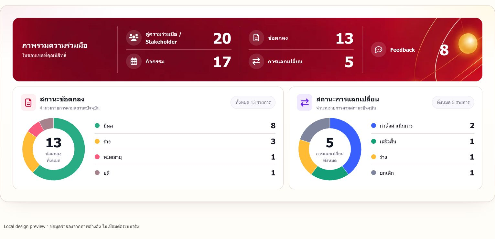
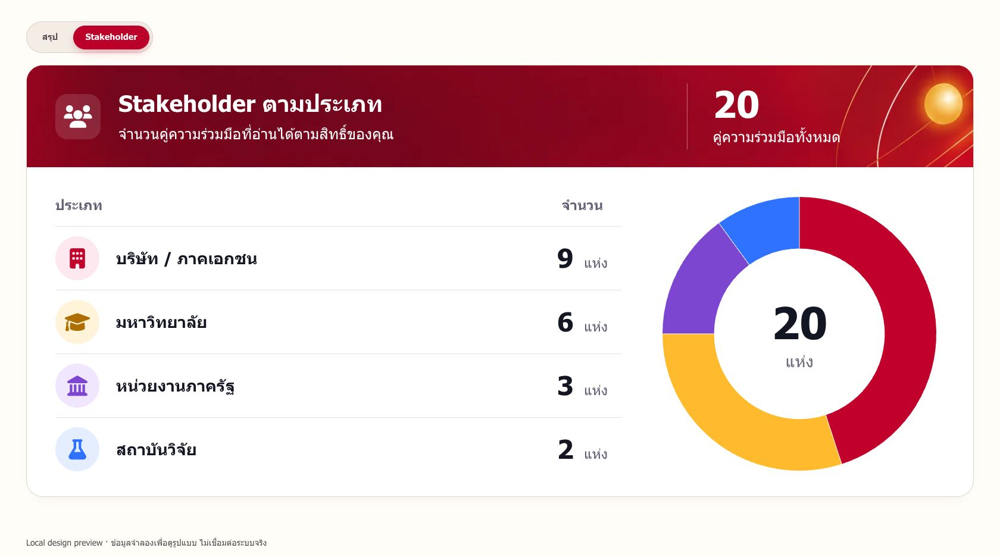

# V4 Design — ภาพรวมความร่วมมือและ Stakeholder

เอกสารนี้รวมการออกแบบหน้า Overview, Stakeholder และตำแหน่งสรุป Feedback ใน V4 ภาพประกอบเป็นแบบที่เลือกและภาพตรวจงานในเครื่องเมื่อ 31 ตุลาคม 2026 โดยใช้ข้อมูลจำลอง จึงไม่ใช่จำนวนข้อมูลจริงหรือหลักฐานการ deploy ปัจจุบัน

## เอกสารรายละเอียดฟีเจอร์

- [นำเข้าผลตอบรับจากแบบฟอร์ม](v4/form-feedback-import.md): ขั้นตอนนำเข้า การจัดเก็บ สิทธิ์ และข้อจำกัด
- [คู่มือใช้งานภายในเว็บ](v4/in-app-manual.md): การเปิดคู่มือตามบริบท เนื้อหา ภาพ และไฟล์ที่เกี่ยวข้อง

เอกสารประกอบทั้งสองเก็บรายละเอียดการทำงานและบันทึกการตรวจในช่วงพัฒนาไว้ด้วย

## 1. ขอบเขตและแนวทาง

หน้าภาพรวมช่วยให้ผู้ใช้ดูจำนวนคู่ความร่วมมือ กิจกรรม ข้อตกลง การแลกเปลี่ยน และ Feedback ภายในขอบเขตที่ตนมีสิทธิ์ ส่วนการอ่าน Feedback รายรายการอยู่ในหน้า Feedback Inbox เพื่อให้ค้นหาและติดตามความคิดเห็นได้จากจุดเดียว

ใช้สีแดงเข้มและทองร่วมกับลายวงโคจรของเว็บ แบ่งหัวข้อและยอดรวมให้เด่น ส่วนรายละเอียดใช้พื้นสีอ่อน ตัวเลขและข้อความอ่านได้โดยไม่ต้องอาศัยสีของกราฟเพียงอย่างเดียว การตกแต่งไม่เปลี่ยนขอบเขตสิทธิ์หรือความหมายของข้อมูล

| ส่วน | การออกแบบที่เลือก | เหตุผล |
| --- | --- | --- |
| Summary | แถบยอดรวมด้านบน และสองกล่องสถานะด้านล่าง | อ่านภาพรวมก่อนดูรายละเอียดแต่ละสถานะ |
| สถานะข้อตกลงและการแลกเปลี่ยน | Doughnut ทั้งสองกล่อง พร้อมชื่อสถานะและจำนวน | ใช้รูปแบบเดียวกันและเทียบข้อมูลได้ง่าย |
| Stakeholder | หัวแถบสีแดง ตารางประเภท/จำนวนด้านซ้าย และ Doughnut ด้านขวา | เห็นทั้งจำนวนที่แน่นอนและขนาดของแต่ละกลุ่ม |
| Feedback | ย้ายสรุปจำนวนและข้อเสนอแนะไป Feedback Inbox | ลดข้อมูลซ้ำระหว่างหน้าและอ่านต่อกับรายการ Feedback ได้ |
| ผลลัพธ์ | ถอด metric/tab ผลลัพธ์ที่ไม่ได้ใช้ในภาพรวม | ลดส่วนที่ไม่จำเป็น โดยไม่ลบข้อมูลผลลัพธ์ระดับรายการใน backend |

## 2. Summary — ภาพรวมความร่วมมือ

ส่วนบนแสดงจำนวนตามสิทธิ์ของผู้ใช้ โดยภาพ Executive ประกอบด้วย Stakeholder, กิจกรรม, ข้อตกลง, การแลกเปลี่ยน และ Feedback ส่วนล่างแยกสถานะข้อตกลงกับสถานะการแลกเปลี่ยน แต่ละกล่องมี Doughnut ยอดรวมตรงกลาง และรายการสถานะพร้อมจำนวน

- ตัวกรองเดิมยังเป็นจุดกำหนดขอบเขตข้อมูล เมื่อเปลี่ยนเงื่อนไข ยอดรวมและกราฟต้องเปลี่ยนตามผลค้นหาเดียวกัน
- ข้อตกลงแสดงสถานะมีผล ร่าง หมดอายุ และยุติ ส่วนการแลกเปลี่ยนแสดงกำลังดำเนินการ เสร็จสิ้น ร่าง และยกเลิก
- ไม่แสดงเปอร์เซ็นต์บนกราฟหรือรายการสถานะ ใช้จำนวนรายการเป็นค่าหลัก
- ถอดหัวข้อผลลัพธ์และแถวสรุปผลลัพธ์ที่ไม่ได้ใช้ใน CSV ของภาพรวม โดยไม่แก้ข้อมูลผลลัพธ์ที่บันทึกกับรายการงาน
- ภาพตัวอย่างเป็นสิทธิ์ Executive ไม่ใช้เป็นข้อกำหนดให้ทุกบทบาทเห็นข้อมูลหรือแท็บทั้งหมด

### ภาพหน้าจอที่ตรวจในเครื่อง

[ดูแบบที่เลือก](v4/overview/selected-design.jpg) · [ดูภาพบนมือถือ](v4/overview/mobile.jpg)

## 3. Stakeholder — คู่ความร่วมมือตามประเภท

หัวแถบแสดงชื่อส่วน คำอธิบายขอบเขต และจำนวนคู่ความร่วมมือทั้งหมด ด้านซ้ายเป็นตารางสองคอลัมน์ ได้แก่ ประเภทและจำนวน ด้านขวาเป็น Doughnut พร้อมจำนวนรวมตรงกลาง

| ประเภทในภาพตัวอย่าง | สีประจำกลุ่ม | จำนวนจำลอง |
| --- | --- | ---: |
| บริษัท / ภาคเอกชน | แดง | 9 |
| มหาวิทยาลัย | ทอง | 6 |
| หน่วยงานภาครัฐ | ม่วง | 3 |
| สถาบันวิจัย | น้ำเงิน | 2 |

ยอดรวม 20 แห่งในภาพใช้สำหรับเทียบแบบเท่านั้น หน้าใช้งานต้องแสดงค่าจาก API ตามสิทธิ์และตัวกรอง ไม่กำหนดตัวเลขตายตัวตามภาพ

- ไม่มีคอลัมน์สัดส่วนหรือเปอร์เซ็นต์บนวงกราฟ
- ชื่อประเภทมีไอคอนและจำนวนประกอบ ชื่อยาวขึ้นบรรทัดใหม่ได้
- เมื่อไม่มีข้อมูล แสดงจำนวน 0 วงกราฟสีเป็นกลาง และข้อความไม่มีผลลัพธ์
- ประเภทที่ไม่รู้จักใช้สีและไอคอนกลาง ไม่ทำให้ข้อมูลหายจากการแสดงผล

### ภาพหน้าจอที่ตรวจในเครื่อง

[ดูแบบที่เลือก](v4/stakeholder/selected-design.jpg) · [ดูภาพบนมือถือ](v4/stakeholder/mobile.png)

## 4. Feedback — สรุปในหน้า Inbox

นำข้อความสรุปจำนวน Feedback และจำนวนที่มีข้อเสนอแนะไปไว้ในหน้า Feedback Inbox แล้วถอดแท็บสรุป Feedback ออกจากภาพรวมความร่วมมือ ยังคงยอด Feedback ใน Summary ตามสิทธิ์และข้อมูลส่งออกที่เกี่ยวข้อง

สรุปใน Inbox ใช้ข้อมูลชุดเดียวกับรายการที่ผู้ใช้มีสิทธิ์อ่านและเงื่อนไขค้นหา รอโหลดข้อมูลครบทุกหน้าก่อนแสดงยอด ไม่แสดง 0 แทนสถานะกำลังโหลดหรือโหลดล้มเหลว และไม่นับช่องข้อเสนอแนะที่มีเพียงช่องว่าง

[ดูภาพหน้า Feedback Inbox](v4/stakeholder/feedback.png)

## 5. Responsive และการเคลื่อนไหว

- Desktop วางกล่องสถานะคู่กัน และวางตาราง Stakeholder คู่กับกราฟ
- จอแคบเรียงเนื้อหาลงมาเป็นส่วน ๆ ปรับตำแหน่งยอดรวมและกราฟ ให้ข้อความยาวอ่านได้และไม่ต้องเลื่อนหน้าจอแนวนอน
- ใช้การปรากฏของเนื้อหาและการเคลื่อนไหวของกราฟแบบสั้น ลายตกแต่งเคลื่อนช้าและไม่วนต่อเนื่องตลอดเวลา
- รองรับ `prefers-reduced-motion` เพื่อลดหรือปิดการเคลื่อนไหว
- กราฟใช้ Chart.js ที่โฮสต์ในโครงการ โหลดเมื่อจำเป็น ตาราง ตัวเลข และชื่อสถานะยังอ่านได้หากกราฟโหลดไม่สำเร็จ
- เมื่อสลับแท็บหรือออกจากหน้า ต้องจัดการอายุกราฟและยกเลิกงานที่ไม่ใช้ ไม่สร้างกราฟซ้อนค้างไว้

## 6. ตำแหน่งโค้ดและหลักฐาน

| ไฟล์ | หน้าที่ |
| --- | --- |
| [overview.js](../../public/assets/overview.js) / [overview.css](../../public/assets/overview.css) | หน้า Summary และ Stakeholder รวมกราฟและการจัดวาง |
| [feedback-inbox.js](../../public/assets/feedback-inbox.js) / [feedback-inbox.css](../../public/assets/feedback-inbox.css) | รายการ Feedback ตัวกรอง และข้อความสรุป |
| [index.html](../../public/index.html) | จุดเชื่อมหน้าเว็บและไฟล์ประกอบ |

ภาพทั้ง 7 ภาพเก็บใต้ `v4/overview/` และ `v4/stakeholder/` โดย `selected-design` เป็นภาพออกแบบ ส่วน `desktop`, `mobile` และ `feedback` เป็นภาพตรวจหน้าเว็บในเครื่อง รายงาน QA เดิมถูกนำออกจากไฟล์ปัจจุบันแล้ว และยังย้อนดูได้จากประวัติ Git; แนวทาง Feedback ปัจจุบันอยู่ในหัวข้อ 4

งานจัดเอกสารนี้ไม่ทดสอบระบบจริงหรือยืนยันผล QA เดิมซ้ำ โครงสร้างข้อมูลและสิทธิ์อ่านต่อได้ใน [Data guide](../data/data-guide.md) ส่วนขั้นตอนปล่อยระบบอยู่ใน [Deployment V4](../deployment/v4-deployment.md)
