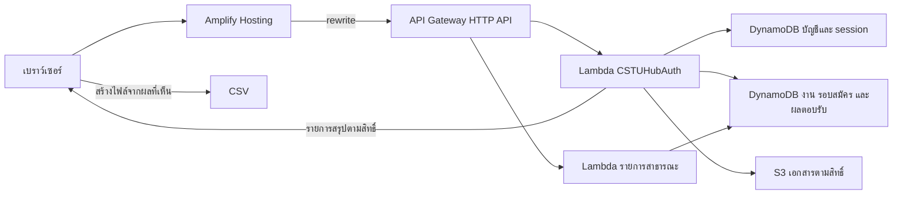

# รายงานผลตามข้อตกลงและการสาธิตตามบทบาท

ช่วงตัวอย่าง 1 พฤศจิกายน 2569 ถึง 31 มีนาคม 2570 มีคู่ความร่วมมือหนึ่งแห่ง ลงนาม MoU งานวิชาการกับ MoA แลกเปลี่ยนคนละฉบับ การทดสอบใช้ Chromium ขนาด 1440 × 1020 บน Cloud เปิดหน้าเว็บจริงผ่านเซิร์ฟเวอร์ท้องถิ่น ส่งคำขอไปยัง Python handler ของระบบ ใช้บัญชีสมมติและตัวจำลองพื้นที่เก็บข้อมูล [ชุดยอดที่คาดก่อนทดสอบ](v7-expected-results.md)

## ผลที่ตรวจบนเว็บและในไฟล์ดาวน์โหลด

| เงื่อนไข | คาดไว้ | ผลจริง |
| --- | --- | --- |
| Staff เลือกเทอม + MoU วิชาการ | 2 กิจกรรม นักศึกษา 0 คน 1 ความคิดเห็น แบบฟอร์ม 0 ชุด | จอกับ CSV ตรงกัน กิจกรรมเดือนมิถุนายนอยู่นอกเทอม ทั้งสองแสดงข้อเสนอให้ส่งกำหนดการล่วงหน้า |
| เปลี่ยนเป็น MoA แลกเปลี่ยน + กำลังดำเนินการ | 0 กิจกรรม นักศึกษา 2 คน แบบฟอร์ม 1 ชุด 3 คำตอบ 0 ความคิดเห็น | ตรงกันทั้งจอและ CSV เปิดแหล่งที่มาและอ่านคำตอบเรื่องแผนที่ได้ |
| เลือกทุกฉบับในเทอม | 2 ความคิดเห็น ในจำนวนนี้เป็นของคู่ความร่วมมืออย่างเดียว 1 | แถว “ยังไม่ระบุข้อตกลง” แสดง 1 ยอดรายฉบับยังคงเดิม |
| เลือกสถานะเสร็จสิ้นใน MoA | 0 นักศึกษา 0 ชุด 0 คำตอบ | ได้ 0 ทั้งสามช่อง |
| ล้างช่วงวันที่แล้วเลือก MoU | 3 กิจกรรม | งานก่อนเปิดเทอมกลับมา ยอดเป็น 3 |
| กรณีไฟล์แลกเปลี่ยนเดิมของ #264 | เลือกสถานะข้อตกลง “มีผล” หรือสถานะโครงการ “กำลังดำเนินการ” ต้องยังพบ 2 คำตอบ | เทสต์ก่อนแก้ได้ 0 เมื่อเลือกกำลังดำเนินการ หลังแก้ได้ 2 พร้อมชื่อไฟล์และฉบับเดิม |

รายงานนับนักศึกษาไม่ซ้ำจากใบสมัครที่มี `enrolledAt` ของโครงการที่ทับซ้อนช่วงวันที่เลือก รวมขั้นตอนยืนยันของนักศึกษาและคู่สัญญาเมื่อรอบนั้นกำหนด การอนุมัติภายในหรือการมีชื่อในรายชื่อผู้เข้าร่วมอย่างเดียวไม่เพิ่มยอด คนเดิมสองรอบหรือสองโครงการในรายงานรวมถูกนับครั้งเดียว ช่วงเทอมและนิยามนี้ยึดตามร่างของทีม หลักสูตรยังสามารถยืนยันนิยามทางการภายหลังได้

สถานะ “ร่าง” ใช้ได้ทั้งฉบับและโครงการ จึงรวมงานของฉบับร่างและโครงการร่างโดยนับงานหนึ่งครั้ง หน้าจอและ CSV ใช้ผลคำขอเดียวกัน การแก้ตัวกรองจะพักปุ่มดาวน์โหลดจนกด “แสดงผล” อีกครั้ง ในรายงานแสดงข้อเสนอเพื่อปรับปรุงล่าสุดไม่เกินห้ารายการ ส่วนคำตอบรายแถวจากแบบฟอร์มให้เปิดจากแหล่งที่มาตามสิทธิ์

[ภาพรายงาน MoU](assets/v7/agreement-report/mou-feedback.png) · [CSV ของ MoU](assets/v7/agreement-report/mou-term.csv) · [ภาพรายงาน MoA](assets/v7/agreement-report/moa-term.png) · [CSV ของ MoA](assets/v7/agreement-report/moa-term.csv)

## ตามงานและตรวจสิทธิ์

| บัญชีสมมติ | สิ่งที่ลองและผลที่เห็น |
| --- | --- |
| Staff | เปิดคู่ความร่วมมือ → MoA → โครงการ Exchange → แท็บผลตอบรับจากแบบฟอร์ม → นำเข้า 3 คำตอบ → ภาพรวมความร่วมมือ → ดาวน์โหลด CSV ทั้งสองฉบับ ชื่อนักศึกษา ชื่อผู้ตอบ และอีเมลคอลัมน์ที่ข้ามไม่ปรากฏในตัวอย่าง CSV |
| Executive | เปิดภาพรวม เห็นผลรวมของขอบเขต ส่งออกยอด 2 คนได้หลังบริการกลับมา ชุด #264 ทวนการเปิดไฟล์ต้นทางและงานที่เกี่ยวข้อง |
| Coordinator | ที่คู่ความร่วมมือเห็น MoU ที่รับผิดชอบและกิจกรรม 3 งาน ไม่เห็นปุ่มของ MoA อีกฉบับ หน้า Overview ไม่มีปุ่มส่งออก ชุด #264 ตรวจคำตอบ 403 และทวนการใช้งานกล่องผลตอบรับตามสิทธิ์ |
| Student | ชุด #264 เปิด Exchange ที่บัญชีสมมติเข้าร่วม และตรวจว่าการอ่านชุดคำตอบจากแบบฟอร์มถูกจำกัดตามบทบาท |

ในเบราว์เซอร์ของ Executive จำลองให้คำขอ Overview ล้มเหลวด้วย HTTP 503 หนึ่งครั้ง หน้าแสดง “โหลดข้อมูลสรุปไม่สำเร็จ กรุณาลองใหม่” ล้างผลเก่าและพักปุ่ม CSV จากนั้นกด “แสดงผล” อีกครั้งในหน้าเดิม เห็นยอดเดิมและดาวน์โหลดได้ [ภาพ Coordinator](assets/v7/agreement-report/coordinator.png) · [ภาพขณะ API ใช้ไม่ได้](assets/v7/agreement-report/outage.png)

## สถาปัตยกรรมและรุ่นที่ตรวจได้

รุ่นฐาน `e47f9a19ba68ca07428554365eaa75f55632ac83` มีหลักฐานจาก GitHub Actions ว่างาน Deploy four Lambdas สำเร็จ ภาพและ CSV ด้านบนมาจากโค้ดบน branch ของ PR นี้ใน Cloud การยืนยันหน้า Amplify และ API รุ่นใหม่ร่วมกันหลังทีมปล่อยเป็นขั้นที่ยังรอ [งาน deploy ของรุ่นฐาน](https://github.com/Micosz/Cs361-Group1-Project7/actions/runs/46150648851/job/140996960863) · [ผังระบบใน repository](../architecture/v5/v5-iac.md)

- **สิทธิ์และข้อมูลส่วนตัว** Lambda ตรวจ session และขอบเขต Staff/Executive ก่อนหาโครงการและนับใบสมัคร ส่งกลับเฉพาะจำนวนคน อนุญาตเปิดคำตอบรายแถวผ่าน endpoint ที่ตรวจสิทธิ์อีกครั้ง ข้อความที่ผู้ใช้พิมพ์ในช่องข้อเสนอแนะอาจมีข้อมูลส่วนตัว ทีมควรอ่านก่อนนำไฟล์ไปเผยแพร่
- **ขนาดและความเร็ว** ใช้ดัชนีเดิมอ่านรอบตามขอบเขต แล้วอ่านใบสมัครเฉพาะรอบของโครงการที่ผ่านตัวกรอง จำนวนรอบและใบสมัครที่มากขึ้นทำให้จำนวนครั้งอ่านสูงขึ้น หากรายงานช้าลง ควรวัดการอ่านและเวลาจริงก่อนเลือกระหว่างเพิ่มดัชนีและเก็บยอดรวม การเก็บยอดแยกต้องรองรับคนเดิมหลายโครงการและการเปลี่ยนสิทธิ์
- **ต้นทุน** หลักฐาน V6 วัดหน้า Welcome ที่ผู้ใช้พร้อมกัน 3 คน เวลาเห็นการ์ดแรก p95 ลดจาก 4.616 เป็น 1.001 วินาที ค่าใช้จ่ายรวมแบบ warm ที่ทีมประมาณต่อ 1,000 ครั้งลดจาก 0.020740 เป็น 0.009818 ดอลลาร์ ตัวเลขนี้ใช้เปรียบเทียบสถาปัตยกรรมหน้า Welcome เท่านั้น ต้นทุนและ p95 ของรายงาน V7 ยังรอการวัดเมื่อมีปริมาณงานจริง [ผลวัด V6](https://github.com/Micosz/Cs361-Group1-Project7/issues/259#issuecomment-7239965313) · [สมมติฐานค่าใช้จ่าย](https://github.com/Micosz/Cs361-Group1-Project7/issues/262#issuecomment-7240000882)
- **ความพร้อมใช้และการกู้คืน** การทดสอบ 503 ยืนยันการกลับมาใช้หน้ารายงานหลังคำขอถัดไปสำเร็จ งานปล่อย Lambda สำรองโค้ดก่อนอัปเดต การกู้ฐานข้อมูลและเวลาที่ใช้กู้คืนจริงยังไม่ได้ทดสอบรอบนี้ [ขั้นตอนปล่อยรุ่น](../../.github/workflows/lambda-deploy.yml) · [นโยบายข้อมูลในชุดทดลอง](../design/v5-design.md)
- **การนำเข้าผลตอบรับ** เมื่อคู่สัญญาส่งผลหลังจบกิจกรรมเป็นครั้งคราว ไฟล์หนึ่งชุดต่อรอบเปิดให้เจ้าหน้าที่เลือกคอลัมน์ ตรวจตัวอย่าง และตรวจย้อนถึงไฟล์ต้นทางได้ ต้นทุนคือมีขั้นตอนคนและข้อมูลอาจมาช้า ชุดทดสอบเดิมยืนยันว่านำเข้าไฟล์ซ้ำแล้วยอดคง 8 คำตอบ

## ทำซ้ำ

เมื่อติดตั้ง dependency ของ repo และ Chromium แล้ว รัน `npm run build`, `npm test` และ `npm run test:v7-feedback` ตั้ง `CSTU_V7_REPORT_EVIDENCE_DIR` เพื่อบันทึกภาพและ CSV ลงโฟลเดอร์ที่เลือก และ `CSTU_V7_264_EVIDENCE_DIR` เพื่อเลือกปลายทางภาพของชุดเดิม ข้อมูลสร้างใหม่ทุกครั้ง บัญชีและคำขอ HTTP ในชุดทดสอบทำงานภายในเครื่อง [เส้นทางทดสอบรายงาน](../../tests/v7-feedback/agreement-report.spec.cjs) · [เส้นทางทดสอบผลตอบรับเดิม](../../tests/v7-feedback/journey.spec.cjs)
