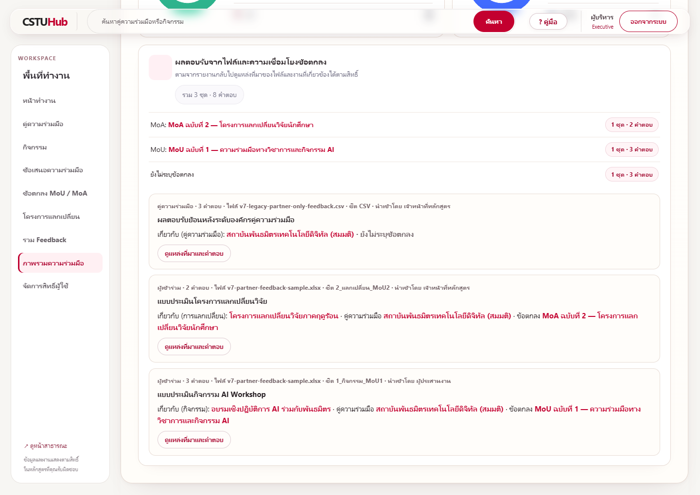
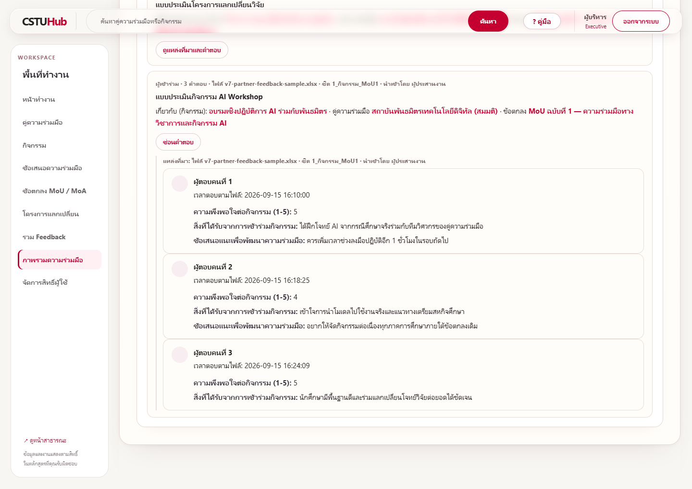
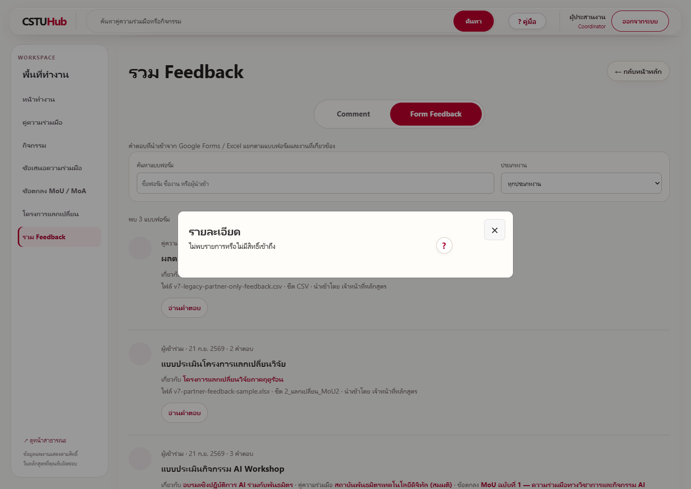
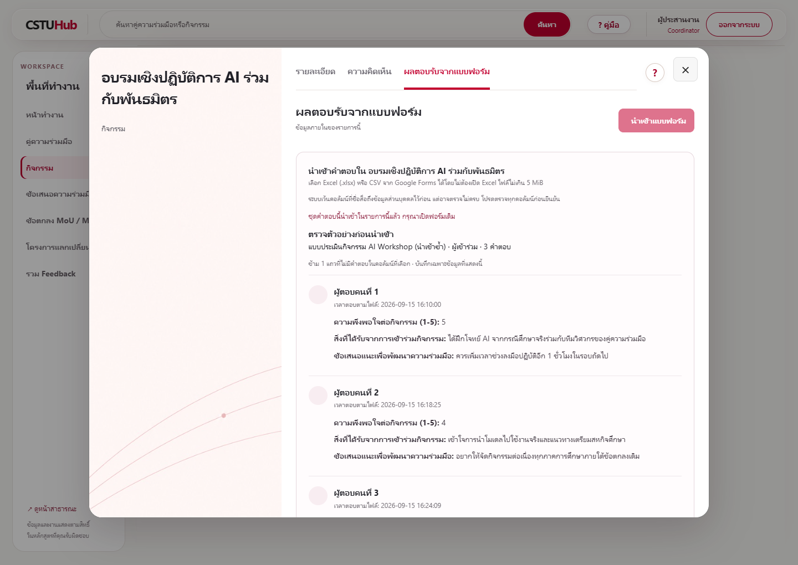

# หลักฐานการตรวจรับงาน #264 — เชื่อมผลตอบรับจากไฟล์กับข้อมูลในรายงาน (V7)

- **Issue**: `#264` (`[V7] เชื่อมผลตอบรับจากไฟล์กับข้อมูลในรายงาน`) · งานหลัก `#258`
- **Branch**: `v7-integrated-system-264`
- **ขอบเขตการทดสอบ**: ทดสอบ End-to-End ผ่านเบราว์เซอร์จริง (Google Chrome ผ่าน Playwright) ร่วมกับ `AuthApplication` และฐานข้อมูลจำลองในเครื่อง (`tests/v7-feedback/driver.py`) โดยไม่เรียกใช้ AWS จริง ไม่แก้ไขสิทธิ์เดิมของระบบ ไม่แก้ไขงาน `#263` และไม่แก้ไขตรรกะตัวกรองวันที่ของรายงานในรอบนี้
- **สถานะการเชื่อมต่อกับ `#263`**: **รอทดสอบร่วมกับชุดข้อมูลจริงจาก #263** — ขณะเก็บหลักฐานนี้ยังไม่มีชุดข้อมูลของ `#263` ถูก push เข้าสู่ branch ร่วม จึงจำลองชุดข้อมูลคู่ความร่วมมือ 1 รายที่มีข้อตกลง 2 ฉบับ (`MoU 1` ผูกกับกิจกรรม และ `MoA 2` ผูกกับโครงการแลกเปลี่ยน) ให้ตรงตามโครงสร้างของ `#263` ทุกประการ

---

## 1. สรุปผลการตรวจตามเกณฑ์ตรวจรับ (Acceptance Criteria)

| เกณฑ์ตรวจรับ | ผลการตรวจ | รายละเอียดหลักฐาน |
| --- | --- | --- |
| 1. ใช้ตัวนำเข้า Excel/CSV เดิมนำเข้าผลตอบรับทั้ง 3 แบบผ่านหน้าเว็บ และผลตอบรับที่รู้เพียงคู่ความร่วมมือแสดงว่า **“ยังไม่ระบุข้อตกลง”** โดยไม่เพิ่มยอดให้ MoU/MoA ใด | **ผ่าน** | นำเข้าผ่านแท็บ `ผลตอบรับจากแบบฟอร์ม` → `นำเข้าแบบฟอร์ม` ครบ 3 ชุด: กิจกรรมของ `MoU 1` (**3 คำตอบ**, ข้ามแถวว่าง 1 แถวอัตโนมัติ), โครงการแลกเปลี่ยนของ `MoA 2` (**2 คำตอบ**) และผลตอบรับเก่าระดับคู่ความร่วมมือ (**3 คำตอบ**) คอลัมน์ `อีเมลผู้ตอบ` ถูกเว้นไม่นำเข้าอัตโนมัติ ในหน้า Overview แสดง `MoU 1 = 1 ชุด · 3 คำตอบ`, `MoA 2 = 1 ชุด · 2 คำตอบ` และ **`ยังไม่ระบุข้อตกลง = 1 ชุด · 3 คำตอบ`** (รวม **8 คำตอบ**) |
| 2. จาก Overview กดดูชื่อไฟล์ ชีต และคำตอบ แล้วกดเปิดงานหรือข้อตกลงที่เกี่ยวข้องได้จริงตามสิทธิ์เดิม | **ผ่าน** | กด `ดูแหล่งที่มาและคำตอบ` แสดงชื่อไฟล์ ชื่อชีต ผู้นำเข้า และคำตอบรายแถวครบถ้วน กดลิงก์เปิด `MoU 1`, กิจกรรม, โครงการแลกเปลี่ยน และคู่ความร่วมมือได้จากหน้ารายงานทันที และตรวจครบทั้งบัญชีที่มีสิทธิ์ (`executive`, `staff`, `coordinator` เฉพาะงานที่รับผิดชอบ) และบัญชีที่ไม่มีสิทธิ์ (`coordinator` ในงานที่ไม่ได้รับมอบหมาย / หน้า Overview และ `student-a`) โดยไม่เปลี่ยนนโยบายสิทธิ์ |
| 3. นำเข้าไฟล์เดิมซ้ำกับรายการเดิม แล้วเปิดรายงานใหม่ ยอดต้องยังเป็น **8 → 8** และยอดแยก **3 / 2 / 3** | **ผ่าน** | นำเข้าไฟล์และชีตเดิมซ้ำบนทั้ง 3 รายการ ระบบปฏิเสธการบันทึกซ้ำ (`409 DUPLICATE_FORM_IMPORT`) และแสดงข้อความ **`ชุดคำตอบนี้นำเข้าในรายการนี้แล้ว กรุณาเปิดฟอร์มเดิม`** เมื่อรีโหลดหน้า Overview ใหม่ ยอดรวมยังคงเป็น **8 → 8** (`รวม 3 ชุด · 8 คำตอบ`) และยอดแยกยังคงเป็น **3 / 2 / 3** เท่าเดิม |

---

## 2. ชุดข้อมูลจำลองและไฟล์ตัวอย่างที่ใช้ทดสอบ

### ไฟล์ตัวอย่างใน `tests/fixtures/v7-feedback/`
1. [`v7-partner-feedback-sample.xlsx`](../../tests/fixtures/v7-feedback/v7-partner-feedback-sample.xlsx) — ไฟล์ Excel 3 ชีต:
   - ชีต `1_กิจกรรม_MoU1`: **3 คำตอบ** (+ 1 แถวว่างที่ตัวนำเข้าข้ามอัตโนมัติ) สำหรับกิจกรรม `act-v7-mou1` ภายใต้ `mou-v7-1`
   - ชีต `2_แลกเปลี่ยน_MoU2`: **2 คำตอบ** สำหรับโครงการแลกเปลี่ยน `ex-v7-moa2` ภายใต้ `moa-v7-2`
   - ชีต `3_ผลตอบรับเก่า_คู่ความร่วมมือ`: **3 คำตอบ** สำหรับผลตอบรับย้อนหลังที่รู้เพียงชื่อคู่ความร่วมมือ `partner-v7-demo`
2. ไฟล์ CSV ข้อมูลชุดเดียวกันแยกตามกรณีทดสอบ:
   - [`v7-activity-mou1-feedback.csv`](../../tests/fixtures/v7-feedback/v7-activity-mou1-feedback.csv) (`3 คำตอบ`)
   - [`v7-exchange-mou2-feedback.csv`](../../tests/fixtures/v7-feedback/v7-exchange-mou2-feedback.csv) (`2 คำตอบ`)
   - [`v7-legacy-partner-only-feedback.csv`](../../tests/fixtures/v7-feedback/v7-legacy-partner-only-feedback.csv) (`3 คำตอบ` — ใช้ทดสอบนำเข้าจริงผ่านเบราว์เซอร์สำหรับกลุ่มรู้เพียงชื่อคู่ความร่วมมือ)

### ตารางเปรียบเทียบยอดคำตอบก่อนและหลังนำเข้าซ้ำ

| รายการที่นำเข้า | ไฟล์ / ชีตที่ใช้ | ข้อตกลงที่เชื่อมในรายงาน | หลังนำเข้าครั้งแรก | หลังนำเข้าไฟล์เดิมซ้ำ (ครั้งที่สอง) |
| --- | --- | --- | ---: | ---: |
| กิจกรรม `อบรมเชิงปฏิบัติการ AI ร่วมกับพันธมิตร` (`act-v7-mou1`) | `v7-partner-feedback-sample.xlsx` · ชีต `1_กิจกรรม_MoU1` | `MoU ฉบับที่ 1 — ความร่วมมือทางวิชาการและกิจกรรม AI` (`mou-v7-1`) | **3** | **3** |
| โครงการแลกเปลี่ยน `โครงการแลกเปลี่ยนวิจัยภาคฤดูร้อน` (`ex-v7-moa2`) | `v7-partner-feedback-sample.xlsx` · ชีต `2_แลกเปลี่ยน_MoU2` | `MoA ฉบับที่ 2 — โครงการแลกเปลี่ยนวิจัยนักศึกษา` (`moa-v7-2`) | **2** | **2** |
| คู่ความร่วมมือ `สถาบันพันธมิตรเทคโนโลยีดิจิทัล (สมมติ)` (`partner-v7-demo`) | `v7-legacy-partner-only-feedback.csv` · ชีต `CSV` | **ยังไม่ระบุข้อตกลง** *(ไม่เพิ่มยอดให้ MoU 1 หรือ MoA 2)* | **3** | **3** |
| **ยอดรวมในรายงาน Overview และส่งออก CSV** | **รวม 3 ชุดแบบฟอร์ม** | **แยกตามกลุ่ม `3 / 2 / 3`** | **8** | **8** |

---

## 3. ผลตรวจสิทธิ์ตามนโยบายเดิม (ไม่แก้ไขสิทธิ์เพื่อให้เทสต์ผ่าน)

| บัญชีทดสอบ | สิทธิ์ในชุดข้อมูลทดสอบ | ผลการตรวจจริงผ่านเบราว์เซอร์และ API |
| --- | --- | --- |
| `executive` (ผู้บริหาร) | อ่านภาพรวมระดับหลักสูตรและงานทั้งหมดในขอบเขต | เปิดหน้า Overview เห็นยอด `รวม 3 ชุด · 8 คำตอบ` (`3 / 2 / 3`), กดดูชื่อไฟล์ ชีต และคำตอบได้ครบ และกดเปิดรายละเอียด `MoU 1`, กิจกรรม, โครงการแลกเปลี่ยน และคู่ความร่วมมือได้ครบ |
| `staff` (เจ้าหน้าที่หลักสูตร) | จัดการงานในขอบเขต อ่าน Overview และส่งออกรายงาน | นำเข้าผลตอบรับได้, เปิดหน้า Overview เห็นยอด `8` (`3 / 2 / 3`) ตรงกัน และกด `ส่งออกรายงาน CSV` ได้ไฟล์ที่มีแถวสรุป `8` คำตอบ และยอดแยก `MoU 1 = 3`, `MoA 2 = 2`, `ยังไม่ระบุข้อตกลง = 3` โดยไม่มีอีเมลผู้ตอบ |
| `coordinator` (ผู้ประสานงาน) | รับผิดชอบ `act-v7-mou1` และ `mou-v7-1` แต่ **ไม่ได้** รับผิดชอบ `ex-v7-moa2` และ `moa-v7-2` (`internal`) | เข้าหน้า Overview ไม่ได้ (`#board-overview` ถูกซ่อน, ไม่มีเมนู `ภาพรวมความร่วมมือ`, `GET /api/overview` คืน `403`); ในหน้า `รวม Feedback` → `Form Feedback` เปิดอ่านคำตอบและกดเปิด `MoU 1` ที่ตนรับผิดชอบได้สำเร็จ แต่ไม่เห็นชื่อ `MoA 2` ที่เป็น `internal` และเมื่อกดเปิด `โครงการแลกเปลี่ยนวิจัยภาคฤดูร้อน` ที่ไม่ได้รับมอบหมาย ระบบแสดง **`ไม่พบรายการหรือไม่มีสิทธิ์เข้าถึง`** |
| `student-a` (นักศึกษาผู้เข้าร่วมแลกเปลี่ยน) | เป็น `participantUserIds` ใน `ex-v7-moa2` เท่านั้น | เปิดดูข้อมูลสำหรับผู้เข้าร่วมของ `ex-v7-moa2` ได้ตามปกติ แต่แท็บ `ผลตอบรับจากแบบฟอร์ม` ถูกซ่อน และไม่มีสิทธิ์เข้าถึงหน้า Overview หรือกล่องรวม Form Feedback |

> **จุดบกพร่องเฉพาะ #264 ที่พบและแก้ไขระหว่างทดสอบบนเบราว์เซอร์จริง**: บนหน้า `work.html` ตัวดักคลิกแบบ capture-phase ใน `public/assets/role-home.js` แปลงลิงก์ที่ชี้ `index.html?kind=...` ให้เปลี่ยนหน้าทั้งแท็บก่อนที่ `CstuRecords.openRelated` จะทำงาน จึงปรับลิงก์รายการที่เกี่ยวข้องใน `public/assets/overview.js` และ `public/assets/feedback-inbox.js` ให้อ้างอิงหน้าปัจจุบัน (`work.html` เมื่ออยู่บนพื้นที่ทำงาน และ `index.html` เมื่ออยู่บนหน้าหลัก) ทำให้กดเปิดข้อตกลงและงานที่เกี่ยวข้องจาก Overview และกล่องรวม Feedback ได้ทันทีโดยไม่หลุดจากหน้ารายงาน

---

## 4. ภาพหน้าจอเดสก์ท็อปจากการทดสอบจริง

### 4.1 รายงาน Overview หลังนำเข้าครั้งแรก (`รวม 3 ชุด · 8 คำตอบ`, แยก `2 / 3 / 3`)


### 4.2 การกดดูแหล่งที่มา (ชื่อไฟล์ ชีต ผู้นำเข้า) และคำตอบจากหน้า Overview


### 4.3 การตรวจสิทธิ์เมื่อบัญชีที่ไม่ได้รับมอบหมายกดเปิดงานที่เกี่ยวข้อง (`ไม่พบรายการหรือไม่มีสิทธิ์เข้าถึง`)


### 4.4 ข้อความแจ้งเตือนเมื่อนำเข้าไฟล์เดิมซ้ำในรายการเดิม


### 4.5 รายงาน Overview หลังนำเข้าซ้ำและรีโหลดหน้าใหม่ (ยอดคงเดิม `8 → 8` และ `3 / 2 / 3`)


---

## 5. ขั้นตอนทำซ้ำ (Reproduction Steps)

รันจากรากของ repository (`Cs361-Group1-Project7`) โดยไม่ต้องเชื่อมต่อ AWS จริง:

```bash
# 1. ติดตั้ง dependencies และสร้างหน้า work.html ล่าสุด
npm ci
node scripts/build-role-home.cjs

# 2. รันการทดสอบผ่านเบราว์เซอร์จริง (นำเข้า 3 แบบ -> ตรวจ Overview/สิทธิ์ -> นำเข้าซ้ำ 8 -> 8 และบันทึกภาพหลักฐาน)
npm run test:v7-feedback

# 3. รันชุดทดสอบอัตโนมัติทั้งหมด (Frontend, Lambda, Backend, Deployment)
npm run test:frontend
npm run test:lambda
python3 tests/run-backend.py
python3 -m unittest discover -s tests/deployment
```

> บน Windows ที่ติดตั้ง Python ผ่านตัวติดตั้งแยกหรือ WindowsApps สามารถระบุตัวแปรสภาพแวดล้อม `PYTHON="<path-to-python.exe>"` ก่อนรัน `npm run test:v7-feedback` ได้ทันที

### ผลรันชุดทดสอบล่าสุด
- `npm run test:v7-feedback` (`tests/v7-feedback/journey.spec.cjs`): **ผ่าน 1 ข้อ (ครบทุกขั้นตอนย่อยบน Chrome จริง รวมตัวกรองสถานะข้อตกลง `หมดอายุ` → `0` และ `มีผล` → แสดงไฟล์และยอดตรงกับ CSV)**
- `node scripts/run-tests.cjs frontend`: **ผ่าน 44 / 44 ข้อ**
- `node scripts/run-tests.cjs lambda`: **ผ่าน 9 / 9 ข้อ**
- `python tests/run-backend.py`: **ผ่าน 274 / 274 ข้อ**
- `python -m unittest discover -s tests/deployment`: **ผ่าน 21 / 21 ข้อ**

---

## 6. ข้อสังเกตแยก: พฤติกรรมตัวกรองวันที่ในหน้า Overview ต่อผลตอบรับที่นำเข้า

ตามขอบเขตของรอบนี้ **ไม่ได้แก้ไขตรรกะตัวกรองวันที่** แต่บันทึกพฤติกรรมปัจจุบันไว้แยกสำหรับการพิจารณารอบถัดไปดังนี้:
- เมื่อผู้ใช้กรองช่วงวันที่ `startDate` / `endDate` ในหน้า Overview (`GET /api/overview` ใน `backend/lambda/CSTUHubAuth/backend/permissions/gateway.py`):
  1. ผลตอบรับที่ผูกกับ **กิจกรรม (`activity`)** จะถูกกรองตามวันที่จัดกิจกรรม (`activity.periodDate`)
  2. ผลตอบรับที่ผูกกับ **โครงการแลกเปลี่ยน (`exchange`)** จะถูกกรองตามการทับซ้อนของช่วงวันแลกเปลี่ยน (`exchange.startDate` – `exchange.endDate`)
  3. ผลตอบรับเก่าที่ผูกกับ **คู่ความร่วมมือโดยตรง (`partner` / “ยังไม่ระบุข้อตกลง”)** ไม่มีวันที่จัดงานของรายการแม่ และฟิลด์ `rows[].respondedAt` ในชีตนำเข้าเป็นข้อความอิสระที่ไม่บังคับรูปแบบ ISO (`docs/data/data-guide.md`) ระบบจึงใช้วันที่บันทึกการนำเข้า (`batch.createdAt[:10]`) เป็นเกณฑ์กรองช่วงวันที่แทน
- ข้อสังเกตสำหรับอนาคต: หากต้องการให้ผลตอบรับย้อนหลังระดับคู่ความร่วมมือถูกกรองตามปี/ช่วงเวลาของแบบสำรวจเดิม อาจพิจารณาเพิ่มฟิลด์ช่วงเวลาอ้างอิงของชุดแบบฟอร์มตอนนำเข้า หรือแปลง `respondedAt` เฉพาะแถวที่เป็นวันที่มาตรฐานในงานแยกต่างหาก
